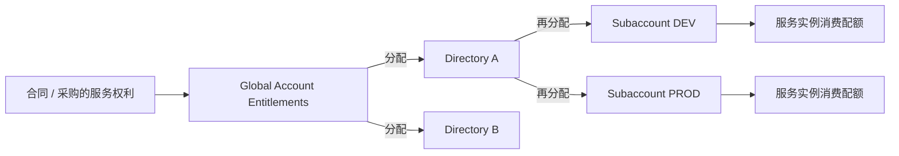

## 6. 功能是什么？

**账号体系**是 BTP 的组织骨架。它回答三个问题：谁拥有资源、资源分给谁、应用实际跑在哪个租户里。

| 层级 | 英文 | 职责 | 是否必须 |
| --- | --- | --- | --- |
| 全局账号 | Global Account | 与客户合同绑定，持有全部服务配额权利（Entitlements），向下分配 | 必须，且通常只有一个 |
| 目录 | Directory | 按业务单元或环境对 Subaccount 分组，可集中分配配额，可嵌套 | 可选 |
| 子账号 | Subaccount | 真正的租户，承载应用、服务实例、身份信任与运行环境 | 必须，可多个 |

<Callout type="info" title="术语解释：租户（Tenant）">
租户指一套隔离的运行环境与数据空间。一个 Subaccount 通常对应一个租户，拥有独立的 Subdomain、用户信任配置与服务实例清单。
</Callout>

**Region（区域）** 是数据中心所在地，**Provider（基础设施提供方）** 是承载该区域的底层云或 SAP 自有数据中心。两者在 Subaccount 创建时选定，决定数据驻留位置与该区域可用的服务清单，创建后通常不能直接迁移。

**Entitlements** 表示「有权使用哪些服务计划、以及数量上限」，由 Global Account 向下分配。**Quotas** 表示运行环境内的资源上限（例如 Org 内存总量、Space 可创建的服务实例数）。两者是不同层面的约束：前者是服务计划级，后者是运行资源级。

## 7. 为什么需要这个功能？

没有账号分层，就无法回答企业最常问的问题：开发环境能不能影响生产？某个业务单元用了多少配额？谁能创建 HANA Cloud 实例？

分层带来的实际价值：

- **隔离**：不同 Subaccount 有独立身份信任与服务实例，故障半径小。
- **预算与配额**：Global Account 统一采购，按需分配给各环境。
- **合规**：按 Region 控制数据驻留，按 Subaccount 记录审计日志。
- **组织映射**：Directory 可对应事业部、子公司或项目群。

## 8. 实际业务应用场景

一家企业常见的划分方式：

```text
Global Account（企业合同）
├── Directory: 集团总部
│   ├── Subaccount: DEV   (Region: <REGION>)
│   ├── Subaccount: TEST  (Region: <REGION>)
│   └── Subaccount: PROD  (Region: <REGION>)
└── Directory: 海外事业部
    └── Subaccount: PROD-APAC (Region: <APAC_REGION>)
```

- 小型团队也可以不使用 Directory，直接在 Global Account 下建多个 Subaccount。
- 若合规要求强隔离，建议生产环境使用独立 Subaccount 甚至独立 Global Account。
- Trial 账号只有一个 Global Account 与有限 Subaccount 能力，不适合照搬企业结构。

## 10. 操作前需要准备什么？

- 具备 Global Account 查看权限的账号。
- 一张记录表：`GLOBAL_ACCOUNT`、`SUBACCOUNT`、`SUBDOMAIN`、`REGION`、`PROVIDER`。
- 在 Discovery Center 预先核对目标 Region 是否提供你需要的服务。

## 11. 详细操作步骤

1. 登录 BTP Cockpit，左上角确认当前 **Global Account** 名称。
2. 打开 **Account Explorer**，展开层级树，观察是否存在 Directory。
3. 点击一个 Subaccount，进入 **Overview → General**，记录 `Subdomain`、`Region`、`Provider`、`Subaccount ID`。
4. 返回 Global Account，打开 **Entitlements**，选择一个服务，查看「可用数量 / 已分配数量」。
5. 进入 Subaccount 的 **Entitlements**，观察它被分配到的服务计划清单。
6. 若已启用 Cloud Foundry，打开 **Cloud Foundry → Spaces**，记录 Space 名称与配额。
7. 对比「Global Account 可用量」与「Subaccount 已分配量」，理解配额是自上而下分配的。

## 12. 每一步需要填写的参数

| 参数 | 占位符 | 说明 |
| --- | --- | --- |
| 全局账号显示名 | `<GLOBAL_ACCOUNT_NAME>` | 由 SAP 合同决定，通常用于识别环境归属 |
| 目录名 | `<DIRECTORY_NAME>` | 可选，建议体现组织或环境 |
| 子账号显示名 | `<SUBACCOUNT_DISPLAY_NAME>` | 可修改，便于人阅读 |
| 子域名 | `<SUBDOMAIN>` | 全局唯一，影响应用 URL 与 XSUAA 租户域名 |
| 区域 | `<REGION>` | 按数据驻留与服务可用性选择 |
| 服务计划分配量 | `<ASSIGNED_AMOUNT>` | 不能超过 Global Account 的可用量 |

## 13. 配置截图或界面示意图

下图为本站自绘的**配额分配流向示意图**，非 SAP Cockpit 截图。



## 14. 完整配置文件

账号结构通常用文档或基础设施即代码工具管理。这里给出一个**纯文本清单模板** `accounts.yaml`，用于团队评审（不含任何凭据）：

```yaml
# 账号结构评审模板（示意，不是 SAP 官方配置格式）
globalAccount: "<GLOBAL_ACCOUNT_NAME>"
directories:
  - name: "<DIRECTORY_NAME>"
    subaccounts:
      - name: "DEV"
        subdomain: "<DEV_SUBDOMAIN>"
        region: "<REGION>"
        purpose: "development"
        usedForProduction: false
      - name: "PROD"
        subdomain: "<PROD_SUBDOMAIN>"
        region: "<REGION>"
        purpose: "production"
        usedForProduction: true
entitlementPlan:
  - service: "xsuaa"
    plan: "application"
    assignedToDev: 2
    assignedToProd: 2
```

## 15. 完整代码示例

下面脚本用于**校验记录表是否填写完整**，避免后续部署时才发现缺少 Region 或 Space。保存为 `validate-account-info.js`：

```javascript
'use strict';

// 从环境变量读取非敏感标识；不读取、不输出任何密钥
const fields = [
  'GLOBAL_ACCOUNT_NAME', 'SUBACCOUNT_NAME', 'SUBDOMAIN',
  'REGION', 'PROVIDER', 'CF_API_ENDPOINT', 'CF_ORG', 'CF_SPACE',
];

const missing = fields.filter((key) => !process.env[key]);

if (missing.length) {
  console.error('账号信息不完整，缺少：' + missing.join(', '));
  console.error('请参照教程第 12 节的参数表补齐后重试。');
  process.exit(1);
}

for (const key of fields) {
  // 仅输出字段名与长度，避免把非公开信息直接打印到日志
  console.log(`${key}: 已填写 (${String(process.env[key]).length} 字符)`);
}

console.log('账号信息校验通过，可以进入环境创建步骤。');
```

## 16. 命令行操作

以下命令用于把账号信息注入当前终端会话并运行校验（示例值均为占位符）：

```bash
# macOS / Linux：设置非敏感环境变量（请替换为自己的真实标识）
export GLOBAL_ACCOUNT_NAME="<GLOBAL_ACCOUNT_NAME>"
export SUBACCOUNT_NAME="<SUBACCOUNT_DISPLAY_NAME>"
export SUBDOMAIN="<SUBDOMAIN>"
export REGION="<REGION>"
export PROVIDER="<PROVIDER>"
export CF_API_ENDPOINT="<API_ENDPOINT>"
export CF_ORG="<ORG>"
export CF_SPACE="<SPACE>"

# 运行校验脚本
node validate-account-info.js

# Windows PowerShell 等价写法：
# $env:GLOBAL_ACCOUNT_NAME="<GLOBAL_ACCOUNT_NAME>"
# $env:SUBDOMAIN="<SUBDOMAIN>"
# ... 其余变量同理
# node validate-account-info.js
```

参数解释：`export`（Windows 为 `$env:`）用于设置当前终端会话的环境变量；`<...>` 是占位符，必须替换；脚本只检查是否填写，不连接任何外部系统。

## 17. 执行后的预期结果

```text
GLOBAL_ACCOUNT_NAME: 已填写 (18 字符)
SUBACCOUNT_NAME: 已填写 (9 字符)
SUBDOMAIN: 已填写 (12 字符)
REGION: 已填写 (8 字符)
PROVIDER: 已填写 (3 字符)
CF_API_ENDPOINT: 已填写 (42 字符)
CF_ORG: 已填写 (14 字符)
CF_SPACE: 已填写 (3 字符)
账号信息校验通过，可以进入环境创建步骤。
```

若缺少变量，脚本会列出缺失字段名并以退出码 1 结束。

## 18. 如何验证是否成功

1. 校验脚本输出「账号信息校验通过」。
2. 在 Cockpit 的 Account Explorer 中能对应上记录表里的每一个名称。
3. 在 Global Account → Entitlements 中能看到「可用 / 已分配」两列，并能说出差额的用途。
4. 能明确回答：本教程的操作是否会影响生产环境（答案应取决于你选择的 Subaccount）。

## 19. 常见错误及解决方案

| 现象 | 原因 | 处理 |
| --- | --- | --- |
| Subdomain 已存在无法使用 | Subdomain 全局唯一 | 换成含组织前缀的名称，例如 `<COMPANY>-dev` |
| 创建 Subaccount 时选不到目标服务 | Region 不提供该服务 | 先在 Discovery Center 核对，必要时换 Region |
| Entitlements 分配量不可编辑 | 全部配额已分配给其他 Subaccount | 从低优先级 Subaccount 回收后再分配 |
| 混淆 Directory 与 Space | 一个是账号层，一个是 CF 运行层 | Directory 在 Global Account 下；Space 在 CF Org 下 |

## 20. 安全注意事项

- 生产 Subaccount 的管理员权限只授予少数账号，并开启审计日志。
- 不同环境使用不同的身份信任配置与服务实例，避免共享凭据。
- 账号结构文档不得包含密码、Service Key 或 Client Secret。
- Region 选择涉及数据驻留合规，必须由架构与合规角色共同确认。

## 21. 本章总结

记住这条链路：**合同 → Global Account（持有 Entitlements）→ Directory（可选分组）→ Subaccount（租户）→ 运行环境（Org / Space）→ 应用与服务实例**。Entitlements 决定「能用哪些服务计划」，Quotas 决定「能用多少运行资源」。Subdomain 与 Region 一旦选定会影响后续所有 URL 与服务可用性，必须谨慎。

## 22. 实战练习

1. 在 Cockpit 中画出你自己的账号层级树，并标注每个 Subaccount 的 Region。
2. 找一个服务，记录它在 Global Account 的可用量与在某个 Subaccount 的已分配量。
3. 设计一份 Dev / Test / Prod 的 Entitlement 分配方案，并说明为何生产要预留余量。
4. 阅读 [Subaccount 创建教程](/docs/cockpit-subaccount-create)，准备动手创建第一个 Subaccount。
