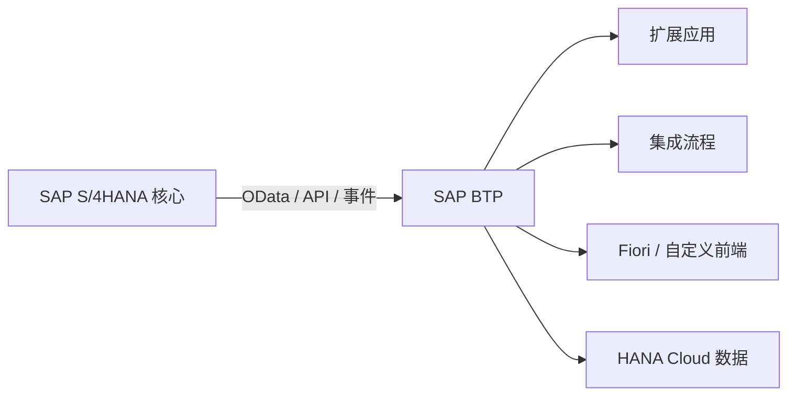
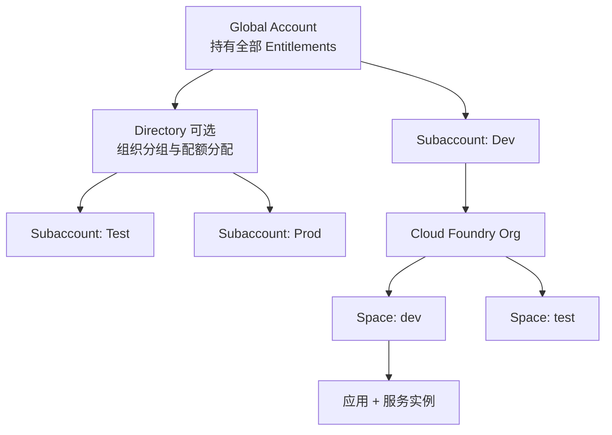

## 6. 功能是什么？

**SAP BTP**（SAP Business Technology Platform，SAP 业务技术平台）是 SAP 提供的一套**平台即服务（PaaS，Platform as a Service）**产品组合。

先解释一个术语：**PaaS** 指的是云厂商提供「运行应用所需的平台」——包括运行环境、数据库、身份认证、消息队列、日志和运维工具，开发者只负责写业务代码，不用自己买服务器、装操作系统、配负载均衡。

<Callout type="info" title="一句话理解">
SAP BTP 不是某一个软件，而是**一组云服务的集合**。它让企业在不修改 SAP 核心业务系统的前提下，完成扩展开发、系统集成、数据分析、AI 创新与统一身份管理。
</Callout>

需要避免的三个误解：

1. **BTP 不是 S/4HANA 的一个模块**。S/4HANA 是业务核心系统（ERP），BTP 是独立的云平台，两者通过网络 API 集成。
2. **BTP 不是单一运行环境**。它同时提供 Cloud Foundry、Kyma、ABAP Environment 等不同运行环境，彼此的部署命令完全不同。
3. **BTP 不是只有开发人员才需要关心**。账号、配额、信任、角色、审计与成本都属于平台管理员与架构师的职责范围。

### 能力域划分

| 能力域 | 典型产品/服务 | 解决什么问题 |
| --- | --- | --- |
| 应用开发 | SAP CAP、SAP Build、Cloud Foundry | 构建云原生扩展应用与低代码应用 |
| 集成 | SAP Integration Suite、SAP Event Mesh、Cloud Connector | 把 SAP 与第三方系统连接起来 |
| 数据与数据库 | SAP HANA Cloud | 持久化业务数据、分析型数据处理 |
| 分析与 AI | SAP AI Core、SAP AI Launchpad | 训练与运行 AI 模型、智能场景 |
| 安全与身份 | SAP Cloud Identity Services、XSUAA | 单点登录、用户授权、身份同步 |
| 运维与治理 | Application Logging、Alert Notification、Transport Management | 日志、告警、传输与交付 |

<Callout type="warning" title="版本与名称会变化">
SAP 的产品名称、服务名称与服务计划会持续调整。本站所有涉及具体服务名称的地方，都要求读者以当前租户 **Service Marketplace** 中显示的名称为准，并以 SAP Help Portal 当前版本文档核对。
</Callout>

## 7. 为什么需要这个功能？

企业在使用 SAP 系统时经常遇到三类需求：要加一个核心系统没有的功能、要把 SAP 和别的系统连起来、要给外部用户做一个新界面。

如果直接修改 S/4HANA 核心代码，会带来升级困难、测试成本高、风险大的问题。SAP 因此提出 **Keep the Core Clean（保持核心干净）**：把定制与创新放到 BTP 上，核心系统保持稳定，两侧通过公开 API、OData 服务与事件通信。



BTP 在这条链路里提供三件关键能力：**运行环境**（应用跑在哪里）、**基础服务**（认证、连接、日志、数据库）、**治理能力**（账号、配额、角色、审计、传输）。

## 8. 实际业务应用场景

- **旁路扩展**：为核心系统增加审批流、供应商门户、移动端页面，而不改动核心代码。
- **系统集成**：把 S/4HANA 与第三方物流、税务、支付系统通过 Integration Suite 或 Event Mesh 连接。
- **统一身份**：员工用企业账号单点登录多个 BTP 应用，由 IAS 与 XSUAA 完成认证和授权。
- **数据分析与 AI**：把业务数据汇聚到 HANA Cloud，用 AI Core 执行预测或分类任务。
- **Dev / Test / Prod 多环境**：用多个 Subaccount 或 Space 隔离开发、测试与生产，配合 CI/CD 交付。

<Callout type="verify" title="初学者自检">
如果你能回答「一个应用部署在 BTP 的哪个层级？谁给它数据库？谁验证用户身份？谁限制它用多少内存？」，就说明已经建立了正确的整体认知。答案分别是：Subaccount 下的运行环境、绑定的服务实例、XSUAA 与 IdP、Entitlements 与 Quotas。
</Callout>

## 10. 操作前需要准备什么？

| 准备项 | 说明 |
| --- | --- |
| SAP 账号 | 用于登录 BTP Cockpit；Trial 可通过 SAP 官方网站申请 |
| 浏览器 | 建议使用最新版 Chrome / Edge |
| 记录表 | 记录 `Subdomain`、`Region`、`API Endpoint`、`Org`、`Space` 五个关键值 |
| 官方核对 | 打开 SAP Help Portal 与 Discovery Center，确认目标服务在你所选区域可用 |

Trial 账号适合学习基础概念与 Cloud Foundry 部署；HANA Cloud、Integration Suite、Cloud Connector 相关的企业级项目通常需要商业账号或相应 Entitlement。

## 11. 详细操作步骤

本节不部署应用，只完成一次「平台结构认知」的实操。

1. 打开 `https://help.sap.com/docs/btp`，在文档中检索 **Account Model**，确认账号层级的官方描述。
2. 打开 `https://discovery-center.cloud.sap/`，选择一个服务，查看它在不同区域与不同服务计划下的可用性。
3. 打开 BTP Cockpit（区域相关地址，例如 `https://cockpit.<REGION>.hana.ondemand.com`），登录后确认可见的 **Global Account**。
4. 在 **Account Explorer** 中展开层级树，观察 Global Account → Directory（若有）→ Subaccount。
5. 进入任一 Subaccount 的 **Overview**，记录 General 卡片中的 Region、Provider 与 Subdomain。
6. 若已启用 Cloud Foundry，切到 **Cloud Foundry Environment** 标签页，记录 `API Endpoint`、`Org Name` 与 `Org ID`。
7. 打开左侧 **Entitlements**，观察某个服务「已分配 / 已使用」的数量关系。

<Callout type="info" title="关于页面结构示意图">
本站自绘的 Cockpit 页面结构示意图可用于菜单结构对照，见 [资源中心的图片说明](/resources#cockpit-reference)。图中所有账号名、Region、ID 与数量均为占位符，不含任何真实租户数据。
</Callout>

## 12. 每一步需要填写的参数

本教程没有表单提交，但需要记录以下参数，后续所有教程都会用到：

| 参数 | 占位符 | 从哪里获取 | 注意事项 |
| --- | --- | --- | --- |
| 子域名 | `<SUBDOMAIN>` | Subaccount → Overview → General | 全局唯一，影响应用 URL |
| 区域 | `<REGION>` | Subaccount → Overview → General | 创建后通常不可直接迁移 |
| 基础设施方 | `<PROVIDER>` | Subaccount → Overview → General | 与 Region 组合决定服务可用性 |
| CF API 地址 | `<API_ENDPOINT>` | Overview → Cloud Foundry Environment | `cf api` 的参数 |
| 组织名 | `<ORG>` | Overview → Cloud Foundry Environment | `cf login -o` 的参数 |
| 空间名 | `<SPACE>` | Cloud Foundry → Spaces | `cf login -s` 的参数 |

## 13. 配置截图或界面示意图

下图是本站自绘的**账号与运行环境分层示意图**，不是 SAP Cockpit 截图。



## 14. 完整配置文件

基础概念篇没有必需的配置文件。下面给出一个**环境信息记录模板**，建议保存为项目根目录的 `env-info.md`（纯文本，不含任何密钥），供团队共享：

```ini
; 环境信息记录模板（请勿在此文件写入任何密码、Client Secret 或 Token）
GLOBAL_ACCOUNT = <GLOBAL_ACCOUNT_NAME>
SUBACCOUNT     = <SUBACCOUNT_DISPLAY_NAME>
SUBDOMAIN      = <SUBDOMAIN>
REGION         = <REGION>
PROVIDER       = <PROVIDER>
CF_API_ENDPOINT= <API_ENDPOINT>
CF_ORG         = <ORG>
CF_SPACE       = <SPACE>
COCKPIT_URL    = https://cockpit.<REGION>.hana.ondemand.com
```

## 15. 完整代码示例

下面是一段用于**自检本地开发环境**的 Node.js 脚本，它只读取环境变量并打印是否存在，不打印任何敏感值。保存为 `check-env.js`：

```javascript
'use strict';

const required = ['NODE_ENV'];
const optional = ['CF_API_ENDPOINT', 'CF_ORG', 'CF_SPACE', 'VCAP_SERVICES'];

let hasError = false;

for (const key of required) {
  const present = Boolean(process.env[key]);
  console.log(`[required] ${key}: ${present ? 'OK' : 'MISSING'}`);
  if (!present) hasError = true;
}

for (const key of optional) {
  // 只输出是否存在，绝不输出具体凭据内容
  console.log(`[optional] ${key}: ${process.env[key] ? 'SET' : 'NOT SET'}`);
}

if (hasError) {
  console.error('缺少必需的环境变量，请先配置后重试。');
  process.exit(1);
}

console.log('环境自检通过。');
```

运行方式与预期输出见第 16、17 节。

## 16. 命令行操作

在本地终端执行（Windows PowerShell 与 macOS/Linux 的差异已注明）：

```bash
# 1) 检查 Node.js 是否安装；输出应为 v20 或更高版本号
node --version

# 2) 检查 npm 是否可用；输出为 npm 的版本号
npm --version

# 3) 创建练习目录并进入（Windows PowerShell 同样支持 mkdir 与 cd）
mkdir btp-basics
cd btp-basics

# 4) 设置临时环境变量后运行自检脚本
#    macOS / Linux:
NODE_ENV=development node check-env.js
#    Windows PowerShell:
#    $env:NODE_ENV="development"; node check-env.js

# 5) 检查是否已安装 Cloud Foundry CLI；未安装会在第 4 阶段教程中完成
cf version
```

每条命令的作用：

- `node --version`：确认 Node.js 运行时存在，后续 CAP、App Router 都依赖它。
- `npm --version`：确认包管理器可用。
- `mkdir` / `cd`：建立隔离的练习目录，避免污染其他项目。
- `NODE_ENV=development node check-env.js`：给进程注入一个非敏感环境变量并执行自检脚本。
- `cf version`：确认 CF CLI 是否安装；若提示命令不存在，属正常现象，按 [CF CLI 安装教程](/docs/cf-cli-install) 处理。

## 17. 执行后的预期结果

```text
[required] NODE_ENV: OK
[optional] CF_API_ENDPOINT: NOT SET
[optional] CF_ORG: NOT SET
[optional] CF_SPACE: NOT SET
[optional] VCAP_SERVICES: NOT SET
环境自检通过。
```

`cf version` 若已安装，会输出类似 `cf version 8.x.x`；若未安装会输出「无法识别的命令」，这不是错误，只需记住后续要安装。

## 18. 如何验证是否成功

1. 自检脚本最后一行输出「环境自检通过。」且退出码为 0。
2. 能在 Cockpit 中说出自己当前所在的 Global Account、Subaccount 与 Region。
3. 能在 Account Explorer 中指出 Directory 是可选层，而不是必须创建的层。
4. 能说出 Cloud Foundry 与 Kyma 至少一处部署方式上的差异（例如 `cf push` 只适用于 Cloud Foundry）。

## 19. 常见错误及解决方案

| 现象 | 原因 | 处理 |
| --- | --- | --- |
| 登录后看不到任何 Global Account | 账号未被授予 BTP 管理权限 | 联系管理员分配权限，或申请 Trial 账号 |
| Service Marketplace 中找不到某服务 | Entitlement 未分配或区域不提供 | 在 Global Account → Entitlements 分配；在 Discovery Center 核对区域 |
| 把 `cf` 命令用在 Kyma 环境 | 运行环境概念混淆 | Kyma 使用 Kubernetes 工具链，不使用 cf CLI |
| 文档中的菜单与租户不一致 | 产品版本 / 账号类型差异 | 以当前租户界面与 Help Portal 当前版本为准 |

## 20. 安全注意事项

- 不要把 Global Account 管理员权限分配给日常开发账号。
- 环境记录表只保存非敏感标识（Subdomain、Region、Org），**绝不保存密码、Client Secret、Service Key 或 JWT**。
- 生产与学习环境使用不同账号或不同 Subaccount，避免误操作影响真实业务。
- 引用官方文档时注明版本与时间，平台能力持续变化。

## 21. 本章总结

SAP BTP 是一组 PaaS 能力，核心价值是在保持核心系统干净的前提下完成扩展、集成与创新。理解它的顺序应该是：

1. **账号层**：Global Account → Directory（可选）→ Subaccount。
2. **运行环境层**：Cloud Foundry / Kyma / ABAP Environment，三者的部署方式不通用。
3. **服务层**：通过 Entitlements 分配、通过 Service Marketplace 创建实例、通过 Binding 提供给应用。
4. **治理层**：角色、配额、审计、日志与成本。

下一章将展开账号模型，这是理解 Cockpit 所有菜单的前提。

## 22. 实战练习

1. 在纸上画出你所在企业的 BTP 账号层级（若使用 Trial，画 Trial 的 Global Account 与唯一 Subaccount）。
2. 在 Discovery Center 中任选一个服务，记录它在两个不同 Region 的可用性差异。
3. 用第 15 节的脚本，把 `VCAP_SERVICES` 加入 `required` 数组，观察在本地未部署时的输出，理解「本地环境」与「BTP 运行环境」的区别。
4. 阅读 [Trial / Free Tier / 商业账号差异](/docs/btp-account-types)，列出你想做的项目需要哪些账号能力。
