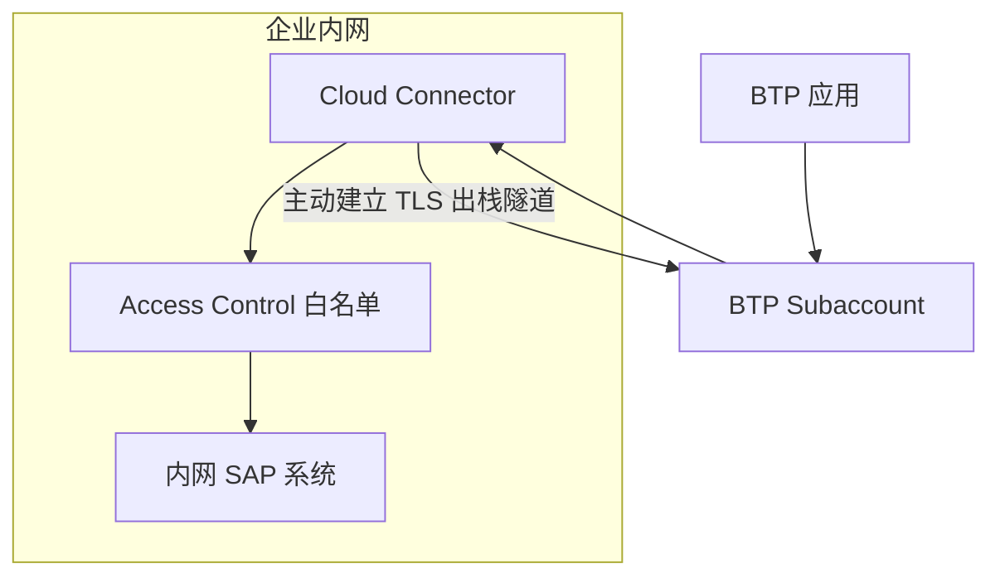

## 6. 功能是什么？

**Cloud Connector** 是部署在企业内网的代理组件，它主动向 BTP Subaccount 建立 TLS 隧道，让云上应用可以访问内网系统，而企业防火墙**无需开放入站端口**。

它由三部分组成：

| 组成 | 作用 |
| --- | --- |
| Subaccount 连接 | 与指定 Subaccount 建立并维持隧道 |
| Access Control（访问控制） | 声明哪些内网主机、端口、路径允许被访问 |
| Location ID（可选） | 同一 Subaccount 有多个 Cloud Connector 时用于路由 |

<Callout type="info" title="方向很重要">
连接由**内网主动发起**（出栈），不是 BTP 主动连进来。这是企业能接受该方案的关键原因。
</Callout>

## 7. 为什么需要这个功能？

内网 SAP 系统通常没有公网地址，也不允许开放入站端口。若把 OData / RFC 服务直接暴露到公网，会带来巨大安全风险。Cloud Connector 用「主动出栈 + 显式白名单 + 证书信任」把暴露面压到最小。

## 8. 实际业务应用场景

- CAP 应用读取内网 S/4HANA OData 服务。
- 调用内网 RFC / 自定义 HTTP 服务。
- Principal Propagation 场景下的证书与用户映射。
- 多数据中心、多分公司用 Location ID 区分不同隧道。

## 10. 操作前需要准备什么？

| 准备项 | 说明 |
| --- | --- |
| 内网主机 | 能访问目标 SAP 系统，且允许对外 HTTPS 出栈 |
| 安装包 | 从 SAP 官方渠道获取与 OS 匹配的版本 |
| Subaccount 信息 | `<SUBDOMAIN>`、`<REGION>`、具备权限的账号 |
| 目标系统 | `<INTERNAL_HOST>`、`<INTERNAL_PORT>`、协议 |
| 路径清单 | 只允许业务所需的最小路径前缀 |

## 11. 详细操作步骤

1. 在内网主机安装 Cloud Connector（介质与安装方式以官方文档为准，**待验证**）。
2. 打开本地管理界面（HTTPS），完成初始管理员账号设置与系统证书初始化。
3. 添加与 BTP Subaccount 的连接：填写 Subaccount 标识、Region 与认证凭据。
4. 若同一 Subaccount 会连接多个 Cloud Connector，设置 `Location ID` = `<LOCATION_ID>`；只有一个连接器时可留空。
5. 确认管理界面显示隧道已连接。
6. 在 Cockpit → **Connectivity → Cloud Connectors** 中确认该连接器可见、状态正常。
7. 打开 Access Control（访问控制），新增内部系统：主机 `<INTERNAL_HOST>`、端口 `<INTERNAL_PORT>`、协议按实际选择。
8. 为该内部系统添加允许访问的资源路径，例如 `/sap/opu/odata/`，只开放必要前缀。
9. 在内网侧验证该主机与路径确实可达（例如浏览器或 curl 从内网访问）。
10. 在 Cockpit 中创建对应的 OnPremise Destination（见 [Destinations 教程](/docs/destinations-overview)）。
11. 通过云上应用发一次真实请求，检查管理界面的访问日志。

## 12. 每一步需要填写的参数

| 参数 | 占位符 | 说明 |
| --- | --- | --- |
| Subaccount 标识 | `<SUBDOMAIN>` | 与目标 Subaccount 一致 |
| Region | `<REGION>` | 与 Subaccount 一致 |
| Location ID | `<LOCATION_ID>` | 多连接器场景必填，Destination 必须一致 |
| 内网主机 | `<INTERNAL_HOST>` | 不写公网地址 |
| 端口 | `<INTERNAL_PORT>` | 目标服务端口 |
| 资源路径 | `/sap/opu/odata/` | 按最小范围填写 |
| 连接器账号 | `<CC_ADMIN_USER>` | 初始管理员，妥善保管 |

## 13. 配置截图或界面示意图



## 14. 完整配置文件

Cloud Connector 主要在管理界面配置。为便于评审与迁移，建议维护一份**配置清单**（YAML 示意，非 SAP 官方导入格式）：

```yaml
# Cloud Connector 配置评审清单（示意文档，不是可直接导入的官方配置格式）
subaccount: "<SUBDOMAIN>"
region: "<REGION>"
locationId: "<LOCATION_ID>"
accountType: "Cloud Foundry"
exposedSystems:
  - internalHost: "<INTERNAL_HOST>"
    internalPort: "<INTERNAL_PORT>"
    protocol: "HTTPS"
    allowedPaths:
      - "/sap/opu/odata/"
    virtualHost: "<VIRTUAL_HOST>"
    virtualPort: "<VIRTUAL_PORT>"
note: "所有占位符必须替换为实际值；本文件不含任何密码、私钥或证书。"
```

## 15. 完整代码示例

云上应用侧的连通性自检脚本（只报告状态，不输出任何凭据）：

```javascript
'use strict';

const raw = process.env.VCAP_SERVICES;
if (!raw) {
  console.error('未找到 VCAP_SERVICES，请确认应用已绑定服务实例。');
  process.exit(1);
}

const services = JSON.parse(raw);
const required = ['connectivity', 'destination'];
let missing = false;

for (const label of required) {
  const bound = Array.isArray(services[label]) && services[label].length > 0;
  console.log(`${label}: ${bound ? 'BOUND' : 'NOT BOUND'}`);
  if (!bound) missing = true;
}

if (missing) {
  console.error('请执行 cf bind-service <APP> <INSTANCE> 并 cf restage <APP>。');
  process.exit(1);
}

console.log('Connectivity 与 Destination 服务绑定检查通过。');
```

## 16. 命令行操作

Cloud Connector 本身在管理界面配置，以下命令用于云上侧配套检查：

```bash
# 1) 确认目标环境
cf target
cf marketplace

# 2) 创建 Connectivity 与 Destination 服务实例（计划名以实际为准）
cf create-service connectivity <CONNECTIVITY_PLAN> <CONNECTIVITY_INSTANCE>
cf create-service destination <DESTINATION_PLAN> <DESTINATION_INSTANCE>

# 3) 绑定应用并使凭据生效
cf bind-service <APP> <CONNECTIVITY_INSTANCE>
cf bind-service <APP> <DESTINATION_INSTANCE>
cf restage <APP>

# 4) 核对绑定（输出含敏感信息，注意保管）
cf env <APP>

# 5) 运行自检脚本（在应用容器内或本地以 VCAP_SERVICES 模拟）
node check-connectivity.js

# 6) 排错日志
cf logs <APP> --recent
```

参数解释：`cf create-service connectivity` 创建 BTP 侧代理通道服务；`-bind-service` 注入代理凭据；`cf restage` 让应用重新加载环境变量；`cf env` 用于确认绑定存在。

## 17. 执行后的预期结果

- Cloud Connector 管理界面显示隧道已连接。
- Cockpit → Connectivity → Cloud Connectors 中可见连接器，Location ID 与配置一致。
- Access Control 中只出现业务所需的主机与路径。
- 自检脚本输出：

```text
connectivity: BOUND
destination: BOUND
Connectivity 与 Destination 服务绑定检查通过。
```

## 18. 如何验证是否成功

1. 隧道状态在管理界面与 Cockpit 两侧都显示正常。
2. 云上应用的 OnPremise Destination 连接检查通过。
3. 云上接口能返回内网系统数据。
4. 管理界面访问日志能看到对应资源请求，且没有越权路径访问记录。
5. 停用 Cloud Connector 后云上请求失败，恢复后重新成功（验证链路确实经过隧道）。

## 19. 常见错误及解决方案

| 现象 | 原因 | 排查顺序 |
| --- | --- | --- |
| 管理界面连不上 Subaccount | 账号无权限 / 出栈被防火墙拦截 / Region 错误 | 核对账号与网络策略 |
| Cockpit 看不到连接器 | 未成功建立连接 | 查看管理界面连接状态 |
| 403（来自连接器） | 请求路径未白名单 | 补最小路径前缀 |
| 502 / 超时 | 隧道断开、内网主机不可达 | 隧道 → 内网连通性 → 端口 |
| Location ID 不匹配 | Destination 与连接器值不同 | 逐字比对 |
| 证书相关错误 | 信任链或到期 | 检查系统证书与 Destination Certificates |
| 应用读不到代理凭据 | 未绑定 connectivity / 未 restage | `cf env` + `cf restage` |

## 20. 安全注意事项

- 白名单遵循最小范围原则，不开放整网或管理端口。
- 初始管理员密码与证书私钥不入库、不共享，设置轮换与到期提醒。
- 生产环境的连接器主机做系统加固与访问审计。
- 只使用官方安装包，及时升级到受支持版本。
- 定期复核已暴露资源，项目下线后删除映射。

## 21. 本章总结

Cloud Connector 的三件事：**建立到 Subaccount 的出栈隧道、用 Access Control 声明最小资源白名单、在多连接器场景配置 Location ID**。云上侧还要有 Connectivity + Destination 服务实例与 OnPremise Destination。排障顺序固定为「隧道 → 白名单 → Location ID → 认证 → 证书」。

## 22. 实战练习

1. 把白名单路径缩小到单个 OData 服务前缀，验证其他路径被拒绝。
2. 停用连接器服务，记录云上应用报错，再恢复。
3. 为第二个连接器配置不同 Location ID，并在两条 Destination 中分别引用。
4. 继续 [项目六：连接企业内部 S/4HANA](/docs/project-s4hana-connect)。
