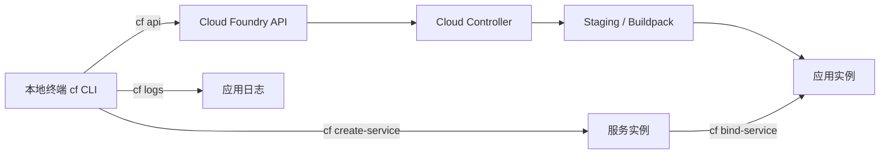

## 6. 功能是什么？

**CF CLI**（命令名 `cf`）是操作 Cloud Foundry 的官方命令行工具。它把「上传代码、创建服务实例、绑定凭据、查看日志、缩放实例」等操作统一到终端里。

<Callout type="info" title="先理解三个作用域">
所有 cf 命令都作用在当前 **API Endpoint + Org + Space** 上。执行任何写操作之前先跑一次 `cf target`，这是避免误部署到生产环境的最重要习惯。
</Callout>

## 7. 为什么需要这个功能？

Cockpit 适合查看与少量管理操作，但持续开发需要可重复、可脚本化、可放进 CI/CD 的命令。`cf push` 一行命令就能完成上传、构建（staging）、启动，日志与环境变量也能即时查看，这是排查部署问题的第一手段。

## 8. 实际业务应用场景

- 本地开发完成后推送到 Dev Space。
- 在 CI/CD 流水线中自动部署到 Test / Prod。
- 为应用创建并绑定 XSUAA、Destination、HANA HDI 等服务实例。
- 部署失败时通过 `cf logs <APP> --recent` 与 `cf env <APP>` 定位原因。

## 10. 操作前需要准备什么？

| 准备项 | 说明 |
| --- | --- |
| CF CLI v8 | 按操作系统从 Cloud Foundry 官方渠道安装 |
| API Endpoint | 来自 Subaccount → Overview → Cloud Foundry Environment |
| 账号 | 具备目标 Org / Space 的访问权限 |
| 目标 Space | 例如 `dev`，且已具备 Space Developer 角色 |
| 应用代码 | 至少一个含 `package.json` 或等效构建描述的项目 |

## 11. 详细操作步骤

1. 按操作系统安装 CF CLI（Windows 可用安装程序或包管理器，macOS 可用 Homebrew，Linux 可用发行版包）。
2. 打开新终端，执行 `cf version` 确认输出为 v8。
3. 从 Cockpit 复制 `API Endpoint`，执行 `cf api <API_ENDPOINT>`。
4. 执行 `cf login --sso`，按提示打开一次性授权页面，把 code 粘贴回终端。
5. 执行 `cf target -o <ORG> -s <SPACE>` 明确目标。
6. 执行 `cf orgs`、`cf spaces` 确认可见范围。
7. 执行 `cf marketplace` 查看可用服务与计划。
8. 部署应用：`cf push`，随后 `cf apps` 与 `cf app <APP>` 查看状态。
9. 查看日志：`cf logs <APP> --recent`。
10. 创建服务实例并绑定，然后 `cf restage <APP>` 让凭据生效。
11. 迭代代码后再次 `cf push`，最后按需 `cf delete <APP> -r` 清理。

## 12. 每一步需要填写的参数

| 参数 | 占位符 | 获取位置 | 说明 |
| --- | --- | --- | --- |
| API Endpoint | `<API_ENDPOINT>` | Overview → Cloud Foundry Environment | 完整 `https://` 地址 |
| Org | `<ORG>` | 同上 | `cf login -o` / `cf target -o` |
| Space | `<SPACE>` | Cloud Foundry → Spaces | `cf target -s` |
| 用户 | `<USER_EMAIL>` | 登录账号 | `cf set-space-role` 使用 |
| 应用名 | `<APP>` | manifest.yml | 全局或域内唯一，影响 Route |
| 服务 / 计划 / 实例 | `<SERVICE> <PLAN> <INSTANCE>` | `cf marketplace` | 三者顺序不可颠倒 |

## 13. 配置截图或界面示意图



## 14. 完整配置文件

`manifest.yml` 让 `cf push` 可重复。下面是完整可用的最小清单（Node.js 应用，服务名需在 Space 中已存在）：

```yaml
---
applications:
  - name: btp-learning-api
    memory: 512M
    disk_quota: 512M
    instances: 1
    buildpacks:
      - nodejs_buildpack
    command: node app.js
    random-route: true
    env:
      NODE_ENV: production
    # 若尚未创建这些服务实例，先注释掉 services，否则 cf push 会失败
    # services:
    #   - btp-learning-xsuaa
```

## 15. 完整代码示例

配套的 `app.js`（监听 `PORT`，这是 Cloud Foundry 的硬性要求）：

```javascript
'use strict';

const http = require('node:http');

const port = Number(process.env.PORT || 3000);

const server = http.createServer((req, res) => {
  if (req.url === '/health') {
    res.writeHead(200, { 'Content-Type': 'application/json; charset=utf-8' });
    res.end(JSON.stringify({ status: 'UP' }));
    return;
  }
  res.writeHead(200, { 'Content-Type': 'text/plain; charset=utf-8' });
  res.end('Hello SAP BTP from Cloud Foundry!');
});

server.listen(port, () => {
  console.log(`App listening on port ${port}`);
});
```

`package.json`：

```json
{
  "name": "btp-learning-api",
  "version": "1.0.0",
  "private": true,
  "scripts": { "start": "node app.js" },
  "engines": { "node": ">=20" },
  "dependencies": {}
}
```

## 16. 命令行操作（含运行结果示例）

<Callout type="warning" title="关于示例输出">
下面的输出是**结构示意**，用于说明每个命令返回什么信息。实际的服务名、计划名、域名、内存数值与时间戳取决于你的租户与 CLI 版本，请勿照抄数值。
</Callout>

### 16.1 安装与登录

```bash
# 检查版本：输出 cf version 8.x.x
cf version

# 设置 API Endpoint
cf api <API_ENDPOINT>
# 输出：Setting api endpoint to <API_ENDPOINT>... OK

# 使用一次性授权码登录（终端会给出授权页面 URL）
cf login --sso
# 输出：One Time Code ( Get one at <AUTH_URL> )>> 输入授权码后显示 OK

# 交互式登录的另一种写法（会提示输入邮箱与密码，不建议在共享终端使用）
cf login -a <API_ENDPOINT> -o <ORG> -s <SPACE>
```

### 16.2 确认目标作用域

```bash
cf target
# API endpoint:   <API_ENDPOINT>
# user:           <USER_EMAIL>
# org:            <ORG>
# space:          <SPACE>

cf orgs
# name
# <ORG>

cf spaces
# name
# dev
# test

cf target -o <ORG> -s <SPACE>
```

### 16.3 应用操作

```bash
# 按当前目录 manifest.yml 部署
cf push

# 指定应用与 manifest 文件
cf push <APP> -f manifest.yml

# 列出应用
cf apps
# name              requested state   instances   memory   routes
# btp-learning-api   started           1/1         512M     <ROUTE>

# 查看单个应用明细
cf app <APP>
# name:              <APP>
# requested state:   started
# routes:            <ROUTE>
# buildpacks:        nodejs_buildpack
# instances:         1/1
# memory usage:      512M
# start command:     node app.js
#     state     since    cpu    memory           disk
# #0   running  <TIME>   0.0%   <MEM> of 512M   <DISK>

# 实时日志 / 最近日志
cf logs <APP>
cf logs <APP> --recent

# 查看环境变量（VCAP_SERVICES 在这里）
cf env <APP>

# 重启（不重新构建）与重新 staging（使绑定与依赖变更生效）
cf restart <APP>
cf restage <APP>

# 调整内存与实例数
cf scale <APP> -m 512M -i 2

# 删除应用并清理 Route
cf delete <APP> -r
```

### 16.4 服务实例、绑定与 Service Key

```bash
# 查看可用服务与计划
cf marketplace
# service     plans                 description
# xsuaa       application, broker   Authorization and Trust Management
# destination lite, ...             Destination Service
# （以上行为结构示意，实际输出以租户为准）

# 创建、查看服务实例
cf create-service <SERVICE> <PLAN> <INSTANCE>
cf services
# name          service      plan          bound apps       last operation
# <INSTANCE>    <SERVICE>    <PLAN>        <APP>            create succeeded

cf service <INSTANCE>

# 绑定与解绑
cf bind-service <APP> <INSTANCE>
cf restage <APP>
cf unbind-service <APP> <INSTANCE>

# Service Key（供本地开发或外部系统使用）
cf create-service-key <INSTANCE> <KEY_NAME>
cf service-keys <INSTANCE>
cf service-key <INSTANCE> <KEY_NAME>
cf delete-service-key <INSTANCE> <KEY_NAME> -f

# 删除服务实例（必须先解绑）
cf delete-service <INSTANCE> -f
```

### 16.5 Space 与角色

```bash
cf create-space <SPACE> -o <ORG>
cf space-users <ORG> <SPACE>
cf set-space-role <USER_EMAIL> <ORG> <SPACE> SpaceDeveloper
cf unset-space-role <USER_EMAIL> <ORG> <SPACE> SpaceDeveloper
cf space-quotas
```

### 16.6 命令参数速查

| 命令片段 | 参数含义 | 执行效果 |
| --- | --- | --- |
| `cf api <API_ENDPOINT>` | 目标 CF API 地址 | 后续命令都发往该地址 |
| `cf login --sso` | 使用浏览器一次性授权码 | 建立认证会话，不在终端输入密码 |
| `cf target -o -s` | 指定 Org / Space | 限定后续命令作用域 |
| `cf push -f` | 指定 manifest 文件 | 按声明式配置部署 |
| `cf logs --recent` | 输出最近日志缓冲 | 定位已崩溃应用的历史错误 |
| `cf env <APP>` | 打印应用环境变量 | 核对 VCAP_SERVICES 是否注入 |
| `cf restage` | 重新执行 staging | 使绑定、环境变量、依赖变更生效 |
| `cf scale -m -i` | 内存与实例数 | 调整容量，受配额限制 |
| `cf delete -r` | 同时删除 Route | 清理应用及其访问入口 |

## 17. 执行后的预期结果

- `cf target` 显示正确的 API Endpoint、用户、Org、Space。
- `cf apps` 中应用状态为 `started`，实例数为 `1/1`。
- `cf app <APP>` 显示 start command 与 buildpack 均符合 `manifest.yml` 或 `package.json`。
- 浏览器打开 `cf app <APP>` 输出的 route，页面显示 `Hello SAP BTP from Cloud Foundry!`，`/health` 返回 `{"status":"UP"}`。
- `cf services` 中服务实例的 last operation 为成功状态。

## 18. 如何验证是否成功

1. `cf target` 的 Org / Space 与记录表一致。
2. `cf logs <APP> --recent` 出现 `App listening on port <PORT>`，且无异常堆栈。
3. `curl https://<ROUTE>/health` 返回 200（Windows 可用浏览器或 `Invoke-WebRequest`）。
4. `cf env <APP>` 的 `VCAP_SERVICES` 中包含已绑定的服务名。
5. 修改代码后重新 `cf push`，访问页面能看到新文案。

## 19. 常见错误及解决方案

| 现象 | 原因 | 处理顺序 |
| --- | --- | --- |
| `cf: command not found` | PATH 未包含 CLI 安装目录 | 重开终端；检查安装路径与 PATH |
| `cf push` staging 失败 | `package.json` 缺 start 脚本 / 依赖安装失败 | `cf logs <APP> --recent` 看堆栈，补齐 start 与 engines |
| 应用反复 crashed | 未监听 `process.env.PORT` | 改用环境变量端口并重启 |
| 内存超限被杀 | `-m` 设置过小 | `cf logs` 查内存错误，适当提高并确认配额 |
| 找不到服务凭据 | 未绑定或绑定后未 restage | `cf services` → `cf bind-service` → `cf restage` |
| 服务计划不存在 | Entitlement 未分配 / 计划名写错 | `cf marketplace` 核对，回 Global Account 分配 |
| 部署到了错误环境 | 未执行 `cf target` | 每次部署前强制 `cf target -o <ORG> -s <SPACE>` |

## 20. 安全注意事项

- 优先使用 `cf login --sso`，避免在终端历史中留下密码。
- `cf env <APP>` 与 `cf service-key` 输出含敏感凭据，不要在屏幕共享、日志或工单中粘贴。
- 生产环境部署命令应由流水线使用受限凭据执行，避免个人账号直接操作。
- 删除操作（`cf delete -r`、`cf delete-service -f`）不可逆，执行前先 `cf target` 确认环境。

## 21. 本章总结

CF CLI 的心智模型是「**先确认目标，再执行操作**」：`cf api` → `cf login` → `cf target`。应用相关命令围绕 `cf push`、`cf logs`、`cf env`；服务相关命令围绕 `cf create-service`、`cf bind-service`、`cf create-service-key`。绑定后记得 `cf restage`。掌握这十几条命令，就足以完成绝大多数 BTP Cloud Foundry 部署与排错。

## 22. 实战练习

1. 完整执行 `cf api` → `cf login --sso` → `cf target`，粘贴 `cf target` 输出（注意隐藏个人邮箱）。
2. 用第 14/15 节的代码完成一次 `cf push`，记录 `cf apps` 与 `cf app` 的输出。
3. 创建一个 XSUAA 实例并绑定到应用，观察 `cf env` 中 `VCAP_SERVICES` 的变化。
4. 故意把 `start` 脚本改名后 `cf push`，用 `cf logs --recent` 定位并修复。
5. 继续 [项目二：部署第一个 Node.js 应用](/docs/project-nodejs-cf)，完成完整项目交付。
