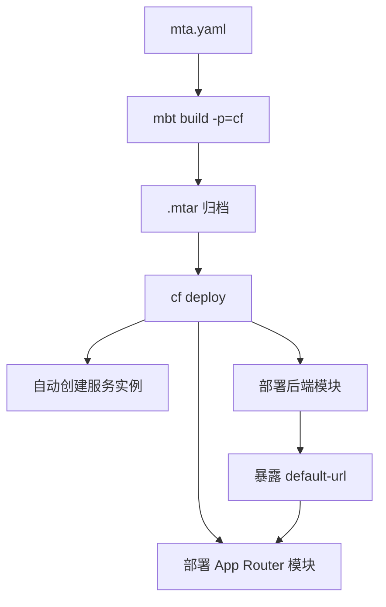

## 6. 功能是什么？

**MTA**（Multi-Target Application，多目标应用）用一个 `mta.yaml` 把多个模块（后端、前端、App Router、数据库部署器）与多个资源（XSUAA、Destination、HDI Container）编排进**同一次部署**。

- **mta.yaml**：部署描述文件。
- **MTAR**：由构建工具生成的 `.mtar` 归档，包含各模块产物与描述信息。
- **MultiApps Plugin**：为 `cf` 增加 `cf deploy` / `cf mtas` / `cf undeploy` 命令的插件。

<Callout type="info" title="什么时候用 MTA">
单应用 `cf push` 只适合一个进程。只要涉及「多个应用 + 自动创建服务实例 + 模块间 URL 注入」，就应使用 MTA：CAP + HANA、SAPUI5 + App Router、XSUAA 登录应用等都是典型场景。
</Callout>

## 7. 为什么需要这个功能？

手工部署多模块项目时，需要按顺序创建服务实例、部署后端、拿后端 URL、写进 App Router 的环境变量、再部署前端。任何一步写错都要重来。MTA 把顺序、依赖与 URL 注入声明化，部署可重复、可放进 CI/CD。

## 8. 实际业务应用场景

- CAP + HANA Cloud 项目：数据库部署器 + 服务 + XSUAA + App Router。
- SAPUI5 前端 + HTML5 Application Repository + 后端 API。
- 多环境（Dev / Test / Prod）使用同一份 `mta.yaml`，只替换扩展描述符中的参数。
- CI/CD 流水线中自动构建并部署 MTAR。

## 10. 操作前需要准备什么？

| 准备项 | 说明 |
| --- | --- |
| CF CLI v8 | `cf version` |
| MTA Build Tool | 提供 `mbt build`（按官方文档安装） |
| MultiApps 插件 | 提供 `cf deploy`（按官方插件仓库安装） |
| Entitlements | 所有 `resources` 中声明的服务计划已分配 |
| 项目模块 | 每个 `modules[].path` 指向真实目录 |

## 11. 详细操作步骤

1. 在项目根目录编写 `mta.yaml`（第 14 节）。
2. 逐一确认 `modules[].path` 目录存在且含各自的 `package.json`。
3. 执行 `cf marketplace` 核对 `resources` 中的服务与计划名。
4. 执行 `mbt build -p=cf`，在 `mta_archives/` 生成 `.mtar`。
5. 执行 `cf target -o <ORG> -s <SPACE>` 确认部署目标。
6. 执行 `cf deploy mta_archives/<FILE>.mtar`，观察各模块与服务实例的创建顺序。
7. 执行 `cf mtas`、`cf apps`、`cf services` 核对部署结果。
8. 执行 `cf routes` 获取访问地址。
9. 失败时用 `cf logs <MODULE> --recent` 与部署输出定位具体模块。
10. 需要回滚或清理时执行 `cf undeploy <MTA_ID> --delete-services`（不可逆）。

## 12. 每一步需要填写的参数

| 字段 | 示例 / 占位符 | 说明 |
| --- | --- | --- |
| `ID` | `btp-learning-mta` | MTA 唯一标识，`cf mtas` 中显示 |
| `version` | `1.0.0` | 版本号，进入归档文件名 |
| `modules[].type` | `nodejs` / `approuter.nodejs` | 决定构建与部署方式 |
| `modules[].path` | `app` / `approuter` | 相对路径，必须存在 |
| `provides.properties.url` | `${default-url}` | 暴露模块实际访问地址 |
| `~{url}` | 依赖注入 | 引用 provides 的属性 |
| `service-plan` | `<PLAN>` | 以 `cf marketplace` 为准 |
| `path`（资源） | `./xs-security.json` | 服务实例配置 |

## 13. 配置截图或界面示意图



## 14. 完整配置文件

`mta.yaml` 完整可运行示例（把占位符替换为实际值后使用）：

```yaml
_schema-version: '3.1'
ID: btp-learning-mta
version: 1.0.0

modules:
  - name: btp-learning-api
    type: nodejs
    path: app
    parameters:
      memory: 512M
      disk-quota: 512M
      instances: 1
    provides:
      - name: backend-api
        properties:
          url: ${default-url}
    requires:
      - name: btp-learning-xsuaa

  - name: btp-learning-approuter
    type: approuter.nodejs
    path: approuter
    parameters:
      memory: 256M
      disk-quota: 256M
      instances: 1
    requires:
      - name: btp-learning-xsuaa
      - name: btp-learning-destination
      - name: backend-api
        group: destinations
        properties:
          name: backend-api
          url: '~{url}'
          forwardAuthToken: true

resources:
  - name: btp-learning-xsuaa
    type: org.cloudfoundry.managed-service
    parameters:
      service: xsuaa
      service-plan: <XSUAA_PLAN>
      path: ./app/xs-security.json

  - name: btp-learning-destination
    type: org.cloudfoundry.managed-service
    parameters:
      service: destination
      service-plan: <DESTINATION_PLAN>
```

### 逐字段解释

| 字段 | 作用 | 常见错误 |
| --- | --- | --- |
| `_schema-version` | MTA 描述格式版本 | 使用不受支持的版本 |
| `ID` / `version` | 标识与版本 | ID 冲突导致覆盖已有部署 |
| `modules[].type` | 模块构建类型 | `approuter.nodejs` 写成 `nodejs` |
| `modules[].path` | 模块源码目录 | 目录不存在导致构建失败 |
| `provides.properties.url` | 暴露模块 URL | 漏写导致依赖模块拿不到地址 |
| `requires.group: destinations` | 注入 App Router 的 destinations | `name` 与 xs-app.json 不一致 |
| `~{url}` | 引用其他模块提供的属性 | 写成 `${url}`（含义不同） |
| `resources[].parameters.path` | 服务实例配置文件 | 路径相对位置错误 |

<Callout type="warning" title="占位符不是合法值">
`<XSUAA_PLAN>`、`<DESTINATION_PLAN>` 必须替换为 `cf marketplace` 中真实存在的计划名，否则 `cf deploy` 会在创建服务实例阶段失败。
</Callout>

## 15. 完整代码示例

下面是构建前自检脚本 `check-mta-project.js`（检查 modules 目录与资源配置文件是否存在）：

```javascript
'use strict';

const fs = require('node:fs');
const path = require('node:path');

// 不引入 YAML 解析依赖，用简单文本检查占位符与目录，避免额外复杂度
const mtaPath = path.join(process.cwd(), 'mta.yaml');
if (!fs.existsSync(mtaPath)) {
  console.error('缺少 mta.yaml');
  process.exit(1);
}

const source = fs.readFileSync(mtaPath, 'utf8');
const placeholders = source.match(/<[A-Z_]+>/g) || [];
if (placeholders.length) {
  console.error('mta.yaml 仍包含未替换的占位符：' + Array.from(new Set(placeholders)).join(', '));
  process.exit(1);
}

const modulePaths = Array.from(source.matchAll(/^\s+path:\s*(.+)$/gm)).map((m) => m[1].trim());
for (const raw of modulePaths) {
  if (raw.startsWith('./') && raw.endsWith('.json')) {
    if (!fs.existsSync(raw)) {
      console.error(`服务配置文件不存在：${raw}`);
      process.exit(1);
    }
    continue;
  }
  if (!raw.includes('$') && !raw.startsWith('<') && !fs.existsSync(raw)) {
    console.error(`模块目录不存在：${raw}`);
    process.exit(1);
  }
}

console.log(`mta.yaml 自检通过：检查了 ${modulePaths.length} 个 path 条目。`);
```

## 16. 命令行操作

```bash
# 1) 工具与目标环境检查
cf version
cf target
cf plugins

# 2) 核对服务与计划
cf marketplace

# 3) 构建前自检
node check-mta-project.js

# 4) 构建 MTAR
mbt build -p=cf
# 产物示例：mta_archives/btp-learning-mta_1.0.0.mtar

# 5) 部署
cf deploy mta_archives/btp-learning-mta_1.0.0.mtar

# 6) 核对部署结果
cf mtas
cf apps
cf services
cf routes

# 7) 查看模块日志
cf logs btp-learning-api --recent
cf logs btp-learning-approuter --recent

# 8) 重新部署新版本
mbt build -p=cf
cf deploy mta_archives/btp-learning-mta_1.0.1.mtar -f

# 9) 卸载（不可逆，会删除服务实例）
cf undeploy btp-learning-mta --delete-services
```

参数解释：

- `mbt build -p=cf`：以 Cloud Foundry 为目标平台构建归档。
- `cf deploy <MTAR>`：按依赖顺序创建服务实例并部署模块。
- `-f`：强制重新部署（部分插件版本支持，以实际帮助为准）。
- `cf mtas`：列出已部署的 MTA，`cf undeploy --delete-services` 会连带删除服务实例，操作不可逆。

## 17. 执行后的预期结果

`cf mtas` 显示 `btp-learning-mta`；`cf apps` 中两个模块均为 `started`；`cf services` 中 XSUAA 与 Destination 实例创建成功且已绑定；`cf routes` 给出 App Router 访问地址；`cf env btp-learning-approuter` 的 `destinations` 环境变量中包含后端 URL。

## 18. 如何验证是否成功

1. `check-mta-project.js` 无占位符与路径错误。
2. `cf deploy` 输出中每个模块都显示部署成功。
3. `cf apps` 状态为 `started`，实例数为 `1/1`。
4. `cf services` 的 last operation 均为成功。
5. App Router 能访问后端接口，后端能收到 JWT。
6. `cf mtas` 中的 MTA 版本与归档一致。

## 19. 常见错误及解决方案

| 现象 | 原因 | 处理 |
| --- | --- | --- |
| `mbt: command not found` | 未安装 MTA Build Tool | 按官方文档安装（**待验证**） |
| `cf deploy` 不存在 | 未安装 MultiApps 插件 | 按官方插件仓库安装 |
| 服务计划不存在 | 占位符未替换或 Entitlement 未分配 | `cf marketplace` 核对 |
| 模块构建失败 | `path` 目录缺 `package.json` / start 脚本 | 补齐模块文件 |
| App Router 拿不到后端地址 | `provides` / `~{url}` 配置错误 | 核对属性名与 group |
| 部署超时 | 服务实例创建慢 | 等待并重新执行 `cf deploy -f` |
| 旧版本残留 | 未卸载旧 MTA | 确认 ID 与版本后再部署或卸载 |

## 20. 安全注意事项

- `mta.yaml` 中不得写入密码、Client Secret 或 Token；凭据由服务绑定注入。
- `cf undeploy --delete-services` 会删除数据，生产环境必须有备份与审批。
- 部署凭据在 CI/CD 中使用受限服务账号，避免使用个人管理员账号。
- 生产与测试使用不同 MTA ID 或不同 Space，避免误覆盖。
- 归档文件可能包含源码，注意分发范围。

## 21. 本章总结

MTA 把「多模块 + 多服务实例」的部署变成一次可重复操作：`mta.yaml` 声明 modules 与 resources，`mbt build` 生成 MTAR，`cf deploy` 按依赖顺序部署，`cf mtas` / `cf apps` / `cf services` 验证。关键是服务计划名、模块路径与 `~{url}` 依赖注入三处不能写错。

## 22. 实战练习

1. 把项目二的 `manifest.yml` 改写成 MTA，并加入一个 XSUAA 资源。
2. 故意把 `~{url}` 写成 `${url}`，观察 App Router 的 destinations 输出差异。
3. 用 `cf undeploy` 清理测试部署，再用同一份 `mta.yaml` 重新部署，验证可重复性。
4. 继续 [CAP + HANA Cloud 完整项目](/docs/project-cap-hana)。
