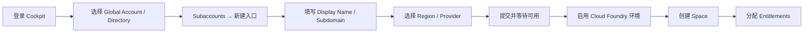

## 6. 功能是什么？

**Subaccount（子账号）** 是 BTP 中承载应用、服务实例、身份信任与运行环境的租户单元。创建 Subaccount 相当于「申请一块独立的云空间」。

创建时最核心的四个字段：

| 字段 | 含义 | 关键点 |
| --- | --- | --- |
| Display Name | 给人看的显示名称 | 通常可后续修改 |
| Subdomain | 全局唯一的子域名 | 会成为应用 URL 与 XSUAA 租户域名的一部分，更改受限 |
| Region | 数据中心区域 | 决定数据驻留与服务可用性，创建后通常不能迁移 |
| Provider | 底层基础设施提供方 | 与 Region 成对出现，按界面可选项选择 |

<Callout type="warning" title="不要照抄示例数值">
本站自绘的页面结构示意图中，Region、Provider、Entitlements 数量与 Subdomain 全部写成占位符，仅用于说明字段位置，不代表任何真实环境的值。请以自己租户界面显示为准。
</Callout>

## 7. 为什么需要这个功能？

应用必须部署在某个 Subaccount 里，服务实例必须挂在某个 Subaccount 里，用户登录信任也配置在 Subaccount 层。没有 Subaccount，就无法创建 Cloud Foundry Org / Space，也就无法 `cf push`。

另外，创建多个 Subaccount 是企业做环境隔离的第一选择：Dev、Test、Prod 各自有独立配额与身份配置，彼此的误操作不会互相影响。

## 8. 实际业务应用场景

- **个人学习**：在 Trial 账号下创建唯一的学习 Subaccount。
- **项目开发**：为项目建立 DEV / TEST / PROD 三个 Subaccount，配额按 2 : 2 : 6 预留。
- **区域合规**：海外业务使用另一个 Region 的 Subaccount，满足数据驻留要求。
- **沙箱验证**：临时 Subaccount 用于验证新服务计划，验证后删除。

## 10. 操作前需要准备什么？

| 准备项 | 说明 |
| --- | --- |
| 权限 | Global Account 或 Directory 管理角色，能创建 Subaccount |
| 命名规范 | 提前定好 `<SUBDOMAIN>`，建议 `<COMPANY>-<PROJECT>-dev` |
| Region 决策 | 在 Discovery Center 确认目标服务在该 Region 可用 |
| Entitlements 余量 | Global Account 有可分配的服务配额 |
| 记录表 | 准备记录 Subdomain、Region、Provider、API Endpoint、Org |

## 11. 详细操作步骤

<Callout type="info" title="界面文案说明">
不同账号类型与版本的按钮文案可能略有差别。下文用「新建/创建入口」描述该操作，请在实际界面中寻找含义相同的入口，不要强行寻找完全一致的中文翻译。
</Callout>

1. 打开区域对应的 BTP Cockpit 地址（例如 `https://cockpit.<REGION>.hana.ondemand.com`），使用已授权账号登录。
2. 在左上角确认当前处于目标 **Global Account**（若使用 Directory，进入目标 Directory）。
3. 在左侧导航打开 **Subaccounts** 列表，查看已有 Subaccount，避免重名。
4. 选择新建/创建 Subaccount 的入口，打开创建向导。
5. 填写 **Display Name**：例如 `<PROJECT> DEV`。
6. 填写 **Subdomain**：例如 `<COMPANY>-<PROJECT>-dev`。系统通常会校验全局唯一性。
7. 选择 **Region**：从下拉列表中选择已在 Discovery Center 核对过的区域。
8. 选择 **Provider**：从该 Region 下可用的基础设施提供方中选择；若只有一个可选项，保持默认即可。
9. 按界面提示设置用途相关标记（如是否用于生产）。**此项的具体文案与可选项标记为待验证**，以当前界面为准；学习用途请选择非生产。
10. 提交创建，等待状态变为可用。创建过程可能需要几十秒到几分钟。
11. 进入新 Subaccount 的 **Overview → General**，核对 Subdomain、Region、Provider 与创建人。
12. 若需要 Cloud Foundry，进入 **Overview → Cloud Foundry Environment**（或在环境配置入口）启用 Cloud Foundry 环境，并记录生成的 `API Endpoint`、`Org Name`、`Org ID`。
13. 在 **Cloud Foundry → Spaces** 中创建第一个 Space，例如 `dev`。
14. 返回 Global Account 的 **Entitlements**，把本项目需要的服务计划（例如 `xsuaa` 的 `application`、`destination` 的对应计划）分配到新 Subaccount。计划名称请以 `cf marketplace` 与实际界面为准。
15. 在 Subaccount 的 **Entitlements** 页确认分配结果。

## 12. 每一步需要填写的参数

| 步骤 | 字段 | 示例值（占位符） | 填写要点 |
| --- | --- | --- | --- |
| 5 | Display Name | `<PROJECT> DEV` | 便于团队识别，可含空格 |
| 6 | Subdomain | `<COMPANY>-<PROJECT>-dev` | 只能使用允许的字符集，全局唯一 |
| 7 | Region | `<REGION>` | 与目标服务可用性、数据驻留绑定 |
| 8 | Provider | `<PROVIDER>` | 按 Region 的可选项选择 |
| 9 | 用途标记 | 非生产 | 文案待验证，按界面实际选择 |
| 12 | 环境类型 | Cloud Foundry | 若计划使用 `cf push` 则启用 |
| 13 | Space 名称 | `dev` | 后续 `cf target -s` 使用 |
| 14 | 服务计划分配量 | `<ASSIGNED_AMOUNT>` | 不能超过 Global Account 可用量 |

## 13. 配置截图或界面示意图

下图为本站自绘的**创建流程示意图**，不是 SAP Cockpit 截图。



<Callout type="verify" title="关于页面结构示意图">
若需要对照 Cockpit 的常见布局，请查看 [资源中心的页面结构示意图](/resources#cockpit-reference)。该图为本站自绘、仅用于理解菜单分组，不是真实操作截图，也不代表官方界面。
</Callout>

## 14. 完整配置文件

创建 Subaccount 是 Cockpit 操作，本身不需要配置文件。下面给出创建后应立即保存的**环境清单** `btp-env.md`，后续所有教程都会引用：

```ini
; 环境清单模板（禁止写入密码、Client Secret、Service Key、JWT）
GLOBAL_ACCOUNT = <GLOBAL_ACCOUNT_NAME>
SUBACCOUNT     = <SUBACCOUNT_DISPLAY_NAME>
SUBDOMAIN      = <SUBDOMAIN>
REGION         = <REGION>
PROVIDER       = <PROVIDER>
CF_API_ENDPOINT= <API_ENDPOINT>
CF_ORG         = <ORG>
CF_ORG_ID      = <ORG_ID>
CF_SPACE       = <SPACE>
COCKPIT_URL    = https://cockpit.<REGION>.hana.ondemand.com
ENVIRONMENT    = Cloud Foundry
```

## 15. 完整代码示例

下面脚本把环境清单转成 `cf` 登录所需的命令提示（**只生成命令文本，不执行任何操作，也不含凭据**）。保存为 `print-cf-hint.js`：

```javascript
'use strict';

const api = process.env.CF_API_ENDPOINT;
const org = process.env.CF_ORG;
const space = process.env.CF_SPACE;

if (!api || !org || !space) {
  console.error('缺少 CF_API_ENDPOINT / CF_ORG / CF_SPACE，请先填写环境清单。');
  process.exit(1);
}

console.log('请依次执行以下命令（占位符已替换为环境变量中的值）：');
console.log(`cf api ${api}`);
console.log('cf login --sso');
console.log(`cf target -o ${org} -s ${space}`);
console.log('');
console.log('注意：cf login 会在浏览器完成身份认证，本脚本不会处理任何凭据。');
```

## 16. 命令行操作

创建完成后，用 CF CLI 做一次连通性验证：

```bash
# 1) 设置要连接的 Cloud Foundry API 地址（来自 Overview → Cloud Foundry Environment）
cf api <API_ENDPOINT>

# 2) 通过一次性授权码在浏览器完成登录；终端会提示打开授权页面并粘贴 code
cf login --sso

# 3) 明确切换到目标 Org 与 Space，避免误操作其他环境
cf target -o <ORG> -s <SPACE>

# 4) 查看当前上下文，确认 API / Org / Space / 用户均正确
cf target

# 5) 列出当前 Org 下的 Space，确认刚创建的 Space 存在
cf spaces

# 6) 列出可用服务与计划，确认 Entitlements 分配已生效
cf marketplace
```

参数解释：

- `<API_ENDPOINT>`：Subaccount 概览页显示的完整 `https://` 地址，不是 Cockpit 地址。
- `--sso`：使用浏览器一次性授权码登录，避免在终端输入密码。
- `-o` / `-s`：分别指定 Org 与 Space，强制限定后续命令的作用域。
- `cf marketplace`：输出当前 Space 可见的服务与计划；若目标服务缺失，多半是 Entitlement 未分配或区域不支持。

## 17. 执行后的预期结果

`cf target` 的典型输出结构（具体字段以 CLI 版本为准）：

```text
API endpoint:   <API_ENDPOINT>
API version:    ...
user:           <USER_EMAIL>
org:            <ORG>
space:          <SPACE>
```

`cf spaces` 应列出你创建的 `dev`；`cf marketplace` 应列出已分配的服务与计划。

## 18. 如何验证是否成功

1. Cockpit 中 Subaccount 状态为可用，Overview 的 General 卡片显示正确的 Region 与 Provider。
2. `cf target` 输出的 Org / Space 与记录表一致。
3. `cf marketplace` 能看到至少一个已分配的服务计划。
4. 在 Global Account → Entitlements 中，该服务计划的「已分配」数量增加了你填写的值。
5. 若启用了 Cloud Foundry，Overview 的 Cloud Foundry Environment 区域能看到 API Endpoint 与 Org 信息。

## 19. 常见错误及解决方案

| 现象 | 原因 | 处理 |
| --- | --- | --- |
| Subdomain 校验不通过 | 已被占用或含非法字符 | 加组织前缀，只用小写字母、数字与连字符 |
| 创建按钮不可点击 | 无创建权限或配额不足 | 联系 Global Account 管理员 |
| 目标服务在 Marketplace 不显示 | Entitlement 未分配 / 区域不提供 | 回 Global Account → Entitlements 分配，并在 Discovery Center 核对 |
| `cf api` 报错 | 填了 Cockpit 地址而非 API Endpoint | 从 Overview → Cloud Foundry Environment 复制完整 API Endpoint |
| `cf login` 后 Org / Space 不对 | 未指定 -o / -s | 执行 `cf target -o <ORG> -s <SPACE>` 重新指定 |

## 20. 安全注意事项

- 学习用途请选择「非生产」标记，避免误被纳入生产治理与计费口径。
- 不要把 Global Account 管理员账号用于日常 `cf push`，应为开发者分配 Space Developer 角色。
- 生产 Subaccount 应开启审计日志并限制可管理信任配置的人数。
- 环境清单文件可入 Git，但必须排除任何凭据文件（例如 Service Key 导出结果）。

## 21. 本章总结

创建 Subaccount 的关键是三个「一次决定」：**Subdomain、Region、Provider**。它们会影响后续的应用 URL、身份租户域名与服务可用性。创建完成后依次完成启用运行环境、创建 Space、分配 Entitlements、CF CLI 连通性验证，环境才算真正可用。

## 22. 实战练习

1. 创建一个名为 `<PROJECT> DEV` 的 Subaccount，并把 Subdomain、Region、Provider 记录到 `btp-env.md`。
2. 启用 Cloud Foundry 环境，创建 `dev` Space，并粘贴 `cf target` 的输出作为验证证据。
3. 故意不分配某个服务的 Entitlement，观察 `cf marketplace` 的变化，再补充分配并对比。
4. 继续完成 [项目一：从零创建 SAP BTP 账号](/docs/project-btp-account)，把权限配置与验证清单补齐。
