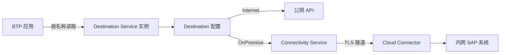

## 6. 功能是什么？

**Destination（目标）** 是一条命名的连接配置，把「后端地址、认证方式、凭据、代理类型、附加属性」集中管理。应用按名称读取，不再把 URL 与密码写死在代码里。

在 BTP 中它通常配合 **Destination Service**：应用绑定该服务实例，运行时用绑定的凭据去读取 Subaccount 中配置的目标。

<Callout type="info" title="两个容易混淆的概念">
- **Cockpit 中的 Destinations 页面**：真正存放目标配置的地方（Subaccount 级）。
- **Destination Service 实例**：应用用来「读取这些配置」的凭据通道，通过 `cf bind-service` 注入 `VCAP_SERVICES`。
两者配套使用，不是同一个对象。
</Callout>

## 7. 为什么需要这个功能？

- **环境解耦**：Dev / Prod 用同一个目标名，指向不同后端地址。
- **凭据集中管理**：避免把 Client Secret 写进代码或 manifest。
- **统一认证**：由平台处理 OAuth token 获取与刷新。
- **内网连通**：配合 Cloud Connector 访问内网 S/4HANA。

## 8. 实际业务应用场景

| 场景 | 认证方式 | ProxyType |
| --- | --- | --- |
| 调用公网 OData / REST API | NoAuthentication 或 OAuth2ClientCredentials | Internet |
| 调用 S/4HANA Cloud API | OAuth2ClientCredentials | Internet |
| 调用内网 S/4HANA OData | PrincipalPropagation 或 BasicAuthentication（仅测试） | OnPremise |
| 保持当前登录用户上下文 | OAuth2UserTokenExchange / OAuth2SAMLBearerAssertion | 视后端而定 |

## 10. 操作前需要准备什么？

| 准备项 | 说明 |
| --- | --- |
| destination 服务实例 | 已创建并绑定到应用 |
| connectivity 服务实例 | 仅 OnPremise 场景需要 |
| Cloud Connector | 仅 OnPremise 场景需要，且已连接 Subaccount |
| 后端地址 | `<BACKEND_URL>` 或内网 `<INTERNAL_HOST>:<PORT>` |
| 认证信息 | OAuth clientId / clientSecret / tokenServiceURL 等（不入库） |

## 11. 详细操作步骤

1. 打开 Subaccount → **Connectivity → Destinations**。
2. 选择新建目标入口，按第 12 节填写核心字段。
3. 若后端在公网，`ProxyType` 选 `Internet`；若在内网，选 `OnPremise` 并填写 `CloudConnectorLocationId`（当 Cloud Connector 配置了非空 Location ID 时必填）。
4. 按后端要求选择 `Authentication`，并填写相应凭据字段。
5. 保存后使用界面提供的连接检查能力验证目标是否可达（检查入口名称以当前界面为准）。
6. 在应用侧创建并绑定 `destination` 服务实例，执行 `cf restage <APP>`。
7. 在 `xs-app.json` 中用 `destination` 字段引用目标名，或在 CAP 中按名称读取。
8. 通过应用接口发一次真实请求，核对返回状态码与日志。

## 12. 每一步需要填写的参数

| 字段 | 示例 / 占位符 | 说明 |
| --- | --- | --- |
| `Name` | `S4HANA_ODATA` | 应用引用的目标名，大小写敏感 |
| `Type` | `HTTP` | 常见类型 |
| `URL` | `https://<BACKEND_HOST>:<PORT>/<PATH>` | 目标根地址 |
| `ProxyType` | `Internet` / `OnPremise` | 内网系统必须为 OnPremise |
| `Authentication` | `OAuth2ClientCredentials` 等 | 按后端支持选择 |
| `User` / `Password` | `<USER>` / `<PASSWORD>` | 仅 BasicAuthentication，生产不推荐 |
| `clientId` / `clientSecret` | `<CLIENT_ID>` / `<CLIENT_SECRET>` | OAuth 凭据，禁止入库 |
| `tokenServiceURL` | `<TOKEN_SERVICE_URL>` | OAuth 换取 token 的地址 |
| `CloudConnectorLocationId` | `<LOCATION_ID>` | 与 Cloud Connector 配置一致 |

<Callout type="warning" title="字段名以界面为准">
不同版本 Cockpit 中 OAuth 参数的显示名称可能带前缀或使用驼峰命名。请以当前界面提示与官方文档为准，不要照抄旧教程中的字段名（**待验证**）。
</Callout>

## 13. 配置截图或界面示意图



## 14. 完整配置文件

Destination 在 Cockpit 中维护；下面是用于**文档化与迁移**的目标定义清单（JSON 结构示意，字段以当前界面为准）：

```json
{
  "Name": "S4HANA_ODATA",
  "Type": "HTTP",
  "URL": "https://<INTERNAL_HOST>:<PORT>",
  "ProxyType": "OnPremise",
  "Authentication": "PrincipalPropagation",
  "CloudConnectorLocationId": "<LOCATION_ID>",
  "Description": "SAP BTP 中文学习中心 - 内网 S/4HANA OData 示例",
  "AdditionalProperties": {
    "note": "所有占位符必须替换为实际值；本文件不含任何真实凭据"
  }
}
```

`xs-app.json` 中引用该目标的完整片段：

```json
{
  "welcomeFile": "/index.html",
  "authenticationMethod": "route",
  "routes": [
    {
      "source": "^/odata/(.*)$",
      "target": "/$1",
      "destination": "S4HANA_ODATA",
      "authenticationType": "xsuaa"
    }
  ]
}
```

## 15. 完整代码示例

CAP / Node.js 中按目标名调用远端服务（使用 SAP Cloud SDK 的常见写法，版本以实际安装为准）：

```javascript
'use strict';

// 依赖示例：@sap-cloud-sdk/http-client（版本请以 npm 当前稳定版核对）
const { executeHttpRequest } = require('@sap-cloud-sdk/http-client');

async function readBusinessPartners(destinationName) {
  const response = await executeHttpRequest(
    { destinationName },
    {
      method: 'get',
      url: '/sap/opu/odata/sap/API_BUSINESS_PARTNER/A_BusinessPartner',
      params: { $top: 5 },
      headers: { Accept: 'application/json' },
    }
  );
  return response.data;
}

module.exports = { readBusinessPartners };
```

Express 中暴露一个受保护的代理接口：

```javascript
'use strict';

const express = require('express');
const { readBusinessPartners } = require('./remote-service');

const app = express();
const destinationName = process.env.DESTINATION_NAME || 'S4HANA_ODATA';

app.get('/api/business-partners', async (req, res) => {
  try {
    const data = await readBusinessPartners(destinationName);
    res.json(data);
  } catch (error) {
    // 不回传内部凭据或完整错误堆栈
    console.error('[remote] 调用失败：', error.message);
    res.status(502).json({ error: 'Bad Gateway', message: '远端服务调用失败' });
  }
});

app.listen(process.env.PORT || 3001);
```

## 16. 命令行操作

```bash
# 1) 查看可用服务与计划
cf marketplace

# 2) 创建并绑定 Destination Service（计划名以实际输出为准）
cf create-service destination <PLAN> <DESTINATION_INSTANCE>
cf bind-service <APP> <DESTINATION_INSTANCE>
cf restage <APP>

# 3) OnPremise 场景额外需要 Connectivity Service
cf create-service connectivity <PLAN> <CONNECTIVITY_INSTANCE>
cf bind-service <APP> <CONNECTIVITY_INSTANCE>
cf restage <APP>

# 4) 核对应用是否拿到 destination 与 connectivity 凭据
cf env <APP>
# Windows PowerShell 可用：cf env <APP> | Select-String "destination|connectivity"

# 5) 排查调用失败
cf logs <APP> --recent
cf services
```

参数解释：`cf create-service destination <PLAN> <INSTANCE>` 创建读取目标所需的服务实例；`cf bind-service` 把凭据注入应用；`cf restage` 使环境变量生效；`cf env` 用于确认凭据存在（输出含敏感信息，注意保管）。

## 17. 执行后的预期结果

- Cockpit → Connectivity → Destinations 中能看到新目标，连接检查通过。
- `cf env <APP>` 的 `VCAP_SERVICES` 中含 `destination`，OnPremise 场景还含 `connectivity`。
- App Router 按 `xs-app.json` 的 `destination` 名称转发请求，后端返回 200。
- OnPremise 场景中，Cloud Connector 的日志能看到对应资源访问记录。

## 18. 如何验证是否成功

1. 目标名大小写与 `xs-app.json` / 代码中的引用完全一致。
2. `cf env` 中存在 destination 服务凭据。
3. 公网目标：应用接口返回 200 与预期数据。
4. 内网目标：确认 Cloud Connector 隧道在线、资源已白名单、Location ID 一致。
5. 修改 Destination 的 URL 后无需改代码，应用会读取新地址（必要时重启应用刷新缓存）。

## 19. 常见错误及解决方案

| 现象 | 原因 | 处理 |
| --- | --- | --- |
| `Destination ... not found` | 名称不一致或应用未绑定服务 | 核对 Name、大小写与 `cf env` |
| 401 | 认证方式或凭据错误 | 核对 OAuth 参数与 tokenServiceURL |
| 403 | 后端用户无权限 | 检查后端授权与用户映射 |
| 502 / 超时（OnPremise） | 隧道断开、白名单缺失、Location ID 不匹配 | 检查 Cloud Connector 状态与 Access Control |
| 回调/重定向失败 | URL 或附加属性配置错误 | 逐项对照官方文档当前字段名 |
| 修改目标不生效 | 应用侧缓存 | 重新部署或按官方说明刷新缓存 |

## 20. 安全注意事项

- 生产环境避免 BasicAuthentication；优先 OAuth 类认证或 PrincipalPropagation。
- Client Secret 不入库、不贴日志；使用密钥管理与定期轮换。
- OnPremise 白名单只开放必需的主机、端口与路径。
- 不要把内部系统完整地址暴露给前端，统一通过后端或 App Router 转发。
- 目标配置变更纳入审计与变更管理。

## 21. 本章总结

Destination 把「去哪里、怎么认证」从代码中抽离：Cockpit 中定义目标，应用通过 Destination Service 实例按名称读取，App Router 用 `destination` 字段转发，CAP 用目标名调用远端服务。OnPremise 场景还必须有 Connectivity Service 与 Cloud Connector 配合。

## 22. 实战练习

1. 创建一条指向公网公开 API 的 `Internet` Destination，通过 App Router 路由访问它。
2. 把目标 URL 改成另一个地址，验证应用代码无需修改。
3. 设计一条 OnPremise Destination，列出所需的 Cloud Connector 白名单与 Location ID 配置。
4. 继续 [Cloud Connector 配置](/docs/cc-config) 与 [项目六：连接 S/4HANA](/docs/project-s4hana-connect)。
