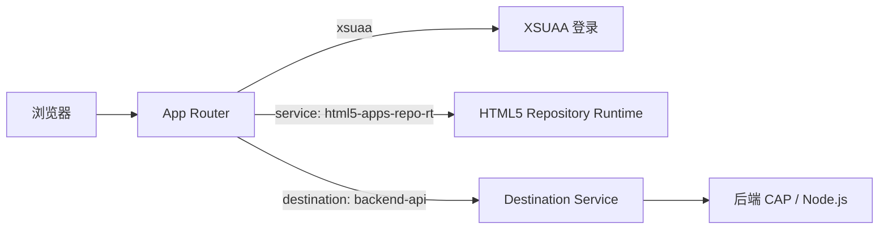

## 6. 功能是什么？

**App Router**（`@sap/approuter`）是 BTP 前端应用的统一入口，本质上是一个 Node.js 反向代理，负责：

1. 处理用户登录跳转与会话（配合 XSUAA）。
2. 按 `xs-app.json` 的路由规则把请求转发到后端或静态资源。
3. 把已校验的 JWT 转发给后端。
4. 提供 Logout 端点。

**HTML5 Application Repository** 是托管 SAPUI5 / Fiori / 静态前端内容的服务，常见两类能力：**Host**（接收并存储部署产物）与 **Runtime**（运行时向 App Router 提供内容）。

<Callout type="info" title="访问链路">
浏览器 → App Router →（认证）→ 静态内容（HTML5 Repo Runtime）或后端 API（Destination）。直接访问后端应用通常不是推荐的业务入口。
</Callout>

### Managed 与 Standalone 的差异

| 对比项 | Managed App Router | Standalone App Router |
| --- | --- | --- |
| 谁维护 | SAP 提供共享的 App Router 实例 | 项目自行部署 `@sap/approuter` 应用 |
| 部署内容 | 前端内容 + 订阅入口 | 前端内容 + App Router 模块 + XSUAA/Destination 绑定 |
| 定制能力 | 受平台约束 | 可定制中间件、路由与扩展 |
| 适用 | 标准 Fiori / Work Zone 发布 | 需要完全控制路由与认证逻辑 |

## 7. 为什么需要这个功能？

浏览器应用不能直接持有 Client Secret，也不该让每个前端各自实现登录。App Router 把认证、会话与路由集中在入口，后端只处理业务与 Scope 校验，安全边界清晰。

## 8. 实际业务应用场景

- 把 SAPUI5 应用部署到 BTP 并通过 Work Zone 发布。
- 前后端分离应用：App Router 把 `/api` 转发到 CAP 服务，把静态资源交给 HTML5 Repository。
- 为健康检查路径配置公开访问，其余路径要求登录。
- 按 Scope 限制部分前端路由。

## 10. 操作前需要准备什么？

| 准备项 | 说明 |
| --- | --- |
| XSUAA 实例 | 认证与授权 |
| Destination 实例 | 后端目标（如使用 destination 路由） |
| HTML5 Repository 资源 | 若采用前端托管方案 |
| `xs-app.json` | 路由与认证规则 |
| 前端构建产物 | 例如 `webapp/` 或 `dist/` |

## 11. 详细操作步骤

1. 确定方案：Managed（订阅 + 内容发布）或 Standalone（自行部署 App Router）。
2. 编写 `xs-app.json`，把精确路径规则放在通配规则之前。
3. 为 Standalone 方案创建 `approuter/package.json` 与 `approuter/manifest.yml`。
4. 创建并绑定 XSUAA、Destination 服务实例。
5. 若使用 HTML5 Repository，按当前租户可用的服务计划创建 Host / Runtime 实例（名称以 Service Marketplace 为准）。
6. 部署前端内容（MTA content 模块或官方示例提供的方式）。
7. 部署 App Router（Standalone）或订阅 Managed App Router 入口。
8. 通过 `cf routes` 或订阅 URL 获取访问地址。
9. 无痕窗口访问，验证登录跳转、静态页面加载与 `/api` 转发。
10. 用 `cf logs <APPROUTER_APP> --recent` 排查路由与认证问题。

## 12. 每一步需要填写的参数

| 参数 | 示例 / 占位符 | 说明 |
| --- | --- | --- |
| `welcomeFile` | `/index.html` | 默认首页文件 |
| `authenticationMethod` | `route` | 按路由决定认证 |
| `source` | `^/api/(.*)$` | 正则，注意顺序 |
| `target` | `/$1` | 转发路径，`$1` 为捕获组 |
| `destination` | `backend-api` | Destination 名称 |
| `service` | `html5-apps-repo-rt` | 引用 HTML5 Runtime 服务实例 |
| `authenticationType` | `xsuaa` / `none` | 是否需要登录 |
| `logoutEndpoint` | `/do/logout` | 登出路径 |

## 13. 配置截图或界面示意图



## 14. 完整配置文件

### `xs-app.json`（Standalone App Router，前后端分离）

```json
{
  "welcomeFile": "/index.html",
  "authenticationMethod": "route",
  "logout": {
    "logoutEndpoint": "/do/logout",
    "logoutPage": "/"
  },
  "routes": [
    {
      "source": "^/health$",
      "target": "/health",
      "destination": "backend-api",
      "authenticationType": "none"
    },
    {
      "source": "^/api/(.*)$",
      "target": "/api/$1",
      "destination": "backend-api",
      "authenticationType": "xsuaa"
    },
    {
      "source": "^(/.*)$",
      "target": "$1",
      "service": "html5-apps-repo-rt",
      "authenticationType": "xsuaa"
    }
  ]
}
```

<Callout type="warning" title="路由顺序是第一大坑">
`^(/.*)$` 会匹配所有路径。如果把它写在 `/api` 规则之前，所有 API 请求都会被当成静态资源处理，导致 404。
</Callout>

### `approuter/package.json`

```json
{
  "name": "btp-learning-approuter",
  "version": "1.0.0",
  "private": true,
  "scripts": {
    "start": "node node_modules/@sap/approuter/approuter.js"
  },
  "engines": { "node": ">=20" },
  "dependencies": {
    "@sap/approuter": "^16.0.0"
  }
}
```

版本号为示例，请以 npm 当前稳定版与官方文档核对（**待验证**）。

### `approuter/manifest.yml`

```yaml
---
applications:
  - name: btp-learning-approuter
    memory: 256M
    disk_quota: 256M
    instances: 1
    buildpacks:
      - nodejs_buildpack
    command: node node_modules/@sap/approuter/approuter.js
    random-route: true
    services:
      - btp-learning-xsuaa
      - btp-learning-destination
      - btp-learning-html5-runtime
    env:
      destinations: >-
        [
          {"name":"backend-api","url":"<BACKEND_URL>","forwardAuthToken":true}
        ]
```

## 15. 完整代码示例

`webapp/index.html`（最小静态页面，用于验证 App Router 是否正确返回内容）：

```html
<!doctype html>
<html lang="zh-CN">
  <head>
    <meta charset="utf-8" />
    <meta name="viewport" content="width=device-width, initial-scale=1" />
    <title>SAP BTP 中文学习中心</title>
  </head>
  <body>
    <h1>前端页面已由 App Router 提供</h1>
    <p>如果看到本页，说明静态内容托管与路由配置生效。</p>
    <a href="/do/logout">退出登录</a>
  </body>
</html>
```

本地检查 `xs-app.json` 路由顺序的脚本 `check-xs-app.js`：

```javascript
'use strict';

const fs = require('node:fs');
const config = JSON.parse(fs.readFileSync(process.argv[2] || 'xs-app.json', 'utf8'));
const routes = config.routes || [];

for (let i = 0; i < routes.length; i += 1) {
  const source = routes[i].source;
  if (/^\^\/\(\.\*\)\$?$/.test(source) && i < routes.length - 1) {
    console.error(`通配路由位于第 ${i + 1} 条，后面还有 ${routes.length - i - 1} 条规则永远不会命中。`);
    process.exit(1);
  }
}

for (const route of routes) {
  if (!route.authenticationType) {
    console.error(`路由 ${route.source} 缺少 authenticationType，请显式声明 xsuaa 或 none。`);
    process.exit(1);
  }
}
console.log(`xs-app.json 检查通过：共 ${routes.length} 条路由。`);
```

## 16. 命令行操作

```bash
# 1) 本地校验 xs-app.json
node check-xs-app.js xs-app.json

# 2) 创建所需服务实例（计划名以 cf marketplace 为准）
cf marketplace
cf create-service xsuaa <PLAN> btp-learning-xsuaa -c xs-security.json
cf create-service destination <PLAN> btp-learning-destination

# 3) 部署 App Router（Standalone 方案）
cd approuter
npm install
cf push -f manifest.yml
cd ..

# 4) 获取访问地址与状态
cf apps
cf routes
cf app btp-learning-approuter

# 5) 检查绑定与日志
cf env btp-learning-approuter
cf logs btp-learning-approuter --recent

# 6) 使用 MTA 一次部署前端 + App Router + 服务实例
mbt build -p=cf
cf deploy mta_archives/<FILE>.mtar
```

参数解释：`cf push -f manifest.yml` 按指定清单部署；`cf env` 检查 XSUAA / Destination / HTML5 Runtime 绑定；`mbt build` / `cf deploy` 用于多模块部署，避免手工创建服务实例导致环境漂移。

## 17. 执行后的预期结果

- `node check-xs-app.js` 输出「xs-app.json 检查通过」。
- `cf apps` 中 App Router 为 `started`，`cf routes` 给出访问域名。
- 无痕窗口访问域名自动跳转登录页；登录后看到 `index.html` 内容。
- `/health` 无需登录即可访问；`/api/...` 被转发到后端。
- `/do/logout` 后再次访问需要重新登录。

## 18. 如何验证是否成功

1. 页面能加载静态资源且浏览器控制台无 404。
2. 受保护路径在未登录时跳转 IdP。
3. `cf env` 中存在 `xsuaa`、`destination` 与 HTML5 Runtime 相关绑定。
4. `cf logs` 中没有 `destination not found` 或 `service not bound` 错误。
5. 后端收到的请求包含 `Authorization` 头（由 `forwardAuthToken` 传递）。

## 19. 常见错误及解决方案

| 现象 | 原因 | 处理 |
| --- | --- | --- |
| 所有路径 404 | 通配路由写太前 / welcomeFile 不存在 | 调整 routes 顺序，核对前端产物路径 |
| `/api` 返回静态页面 | 被 `^(/.*)$` 提前匹配 | 把精确规则移到前面 |
| 401 | 未绑定 XSUAA 或路由认证类型错误 | `cf env` 核对绑定，检查 authenticationType |
| 403 | 路由或后端要求了用户没有的 Scope | 核对 Role Collection 与 Scope |
| `destination not found` | 名称与 Destination 配置不一致 | 逐字比对大小写 |
| 静态内容未更新 | 内容未重新上传或缓存 | 重新部署前端模块并强制刷新 |
| Managed 方案看不到应用 | 订阅或内容发布未完成 | 检查订阅状态与 Work Zone 内容同步 |

## 20. 安全注意事项

- 只有无数据的健康检查路径可以设为 `none`，其余路径默认要求登录。
- `forwardAuthToken: true` 只在可信后端目标上启用。
- 不要在前端代码中放置 Client Secret 或 Service Key。
- 生产环境的 Scope 约束应同时配置在 App Router 与后端。
- HTML5 Repository 的服务计划与资源名以当前租户为准，不要混用 Managed / Standalone 配置。

## 21. 本章总结

App Router 是 BTP 前端的统一安全入口：`xs-app.json` 决定「哪些路径要登录、转发到哪里」，XSUAA 负责认证，Destination 提供后端地址，HTML5 Application Repository 托管静态内容。掌握路由顺序与认证类型，就能解决绝大多数 404 / 401 / 403 问题。

## 22. 实战练习

1. 把 `/health` 改为 `xsuaa`，观察健康检查行为变化，再改回 `none`。
2. 故意把通配路由放到第一条，用 `check-xs-app.js` 捕获问题。
3. 为一个路由增加 `scope` 约束，验证无权限用户的返回码。
4. 继续 [SAPUI5 / Fiori 应用部署](/docs/project-fiori-deploy)。
