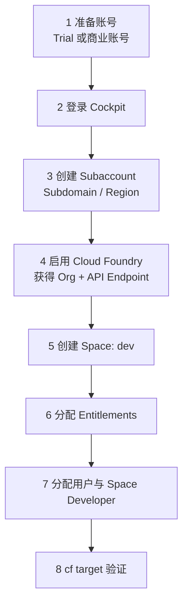

## 6. 功能是什么？

本项目要建立的是一套**最小可用的 BTP 开发环境**，交付物包括：

1. 一个可登录的 Global Account 与 Subaccount。
2. 已启用的 Cloud Foundry 环境（含 API Endpoint 与 Org）。
3. 至少一个 Space（例如 `dev`）。
4. 已分配到该 Subaccount 的服务 Entitlements。
5. 一个具备 Space Developer 角色的开发用户。
6. 一份可被 `cf target` 验证通过的本地 CLI 会话。

<Callout type="info" title="项目边界">
本项目只搭建环境，不部署应用。部署在 [项目二：部署第一个 Node.js 应用](/docs/project-nodejs-cf) 完成。
</Callout>

## 7. 为什么需要这个功能？

后续所有教程都依赖这套环境：XSUAA 实例要创建在 Space 里，Destination 要配置在 Subaccount 里，应用要 `cf push` 到 Space 里。跳过环境搭建会导致后面每一步都卡在「没有权限 / 没有配额 / 连不上 Org」。

## 8. 实际业务应用场景

- 新项目启动时的环境申请与验收。
- 新员工入职后拿到可开发的 BTP 环境。
- 培训前批量准备学员环境。
- 企业做 Dev / Test / Prod 划分时的第一块「开发」拼图。

## 10. 操作前需要准备什么？

| 准备项 | 说明 |
| --- | --- |
| 账号类型决策 | 学习用 Trial；企业项目用商业账号（需管理员分配权限） |
| Region 决策 | 在 Discovery Center 确认目标服务可用 |
| 命名规范 | `<COMPANY>-<PROJECT>-dev` 形式的 Subdomain 与 `dev` Space |
| 本地工具 | Node.js（用于后续项目）、CF CLI v8 |
| 记录表 | `btp-env.md`，只记录非敏感标识 |

## 11. 详细操作步骤

### 步骤 1：准备账号

1. 若没有商业账号，从 SAP 官方渠道申请 **SAP BTP Trial**（入口见 SAP Developers / SAP 官方网站），按向导完成注册与身份验证。
2. 若使用企业商业账号，请管理员确认你拥有目标 Global Account 的可见权限与 Subaccount 创建权限。
3. 记录账号类型：**Trial / Free Tier / 商业账号**，这决定了后续可用的服务计划。

### 步骤 2：登录 Cockpit

4. 打开区域对应的 Cockpit 地址（例如 `https://cockpit.<REGION>.hana.ondemand.com`）。
5. 完成登录，确认左上角显示目标 **Global Account**。
6. 打开 **Account Explorer** 查看现有层级，确认没有同名 Subaccount。

### 步骤 3：创建 Subaccount

7. 在 **Subaccounts** 列表选择新建入口。
8. 填写 `Display Name` = `<PROJECT> DEV`，`Subdomain` = `<COMPANY>-<PROJECT>-dev`。
9. 选择 `<REGION>` 与对应 `<PROVIDER>`；用途选择非生产。
10. 提交并等待状态可用。详细字段说明见 [创建 Subaccount 教程](/docs/cockpit-subaccount-create)。

### 步骤 4：启用 Cloud Foundry 环境

11. 进入新 Subaccount 的 **Overview → Cloud Foundry Environment**（或在环境配置入口）启用 Cloud Foundry。
12. 记录页面显示的 `API Endpoint`、`Org Name`、`Org ID`。
13. 若界面提供「创建 Space」入口，可直接创建；否则进入下一步。

### 步骤 5：创建 Org 与 Space

14. Cloud Foundry 环境启用时会自动生成一个 **Org**；Org 不用手工创建，只需记录名称与 ID。
15. 打开 **Cloud Foundry → Spaces**，创建名为 `dev` 的 Space。
16. 如有 Space Quota 配置项，为该 Space 选择或创建一个配额（例如允许 2 GB 内存、若干服务实例）。具体上限按账号配额决定。

### 步骤 6：分配 Entitlements

17. 回到 Global Account，打开 **Entitlements**。
18. 找到本项目需要的服务（至少 `xsuaa` 与 `destination`；后续项目还需要 `html5-apps-repo`、`connectivity`、`hana` 等）。
19. 把相应服务计划分配到新建的 Subaccount，数量按需填写 `<ASSIGNED_AMOUNT>`。
20. 进入 Subaccount 的 **Entitlements** 页核对分配结果。

### 步骤 7：配置用户权限

21. 打开 Subaccount 的 **Security → Role Collections**，确认存在与 Subaccount 管理相关的角色集合；具体角色名称以租户显示为准。
22. 打开 **Security → Users**，找到你的用户 `<USER_EMAIL>`，分配完成开发所需的最小角色集合。
23. 在 Cloud Foundry 层，用 `cf set-space-role` 为自己授予 **Space Developer**（命令见第 16 节），该角色才允许 `cf push`。

### 步骤 8：验证环境

24. 本地安装 CF CLI v8（见 [CF CLI 安装教程](/docs/cf-cli-install)）。
25. 执行 `cf api <API_ENDPOINT>`、`cf login --sso`、`cf target -o <ORG> -s dev`。
26. 执行 `cf target`、`cf spaces`、`cf marketplace`，保存输出作为验收证据。

<Callout type="warning" title="不要编造菜单">
若你在某一步找不到完全一致的中英文菜单名，请以当前租户界面的相近入口为准，并在 SAP Help Portal 检索对应关键词；不要假设某个按钮一定存在。
</Callout>

## 12. 每一步需要填写的参数

| 步骤 | 参数 | 占位符 / 示例 | 注意 |
| --- | --- | --- | --- |
| 3 | Display Name | `<PROJECT> DEV` | 可后续修改 |
| 3 | Subdomain | `<COMPANY>-<PROJECT>-dev` | 全局唯一、影响 URL |
| 3 | Region / Provider | `<REGION>` / `<PROVIDER>` | 决定服务可用性 |
| 4 | Cloud Foundry | 启用 | 生成 Org 与 API Endpoint |
| 5 | Space | `dev` | `cf target -s` 使用 |
| 6 | 服务计划 | `xsuaa` / `application` 等 | 名称以 Marketplace 为准 |
| 6 | 分配量 | `<ASSIGNED_AMOUNT>` | 不超过可用量 |
| 7 | 用户 | `<USER_EMAIL>` | 来自已配置的 IdP |
| 8 | API Endpoint | `<API_ENDPOINT>` | 不是 Cockpit 地址 |

## 13. 配置截图或界面示意图



## 14. 完整配置文件

项目交付物之一是环境清单 `btp-env.md`：

```ini
; BTP 环境清单（严禁写入任何密码、Token、Client Secret、Service Key）
ACCOUNT_TYPE   = Trial
GLOBAL_ACCOUNT = <GLOBAL_ACCOUNT_NAME>
SUBACCOUNT     = <PROJECT> DEV
SUBDOMAIN      = <COMPANY>-<PROJECT>-dev
REGION         = <REGION>
PROVIDER       = <PROVIDER>
CF_API_ENDPOINT= <API_ENDPOINT>
CF_ORG         = <ORG>
CF_ORG_ID      = <ORG_ID>
CF_SPACE       = dev
USER_EMAIL     = <USER_EMAIL>
ENTITLEMENTS   = xsuaa/application, destination/<PLAN>
```

## 15. 完整代码示例

下面的 `verify-btp-env.js` 脚本用于**自动检查本地环境是否具备继续学习的最低条件**。它不调用任何 BTP API，只检查 Node 版本与必需环境变量：

```javascript
'use strict';

const major = Number(process.versions.node.split('.')[0]);
if (major < 20) {
  console.error(`Node.js 版本过低：${process.versions.node}，请升级到 20 或更高版本。`);
  process.exit(1);
}
console.log(`Node.js 版本检查通过：${process.versions.node}`);

const required = ['CF_API_ENDPOINT', 'CF_ORG', 'CF_SPACE'];
const missing = required.filter((key) => !process.env[key]);
if (missing.length) {
  console.error('缺少环境变量：' + missing.join(', '));
  console.error('请把 btp-env.md 中的对应值填入当前终端会话（不要写入任何凭据）。');
  process.exit(1);
}

console.log('CF 目标环境已配置：');
console.log(`  API Endpoint: ${process.env.CF_API_ENDPOINT}`);
console.log(`  Org:          ${process.env.CF_ORG}`);
console.log(`  Space:        ${process.env.CF_SPACE}`);
console.log('环境清单校验通过。接下来请执行教程第 16 节的 cf 命令完成连通性验证。');
```

## 16. 命令行操作

```bash
# ---------- 本地工具检查 ----------
node --version
npm --version
cf version

# ---------- 设置非敏感环境变量 ----------
# macOS / Linux
export CF_API_ENDPOINT="<API_ENDPOINT>"
export CF_ORG="<ORG>"
export CF_SPACE="dev"
# Windows PowerShell
# $env:CF_API_ENDPOINT="<API_ENDPOINT>"
# $env:CF_ORG="<ORG>"
# $env:CF_SPACE="dev"

# 运行本地环境校验
node verify-btp-env.js

# ---------- 连接 Cloud Foundry ----------
cf api <API_ENDPOINT>
cf login --sso
cf target -o <ORG> -s dev
cf target
cf orgs
cf spaces

# ---------- 权限与配额 ----------
# 为自己授予 Space Developer（需要有相应管理权限的账号执行）
cf set-space-role <USER_EMAIL> <ORG> dev SpaceDeveloper
cf space-users <ORG> dev

# ---------- 服务与配额核对 ----------
cf marketplace
cf services
```

参数解释：

- `cf set-space-role <USER_EMAIL> <ORG> dev SpaceDeveloper`：四个位置参数依次是用户邮箱、Org 名、Space 名、角色名；执行后该用户才能推送与管理应用。
- `cf space-users <ORG> dev`：列出该 Space 中已分配角色的用户，用于确认上一步生效。
- `cf marketplace`：验证 Entitlements 分配结果；`cf services` 应为空（尚未创建实例）。

## 17. 执行后的预期结果

```text
Node.js 版本检查通过：v22.12.0
CF 目标环境已配置：
  API Endpoint: <API_ENDPOINT>
  Org:          <ORG>
  Space:        dev
环境清单校验通过。接下来请执行教程第 16 节的 cf 命令完成连通性验证。
```

`cf target` 输出应显示正确的 API Endpoint、用户、Org 与 Space；`cf space-users` 列表中应能看到 `<USER_EMAIL>` 对应 SpaceDeveloper；`cf marketplace` 应能看到已分配的服务。

## 18. 如何验证是否成功

1. `node verify-btp-env.js` 退出码为 0。
2. `cf target` 中 Org 与 Space 均为预期值。
3. `cf spaces` 包含 `dev`。
4. `cf space-users <ORG> dev` 显示你的用户具备 SpaceDeveloper。
5. `cf marketplace` 包含至少一项已分配的服务计划。
6. Cockpit 中 Subaccount 状态可用，且 Entitlements 页显示分配量。

## 19. 常见错误及解决方案

| 现象 | 原因 | 处理 |
| --- | --- | --- |
| Trial 注册后找不到 Subaccount | 初始化尚未完成 | 等待初始化，刷新 Cockpit |
| `cf login --sso` 一直失败 | 授权码过期或账号无 CF 权限 | 重新获取 code；确认 Space 角色 |
| `cf set-space-role` 权限不足 | 执行者不是 Org Manager | 请管理员执行，或在 Cockpit 中分配角色 |
| `cf marketplace` 为空 | Entitlement 未分配 | 回 Global Account → Entitlements 分配 |
| 无法创建 Space | Org 配额或权限不足 | 检查 Org 内存配额与管理角色 |

## 20. 安全注意事项

- Trial 账号不得用于生产或存放真实业务数据。
- 学习账号与生产账号使用不同密码与身份源，避免凭据复用。
- `Space Developer` 只授予需要部署应用的人员，定期复核 `cf space-users`。
- 环境清单可共享，Service Key 与 `cf service-key` 的输出绝不可提交到仓库。

## 21. 本章总结

本项目完成了从账号到 CLI 的完整闭环：**账号 → Subaccount → Cloud Foundry Org/Space → Entitlements → 角色 → cf target 验证**。请保存 `btp-env.md` 与验证输出，后续所有项目都会复用这些值。

## 22. 实战练习

1. 用第二个用户（若有条件）尝试 `cf push`，观察没有 Space Developer 时的报错，再授予角色后重试。
2. 把某个服务的 Entitlement 分配量改为 0，观察 `cf marketplace` 与创建实例时的报错，再恢复。
3. 为生产环境设计一份独立的 Subaccount 与配额方案，说明与 DEV 的三点差异。
4. 进入 [项目二：部署第一个 Node.js 应用](/docs/project-nodejs-cf)，完成第一次 `cf push`。
