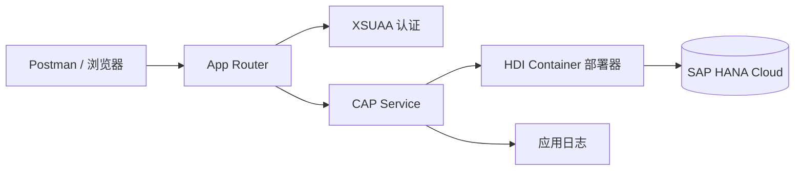

## 6. 功能是什么？

**CAP**（SAP Cloud Application Programming Model）是 SAP 的云原生应用开发框架：用 **CDS**（Core Data Services）声明数据模型与服务，框架自动生成 OData / REST 端点、持久化与权限切面。

本项目交付：

1. 一个包含 `Books` 实体的 CDS 数据模型。
2. 一个提供 CRUD 的 OData V4 Service。
3. 生产持久化使用 **SAP HANA Cloud** 的 **HDI Container**（HANA Deployment Infrastructure 容器，CAP 通过它部署表与视图）。
4. XSUAA 认证与基于角色的权限控制。
5. App Router 作为统一入口，Destination 提供后端地址。
6. MTA 一次部署、Postman 测试、日志与排错。

<Callout type="info" title="本地与生产">
本地开发用 SQLite（内存/文件数据库，`cds watch` 即可），生产部署用 HANA Cloud。两者由配置切换，**业务代码不改**。
</Callout>

## 7. 为什么需要这个功能？

企业应用需要真正持久化的数据库、可审计的权限、可重复的部署与可测试的 API。CAP 把这些标准化，避免每个项目重复造轮子。HANA Cloud 提供生产级数据库，HDI Container 让数据库对象以可部署、可版本化的方式管理。

## 8. 实际业务应用场景

- 企业扩展应用的业务数据服务（订单、审批、主数据）。
- 为 Fiori 前端提供 OData V4 后端。
- 与 S/4HANA 数据集成后落地扩展表。
- 多模块 CAP 服务的统一认证与部署。

## 10. 操作前需要准备什么？

| 准备项 | 说明 |
| --- | --- |
| 开发环境 | Node.js 20+、`npm install -g @sap/cds-dk` |
| BTP 环境 | 已完成项目一；`cf target` 可用 |
| Entitlements | `hana` / `hdi-shared` 类服务、`xsuaa`、`destination` 已分配 |
| HANA Cloud 实例 | 已创建且处于运行状态，规格按账号配额选择 |
| 工具 | MBT、MultiApps 插件、Postman |
| 占位符 | `<SPACE>`、`<HANA_PLAN>`、`<XSUAA_PLAN>` 等 |

## 11. 详细操作步骤

### 11.1 初始化项目

1. 执行 `cds init btp-cap-orders` 并进入目录。
2. 执行 `npm install` 安装依赖。
3. 执行 `cds watch` 确认开发服务器可启动。

### 11.2 定义数据模型与服务

4. 创建 `db/schema.cds`（第 15 节）定义 `Books` 实体。
5. 创建 `srv/service.cds`（第 15 节）暴露 `CatalogService`。
6. 创建 `srv/service.js`（第 15 节）实现自定义逻辑与校验。
7. 用 `cds watch` 本地验证 `/odata/v4/catalog/Books` 的 GET / POST。

### 11.3 加权限

8. 在 `srv/service.cds` 加 `@requires` 与 `@restrict` 注解，声明 Viewer / Editor / Administrator 权限。
9. 本地可用 `cds watch --profile development` 或按官方文档启用模拟用户验证注解效果（具体方式以 CAP 当前文档为准，**待验证**）。

### 11.4 生成生产配置

10. 执行 `cds add hana` 添加 HANA 生产配置。
11. 执行 `cds add xsuaa` 生成 XSUAA 安全描述。
12. 执行 `cds add approuter` 生成 App Router 模块。
13. 执行 `cds add mta` 生成 `mta.yaml`。
14. 逐项核对 `mta.yaml` 中的服务名与计划名，替换为 `cf marketplace` 中的实际值。

### 11.5 配置 HANA Cloud 与 HDI

15. 在 Cockpit → Services → Service Marketplace 创建 **SAP HANA Cloud** 实例（规格、内存与存储按账号配额选择）。
16. 等待实例状态为运行。
17. 确认 MTA 中 `hdi-shared` 类资源声明正确；部署时会自动创建 HDI Container 与部署器模块。

### 11.6 构建与部署

18. 执行 `cf target -o <ORG> -s <SPACE>` 确认目标。
19. 执行 `mbt build -p=cf` 生成 MTAR。
20. 执行 `cf deploy mta_archives/<FILE>.mtar`。
21. 执行 `cf apps`、`cf services` 核对所有模块与服务实例。

### 11.7 授权与测试

22. 在 Cockpit → Security → Role Collections 中创建角色集合，加入 CAP 生成的 Role，并分配给测试用户。
23. 在 Postman 中通过 OAuth 获取 token（Client Credentials 或用户登录 token，取决于配置）。
24. 用 `GET /odata/v4/catalog/Books` 验证读取，`POST` 创建记录，`PATCH` 修改，`DELETE` 删除。
25. 用无权限用户调用写操作，确认返回 403。

### 11.8 数据与运维

26. 通过 HANA 相关工具（HANA Database Explorer 或等价工具）查看 HDI Container 中的表与数据。
27. 执行 `cf logs <SRV_APP> --recent` 查看服务日志。
28. 记录常见问题与解决方式（第 19 节）。

## 12. 每一步需要填写的参数

| 步骤 | 参数 | 占位符 / 示例 | 说明 |
| --- | --- | --- | --- |
| 1 | 项目名 | `btp-cap-orders` | 影响 MTA ID |
| 15 | HANA 规格 | `<HANA_MEMORY>` / `<HANA_STORAGE>` | 按配额与成本选择 |
| 14 | HDI 服务计划 | `<HANA_PLAN>` | 常见形如 `hdi-shared`，以实际为准 |
| 14 | XSUAA 计划 | `<XSUAA_PLAN>` | 常见 `application` |
| 18 | Org / Space | `<ORG>` / `<SPACE>` | 部署目标 |
| 22 | 测试用户 | `<VIEWER_EMAIL>` / `<ADMIN_EMAIL>` | 权限测试 |
| 23 | 访问令牌 | `<ACCESS_TOKEN>` | 不入库、不入日志 |

## 13. 配置截图或界面示意图



## 14. 完整配置文件

### `mta.yaml`（生产部署核心，占位符需替换）

```yaml
_schema-version: '3.1'
ID: btp-cap-orders
version: 1.0.0

modules:
  - name: btp-cap-orders-srv
    type: nodejs
    path: gen/srv
    parameters:
      memory: 512M
      disk-quota: 512M
    provides:
      - name: srv-api
        properties:
          srv-url: ${default-url}
    requires:
      - name: btp-cap-orders-db
      - name: btp-cap-orders-xsuaa

  - name: btp-cap-orders-db-deployer
    type: hdb
    path: gen/db
    parameters:
      buildpack: nodejs_buildpack
    requires:
      - name: btp-cap-orders-db

  - name: btp-cap-orders-approuter
    type: approuter.nodejs
    path: app/approuter
    parameters:
      memory: 256M
      disk-quota: 256M
    requires:
      - name: btp-cap-orders-xsuaa
      - name: srv-api
        group: destinations
        properties:
          name: srv-api
          url: '~{srv-url}'
          forwardAuthToken: true

resources:
  - name: btp-cap-orders-db
    type: org.cloudfoundry.managed-service
    parameters:
      service: hana
      service-plan: <HANA_PLAN>

  - name: btp-cap-orders-xsuaa
    type: org.cloudfoundry.managed-service
    parameters:
      service: xsuaa
      service-plan: <XSUAA_PLAN>
      path: ./xs-security.json
```

**字段解释**：`btp-cap-orders-srv` 是 CAP 服务模块；`btp-cap-orders-db-deployer` 是 HDI 部署器（type `hdb`），负责把 CDS 生成的数据库对象部署到 HDI Container；`resources` 声明 HDI 与 XSUAA 服务实例；App Router 通过 `~{srv-url}` 拿到后端地址。

### `xs-security.json`

```json
{
  "xsappname": "btp-cap-orders-<SUBDOMAIN>",
  "tenant-mode": "dedicated",
  "description": "SAP BTP 中文学习中心 - CAP + HANA 项目",
  "scopes": [
    { "name": "$XSAPPNAME.Display", "description": "查看数据" },
    { "name": "$XSAPPNAME.Write", "description": "写入数据" },
    { "name": "$XSAPPNAME.Admin", "description": "管理数据" }
  ],
  "role-templates": [
    {
      "name": "Viewer",
      "description": "只读用户",
      "scope-references": ["$XSAPPNAME.Display"]
    },
    {
      "name": "Editor",
      "description": "可写用户",
      "scope-references": ["$XSAPPNAME.Display", "$XSAPPNAME.Write"]
    }
  ]
}
```

### `package.json`（本地开发部分）

```json
{
  "name": "btp-cap-orders",
  "version": "1.0.0",
  "private": true,
  "dependencies": {
    "@sap/cds": "^8.0.0"
  },
  "devDependencies": {
    "@sap/cds-dk": "^8.0.0"
  },
  "scripts": {
    "start": "cds-serve"
  }
}
```

版本号为示例范围，请以 CAP 当前稳定版核对（**待验证**）。

## 15. 完整代码示例

### 目录结构

```text
btp-cap-orders/
├── db/
│   └── schema.cds
├── srv/
│   ├── service.cds
│   └── service.js
├── app/
│   └── approuter/
│       ├── package.json
│       └── xs-app.json
├── xs-security.json
├── mta.yaml
└── package.json
```

### `db/schema.cds`

```cds
namespace sap.btp.learning;

using { cuid, managed } from '@cds/common';

entity Books : cuid, managed {
  title       : String(200) not null;
  author      : String(120);
  stock       : Integer default 0;
  price       : Decimal(9,2);
  currency    : String(3) default 'CNY';
}
```

### `srv/service.cds`

```cds
using { sap.btp.learning as db } from '../db/schema';

@path: '/odata/v4/catalog'
service CatalogService @(requires: 'authenticated-user') {

  entity Books as projection on db.Books;

  annotate Books with @(restrict: [
    { grant: 'READ', to: 'Viewer' },
    { grant: ['CREATE', 'UPDATE'], to: 'Editor' },
    { grant: '*', to: 'Administrator' }
  ]);

  @(restrict: [{ grant: 'READ', to: 'Viewer' }])
  function stockSummary() returns Integer;
}
```

### `srv/service.js`

```javascript
const cds = require('@sap/cds');

module.exports = cds.service.impl(async function () {
  const { Books } = this.entities;

  this.before('CREATE', Books, async (req) => {
    const data = req.data;
    if (!data.title || data.title.trim().length === 0) {
      return req.reject(400, '书名不能为空');
    }
    if (data.stock !== undefined && data.stock < 0) {
      return req.reject(400, '库存不能为负数');
    }
  });

  this.on('stockSummary', async () => {
    const result = await SELECT.one.from(Books).columns('sum(stock) as total');
    return result ? Number(result.total || 0) : 0;
  });
});
```

### `app/approuter/xs-app.json`

```json
{
  "welcomeFile": "/index.html",
  "authenticationMethod": "route",
  "routes": [
    {
      "source": "^/odata/(.*)$",
      "target": "/odata/$1",
      "destination": "srv-api",
      "authenticationType": "xsuaa"
    },
    {
      "source": "^(/.*)$",
      "target": "$1",
      "authenticationType": "xsuaa"
    }
  ]
}
```

## 16. 命令行操作

```bash
# ---------- 本地开发 ----------
npm install -g @sap/cds-dk
cds init btp-cap-orders
cd btp-cap-orders
npm install
cds watch
curl http://localhost:4004/odata/v4/catalog/Books

# ---------- 生成生产配置 ----------
cds add hana
cds add xsuaa
cds add approuter
cds add mta
# 编辑 mta.yaml，替换所有 <...> 占位符

# ---------- 部署 ----------
cf target -o <ORG> -s <SPACE>
cf marketplace
mbt build -p=cf
cf deploy mta_archives/btp-cap-orders_1.0.0.mtar
cf apps
cf services
cf routes

# ---------- Postman 接口测试 ----------
# GET 读取
curl -i -H "Authorization: Bearer <ACCESS_TOKEN>" \
  https://<APP_HOST>/odata/v4/catalog/Books

# POST 创建
curl -i -X POST \
  -H "Authorization: Bearer <ACCESS_TOKEN>" \
  -H "Content-Type: application/json" \
  -d "{\"title\":\"SAP BTP 实战\",\"author\":\"学习中心\",\"stock\":10,\"price\":88.00,\"currency\":\"CNY\"}" \
  https://<APP_HOST>/odata/v4/catalog/Books

# PATCH 修改
curl -i -X PATCH \
  -H "Authorization: Bearer <ACCESS_TOKEN>" \
  -H "Content-Type: application/json" \
  -d "{\"stock\":12}" \
  https://<APP_HOST>/odata/v4/catalog/Books(<BOOK_UUID>)

# DELETE 删除
curl -i -X DELETE \
  -H "Authorization: Bearer <ACCESS_TOKEN>" \
  https://<APP_HOST>/odata/v4/catalog/Books(<BOOK_UUID>)

# ---------- 运维 ----------
cf logs btp-cap-orders-srv --recent
cf env btp-cap-orders-srv
```

参数解释：`cds add hana/xsuaa/approuter/mta` 会生成或补齐生产所需配置；`mbt build -p=cf` 生成归档；`cf deploy` 创建 HDI Container、部署数据库对象与各模块；curl 中 `-H` 传 JWT 与内容类型，`<BOOK_UUID>` 是 POST 返回的实体主键。

## 17. 执行后的预期结果

本地 `cds watch` 输出服务地址，`GET /odata/v4/catalog/Books` 返回空集合。部署后 `cf apps` 中 srv、db-deployer（一次性任务）、approuter 均成功；`cf services` 中 HDI 与 XSUAA 实例创建成功。

Postman / curl 结果：

```json
{
  "@odata.context": "$metadata#Books",
  "value": [
    {
      "ID": "<BOOK_UUID>",
      "title": "SAP BTP 实战",
      "author": "学习中心",
      "stock": 10,
      "price": 88.00,
      "currency": "CNY"
    }
  ]
}
```

Viewer 用户执行 POST 返回 403；Editor / Administrator 用户执行 POST 返回 201。

## 18. 如何验证是否成功

1. 本地 SQLite 模式 CRUD 全部通过。
2. `cf deploy` 输出中 HDI 部署器成功执行。
3. HANA 相关工具中能看到由 CDS 生成的表与插入的数据。
4. Postman 用有效 token 能完成 GET / POST / PATCH / DELETE。
5. 无写权限用户 POST 返回 403（不是 401）。
6. `cf logs btp-cap-orders-srv --recent` 无数据库绑定或认证错误。

## 19. 常见错误及解决方案

| 现象 | 原因 | 处理 |
| --- | --- | --- |
| HDI Container 创建失败 | Entitlement 未分配 / HANA Cloud 未运行 | 检查实例状态与配额 |
| `service-plan` 不存在 | 计划名与租户不一致 | `cf marketplace` 核对并替换 |
| 部署器模块失败 | `gen/db` 产物缺失 | 先执行 CDS 构建，再 `mbt build` |
| 401 | XSUAA 未绑定或 token 无效 | `cf env` 核对绑定，重新获取 token |
| 403 | Role Collection 未分配 / @restrict 角色名不匹配 | 核对角色名与用户分配 |
| `cds watch` 启动失败 | `@sap/cds-dk` 未安装或版本不匹配 | 安装当前稳定版并核对 engines |
| 表名与预期不符 | CDS 命名空间转换 | 查看生成的 HDI 部署产物 |

## 20. 安全注意事项

- 生产数据库凭据由 HDI 服务绑定注入，禁止写入代码或 mta.yaml。
- `@restrict` 只是应用层约束，敏感操作仍需后端再校验。
- `<ACCESS_TOKEN>` 不入库、不入日志、不贴工单。
- HANA Cloud 规格影响成本，非生产环境使用最小规格并及时关停。
- 生产与测试使用不同 HDI Container 与 XSUAA 实例。

## 21. 本章总结

本项目完成了 CAP 从建模到生产的闭环：**CDS 模型 → 本地 SQLite 验证 → @restrict 权限 → cds add 生成生产配置 → HDI Container → MTA 部署 → Postman 测试 → 日志与排错**。最重要的两点是服务计划名必须以租户实际输出为准，以及权限注解必须与 Role Collection 分配一致。

## 22. 实战练习

1. 增加 `Orders` 实体与 `OrdersService`，为它设计 Viewer / Editor 权限矩阵。
2. 用 Viewer token 执行 POST，确认返回 403 而非 401。
3. 在 HANA 工具中查看 CDS 生成的表结构，记录字段类型映射。
4. 继续 [SAPUI5 应用部署](/docs/project-fiori-deploy) 与 [S/4HANA 集成](/docs/project-s4hana-connect)。
