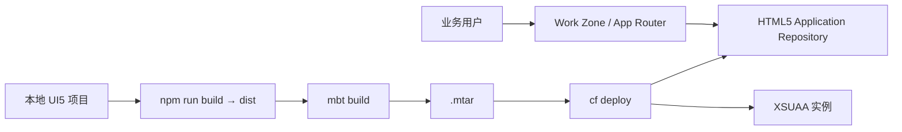

## 6. 功能是什么？

本项目把一个 **SAPUI5 / Fiori 前端应用**部署到 BTP，形成业务用户可访问的入口。涉及：

| 组件 | 作用 |
| --- | --- |
| SAPUI5 应用 | 前端页面与交互 |
| `xs-app.json` | App Router 路由与认证规则 |
| HTML5 Application Repository | 托管前端静态内容（Host / Runtime 能力） |
| XSUAA | 登录与授权 |
| Destination Service | 后端 API 目标 |
| `mta.yaml` + MTAR | 多模块打包与部署 |
| Work Zone / App Router | 业务用户访问入口 |

<Callout type="info" title="两条发布路径">
- **Managed App Router / SAP Build Work Zone**：SAP 提供共享入口，项目订阅并把应用发布为内容。
- **Standalone App Router**：项目自行部署 `@sap/approuter`，由它提供静态内容或转发到后端。
两者配置不通用，本文第 11 节分别说明，不混写。
</Callout>

## 7. 为什么需要这个功能？

本地 `ui5 serve` 只能自己看。企业用户需要统一入口、单点登录、角色权限和可审计的部署流程。把 UI5 应用放进 HTML5 Repository 并通过 Work Zone / App Router 暴露，才能满足这些要求。

## 8. 实际业务应用场景

- 为企业扩展应用提供 Fiori 风格前端。
- 把多个 UI5 应用发布到统一工作台，按角色分配可见性。
- 与 CAP OData 服务集成，形成完整前后端应用。
- 多语言、多版本的静态内容托管。

## 10. 操作前需要准备什么？

| 准备项 | 说明 |
| --- | --- |
| UI5 Tooling | 本地能运行 `ui5 serve` |
| 服务配额 | HTML5 Repository Host/Runtime、XSUAA、Destination |
| MTA 工具 | MBT + MultiApps 插件 |
| 命名 | `<APP_ID>`、`<HTML5_APP_NAME>`、`<SUBDOMAIN>` |
| 入口选择 | Work Zone 订阅或 Standalone App Router |

## 11. 详细操作步骤

### 11.1 创建并本地运行 UI5 应用

1. 创建目录 `btp-ui5-app/webapp`，写入第 15 节的 `index.html`、`manifest.json`、`App.view.xml`、`App.controller.js`。
2. 创建 `ui5.yaml` 与 `package.json`（第 14 节）。
3. 执行 `npm install`，再执行 `npm start`（或 `ui5 serve`）本地启动。
4. 浏览器打开本地地址，确认页面显示「SAP BTP 中文学习中心」。

### 11.2 配置部署文件

5. 在项目根目录创建 `xs-app.json`（第 14 节），设置 `welcomeFile` 与路由认证。
6. 创建 `xs-security.json`，定义应用的 Display Scope 与 Viewer Role Template。
7. 编写 `mta.yaml`：声明 UI5 内容模块、App Router 模块（Standalone 方案）与 XSUAA / Destination / HTML5 Repository 资源。
8. 核对 `mta.yaml` 中所有服务计划名，替换为 `cf marketplace` 实际值。

### 11.3 构建与部署

9. 执行 `npm run build`（UI5 Tooling 构建生成 `dist/`）。
10. 执行 `mbt build -p=cf` 生成 `.mtar`。
11. 执行 `cf target -o <ORG> -s <SPACE>` 确认目标。
12. 执行 `cf deploy mta_archives/<FILE>.mtar`。
13. 执行 `cf apps` / `cf services` 核对模块与服务实例。

### 11.4 发布入口

**方案 A：Standalone App Router**

14. 执行 `cf routes` 获取 App Router 域名，浏览器访问并登录。

**方案 B：Managed App Router / Work Zone**

15. 在 Subaccount 中订阅 SAP Build Work Zone（或当前租户提供的 Managed App Router 入口）。
16. 配置内容提供者，把 HTML5 Application Repository 中的应用同步为可用内容。
17. 创建站点并把应用加入页面/目录，按角色分配可见性。
18. 通过站点 URL 访问应用。

<Callout type="warning" title="不要把两个方案混写">
方案 B 的具体订阅名、内容提供者配置步骤与 MTA content 模块写法，请按当前租户官方文档与官方示例执行（**待验证**）。本站不提供未经核实的产品深链，也不把两种方案的 MTA 片段拼接在一起。
</Callout>

## 12. 每一步需要填写的参数

| 参数 | 占位符 / 示例 | 说明 |
| --- | --- | --- |
| UI5 应用 ID | `sap.btp.learning.ui5` | `manifest.json` 的 sap.app.id |
| HTML5 应用名 | `<HTML5_APP_NAME>` | Repository 中的应用名 |
| `welcomeFile` | `/index.html` | 入口文件 |
| `xsappname` | `btp-ui5-<SUBDOMAIN>` | XSUAA 唯一标识 |
| HTML5 服务计划 | `<HTML5_HOST_PLAN>` / `<HTML5_RUNTIME_PLAN>` | 以 Marketplace 为准 |
| MTA ID | `btp-ui5-app` | `cf mtas` 中显示 |
| 应用域名 | `<APP_HOST>` | `cf routes` 输出 |

## 13. 配置截图或界面示意图



## 14. 完整配置文件

### `xs-app.json`

```json
{
  "welcomeFile": "/index.html",
  "authenticationMethod": "route",
  "logout": {
    "logoutEndpoint": "/do/logout",
    "logoutPage": "/"
  },
  "routes": [
    {
      "source": "^/api/(.*)$",
      "target": "/api/$1",
      "destination": "backend-api",
      "authenticationType": "xsuaa"
    },
    {
      "source": "^(/.*)$",
      "target": "$1",
      "service": "html5-apps-repo-rt",
      "authenticationType": "xsuaa"
    }
  ]
}
```

### `package.json`（UI5 项目）

```json
{
  "name": "btp-ui5-app",
  "version": "1.0.0",
  "private": true,
  "scripts": {
    "start": "ui5 serve",
    "build": "ui5 build --clean-dest"
  },
  "devDependencies": {
    "@ui5/cli": "^4.0.0"
  }
}
```

版本号请以 UI5 Tooling 当前稳定版核对（**待验证**）。

### `ui5.yaml`

```yaml
specVersion: "3.0"
metadata:
  name: sap.btp.learning.ui5
type: application
framework:
  name: SAPUI5
  version: "1.130.0"
  libraries:
    - name: sap.m
    - name: sap.ui.core
```

框架版本请以 SAPUI5 SDK 当前可用版本核对（**待验证**）。

### `mta.yaml`（Standalone 方案示意，计划名需替换）

```yaml
_schema-version: '3.1'
ID: btp-ui5-app
version: 1.0.0

modules:
  - name: btp-ui5-app-approuter
    type: approuter.nodejs
    path: approuter
    parameters:
      memory: 256M
      disk-quota: 256M
    requires:
      - name: btp-ui5-app-xsuaa
      - name: btp-ui5-app-destination
      - name: btp-ui5-app-repo-runtime

resources:
  - name: btp-ui5-app-xsuaa
    type: org.cloudfoundry.managed-service
    parameters:
      service: xsuaa
      service-plan: <XSUAA_PLAN>
      path: ./xs-security.json

  - name: btp-ui5-app-destination
    type: org.cloudfoundry.managed-service
    parameters:
      service: destination
      service-plan: <DESTINATION_PLAN>

  - name: btp-ui5-app-repo-runtime
    type: org.cloudfoundry.managed-service
    parameters:
      service: html5-apps-repo
      service-plan: <HTML5_RUNTIME_PLAN>
```

<Callout type="warning" title="前端内容上传模块">
上面的 MTA 只示意了 App Router 与服务实例。把 `dist/` 内容上传到 HTML5 Repository 需要额外的 content 模块与 Host 服务实例，其具体 `type`、`build-parameters` 与 `parameters` 在 Managed / Standalone 方案中不同。请以 [SAP Samples](https://github.com/SAP-samples) 中与你方案一致的官方示例为准（**待验证**）。
</Callout>

## 15. 完整代码示例

### 目录结构

```text
btp-ui5-app/
├── webapp/
│   ├── index.html
│   ├── index.js
│   ├── manifest.json
│   ├── view/App.view.xml
│   └── controller/App.controller.js
├── approuter/
│   ├── package.json
│   └── xs-app.json
├── xs-app.json
├── xs-security.json
├── ui5.yaml
├── mta.yaml
└── package.json
```

### `webapp/index.html`

```html
<!doctype html>
<html lang="zh-CN">
  <head>
    <meta charset="utf-8" />
    <meta name="viewport" content="width=device-width, initial-scale=1" />
    <title>SAP BTP 中文学习中心</title>
    <script
      id="sap-ui-bootstrap"
      src="https://ui5.sap.com/1.130.0/resources/sap-ui-core.js"
      data-sap-ui-theme="sap_fiori_3"
      data-sap-ui-libs="sap.m"
      data-sap-ui-resourceroots='{"sap.btp.learning.ui5": "./"}'
      data-sap-ui-onInit="module:sap/btp/learning/ui5/index"
      data-sap-ui-compatVersion="edge"
      data-sap-ui-async="true">
    </script>
  </head>
  <body class="sapUiBody" id="content"></body>
</html>
```

### `webapp/index.js`

```javascript
sap.ui.define([
  "sap/ui/core/mvc/XMLView"
], function (XMLView) {
  "use strict";

  XMLView.create({
    viewName: "sap.btp.learning.ui5.view.App"
  }).then(function (view) {
    view.placeAt("content");
  });
});
```

### `webapp/manifest.json`

```json
{
  "sap.app": {
    "id": "sap.btp.learning.ui5",
    "type": "application",
    "title": "SAP BTP 中文学习中心",
    "description": "SAPUI5 应用部署示例",
    "applicationVersion": { "version": "1.0.0" },
    "dataSources": {
      "catalog": {
        "uri": "/odata/v4/catalog/",
        "type": "OData",
        "settings": { "odataVersion": "4.0" }
      }
    }
  },
  "sap.ui": { "technology": "UI5" },
  "sap.ui5": {
    "rootView": {
      "viewName": "sap.btp.learning.ui5.view.App",
      "type": "XML",
      "async": true,
      "id": "app"
    },
    "dependencies": {
      "minUI5Version": "1.120.0",
      "libs": { "sap.m": {}, "sap.ui.core": {} }
    },
    "models": {
      "": { "dataSource": "catalog", "type": "sap.ui.model.odata.v4.ODataModel" }
    }
  }
}
```

### `webapp/view/App.view.xml`

```xml
<mvc:View
  controllerName="sap.btp.learning.ui5.controller.App"
  xmlns="sap.m"
  xmlns:mvc="sap.ui.core.mvc"
  displayBlock="true">
  <Page title="SAP BTP 中文学习中心">
    <content>
      <VBox class="sapUiMediumMargin">
        <Text text="SAPUI5 应用已成功部署并由 App Router 提供。" />
        <Text text="下面的列表绑定了 CAP CatalogService 的 Books 实体。" />
        <List items="{/Books}">
          <StandardListItem title="{title}" description="{author}" />
        </List>
        <Button text="退出登录" press="onLogout" />
      </VBox>
    </content>
  </Page>
</mvc:View>
```

### `webapp/controller/App.controller.js`

```javascript
sap.ui.define([
  "sap/ui/core/mvc/Controller"
], function (Controller) {
  "use strict";

  return Controller.extend("sap.btp.learning.ui5.controller.App", {
    onLogout: function () {
      // App Router 的 logout 端点会清除会话并跳转到 logoutPage
      window.location.assign("/do/logout");
    }
  });
});
```

## 16. 命令行操作

```bash
# ---------- 本地开发 ----------
npm install
npm start
# 浏览器打开 UI5 Tooling 输出的本地地址

# ---------- 构建前端产物 ----------
npm run build
# 产物位于 dist/

# ---------- 部署前核对 ----------
cf target
cf marketplace
node -e "JSON.parse(require('fs').readFileSync('xs-security.json','utf8')); console.log('xs-security.json OK')"

# ---------- 构建并部署 MTA ----------
mbt build -p=cf
cf deploy mta_archives/<FILE>.mtar
cf apps
cf services
cf routes

# ---------- 访问验证 ----------
curl -i https://<APP_HOST>/
cf logs btp-ui5-app-approuter --recent

# ---------- 清理 ----------
cf undeploy btp-ui5-app --delete-services
```

参数解释：`npm run build` 调用 UI5 Tooling 生成 `dist/`；`mbt build` 把各模块打进 MTAR；`cf deploy` 部署 App Router 与服务实例；`cf routes` 给出访问域名；`cf undeploy --delete-services` 会删除服务实例，操作不可逆。

## 17. 执行后的预期结果

- 本地 `npm start` 后浏览器显示 UI5 页面。
- `cf apps` 中 App Router 为 `started`，`cf services` 中 XSUAA / Destination / HTML5 Runtime 实例创建成功。
- Cockpit → HTML5 Applications 中能看到已上传的应用名。
- 无痕窗口访问入口跳转登录页，登录后显示 UI5 页面与 Books 列表（若后端已就绪）。
- `/do/logout` 后需要重新登录。

## 18. 如何验证是否成功

1. `npm run build` 生成 `dist/index.html` 等产物。
2. `cf deploy` 输出所有模块成功。
3. Cockpit 的 HTML5 Applications 列表中出现应用。
4. 浏览器加载页面且控制台无 404 / CSP 报错。
5. 未登录访问自动跳转 IdP；登录后数据列表能加载。
6. `cf logs` 中没有 `destination not found` 或服务绑定缺失错误。

## 19. 常见错误及解决方案

| 现象 | 原因 | 处理 |
| --- | --- | --- |
| 页面 404 | `welcomeFile` 路径错误或内容未上传 | 核对 dist 结构与 Repository 应用内容 |
| 静态资源 404 | `xs-app.json` 路由顺序错误 | 精确规则放在通配规则之前 |
| 401 | 未绑定 XSUAA 或认证类型错误 | `cf env` 核对绑定 |
| 403 | 用户无对应 Role Collection | 分配角色后重新登录 |
| 数据列表为空 | CAP 后端未就绪或 Destination 名称错误 | 核对 `manifest.json` 的 dataSource 与 Destination |
| MTA content 模块失败 | 方案与官方示例写法不一致 | 按当前方案的 SAP Samples 示例调整（待验证） |
| UI5 版本报错 | `ui5.yaml` 中框架版本不可用 | 使用 SAPUI5 SDK 当前可用版本 |

## 20. 安全注意事项

- 前端代码不得包含 Client Secret、Service Key 或完整 JWT。
- 所有业务接口通过 App Router 转发，后端仍要校验 Scope。
- 内容发布与角色分配要纳入变更管理和审计。
- Content Provider 的同步范围按最小权限设置，避免暴露调试应用。
- 生产环境使用受支持的 UI5 版本并及时升级。

## 21. 本章总结

UI5 应用部署的关键链路是：**本地 UI5 项目 → 构建 dist → xs-app.json 路由与认证 → HTML5 Application Repository 托管 → MTA 部署 → Work Zone / App Router 入口**。Managed 与 Standalone 两条路径的 MTA 写法不同，必须按官方示例选择其一，不能拼接。

## 22. 实战练习

1. 把 `xs-app.json` 的 `welcomeFile` 改成错误路径，观察 404 并修复。
2. 为应用增加一个只读 OData 列表，接入项目四的 CAP 服务。
3. 分别用 Standalone 与 Managed 方案列出 MTA 模块差异清单。
4. 继续 [项目六：连接企业内部 S/4HANA](/docs/project-s4hana-connect)。
