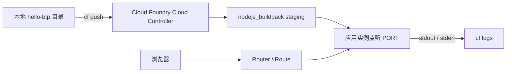

## 6. 功能是什么？

本项目要交付一个最小但**完整可运行**的 Node.js Web 应用，部署到 BTP Cloud Foundry Space 中，通过平台分配的 Route（访问地址）对外提供两个端点：

| 端点 | 返回 | 用途 |
| --- | --- | --- |
| `/` | 一段文本欢迎语 | 证明应用运行 |
| `/health` | JSON 健康状态 | 供平台健康检查与人工验证 |

<Callout type="info" title="术语解释：Route（路由）">
Route 是 Cloud Foundry 分配给应用的访问地址。`random-route: true` 会让平台生成一个不冲突的随机地址，避免学习阶段与其他应用撞名。
</Callout>

## 7. 为什么需要这个功能？

这是理解 BTP 部署链路最短的路径。一次 `cf push` 里包含：上传代码 → 平台选择 buildpack → 安装依赖（staging）→ 启动进程 → 绑定 Route。把这些跑通，后续 XSUAA、CAP、SAPUI5 项目只是在此基础上增加模块与服务绑定。

## 8. 实际业务应用场景

- 新项目的技术验证（PoC）：先确认环境与权限可用。
- 内部工具、Webhook 接收端、健康检查服务等轻量应用。
- CI/CD 流水线的最小部署单元。
- 作为 [项目三 XSUAA 登录应用](/docs/project-xsuaa-login) 的后端基础。

## 10. 操作前需要准备什么？

| 准备项 | 检查命令 / 位置 |
| --- | --- |
| Node.js 20+ | `node --version` |
| npm | `npm --version` |
| CF CLI v8 | `cf version` |
| 目标 Org / Space | `cf target` |
| 可创建应用的角色 | `cf space-users <ORG> <SPACE>` 应包含 SpaceDeveloper |
| 可用内存配额 | `cf app` 或 Cockpit 中查看 Space 配额 |

## 11. 详细操作步骤

### 步骤 1：安装与验证本地工具

1. 安装 Node.js 20 或更高版本，执行 `node --version` 与 `npm --version` 验证。
2. 安装 CF CLI v8，执行 `cf version` 验证。
3. 执行 `cf target`，确认输出中的 Org 与 Space 是本次练习目标。

### 步骤 2：创建项目目录与代码

4. 新建目录 `hello-btp` 并进入。
5. 创建 `app.js`（见第 15 节），实现 `/` 与 `/health`。
6. 创建 `package.json`（见第 15 节），声明 `start` 脚本与 `engines.node`。
7. 创建 `manifest.yml`（见第 14 节），声明应用名、内存、实例数与随机路由。
8. 创建 `README.md`（见第 14 节），记录运行与验证方式。

### 步骤 3：本地运行

9. 执行 `npm install`（本例无外部依赖，仍建议执行以生成 lock 文件）。
10. 执行 `npm start`，浏览器访问 `http://localhost:3000/` 与 `http://localhost:3000/health`。
11. 按 `Ctrl + C` 停止本地进程。

### 步骤 4：登录 Cloud Foundry

12. 执行 `cf api <API_ENDPOINT>`。
13. 执行 `cf login --sso`，按提示完成浏览器授权。
14. 执行 `cf target -o <ORG> -s <SPACE>` 明确目标。

### 步骤 5：部署

15. 在项目根目录执行 `cf push`。
16. 观察终端输出：上传 → staging（buildpack 检测与依赖安装）→ 启动 → 实例状态。

### 步骤 6：查看状态与地址

17. 执行 `cf apps` 查看所有应用。
18. 执行 `cf app btp-learning-hello` 查看详细状态与 routes。
19. 在浏览器打开输出的 Route，验证 `/` 与 `/health`。

### 步骤 7：查看日志

20. 执行 `cf logs btp-learning-hello --recent` 查看最近日志。
21. 执行 `cf logs btp-learning-hello` 实时跟踪，再刷新一次页面观察请求日志。

### 步骤 8：修改并重新部署

22. 修改 `app.js` 中的欢迎语文案。
23. 再次执行 `cf push`。
24. 刷新浏览器，确认新文案已经生效。
25. （可选清理）执行 `cf delete btp-learning-hello -r` 删除应用与 Route。

## 12. 每一步需要填写的参数

| 步骤 | 参数 | 值 / 占位符 | 说明 |
| --- | --- | --- | --- |
| 4 | 目录名 | `hello-btp` | 只影响本地 |
| 7 | `name` | `btp-learning-hello` | 应用名，影响 Route |
| 7 | `memory` | `512M` | 应用内存上限 |
| 7 | `disk_quota` | `512M` | 磁盘上限 |
| 7 | `instances` | `1` | 实例数，学习阶段 1 即可 |
| 7 | `random-route` | `true` | 避免路由冲突 |
| 12 | API Endpoint | `<API_ENDPOINT>` | 来自 Subaccount 概览页 |
| 14 | Org / Space | `<ORG>` / `<SPACE>` | 决定部署位置 |
| 15 | 端口 | `process.env.PORT` | 由平台注入，禁止写死 |

## 13. 配置截图或界面示意图



## 14. 完整配置文件

### `manifest.yml`

```yaml
---
applications:
  - name: btp-learning-hello
    memory: 512M
    disk_quota: 512M
    instances: 1
    buildpacks:
      - nodejs_buildpack
    command: node app.js
    random-route: true
    env:
      NODE_ENV: production
      LOG_LEVEL: info
```

字段逐项说明：

- `name`：应用名，CF 用它生成默认 Route。
- `memory` / `disk_quota`：进程可用资源上限，受 Space 配额约束。
- `instances`：启动的实例数量；学习阶段设为 1。
- `buildpacks`：指定构建包；若省略，平台会自动检测。不同租户的 buildpack 名称可能不同，请以 `cf buildpacks` 输出为准。
- `command`：启动命令；若不写，平台通常按 `package.json` 的 `start` 脚本执行。
- `random-route`：生成随机 Route 避免冲突。
- `env`：注入非敏感环境变量，**禁止**在此写入密码或密钥。

### `README.md`

```markdown
# hello-btp

SAP BTP 中文学习中心 · 项目二：部署第一个 Node.js 应用。

## 本地运行

    npm install
    npm start
    curl http://localhost:3000/health

## 部署到 Cloud Foundry

    cf api <API_ENDPOINT>
    cf login --sso
    cf target -o <ORG> -s <SPACE>
    cf push
    cf apps
    cf app btp-learning-hello
    cf logs btp-learning-hello --recent

## 验证

- `/` 返回欢迎文本
- `/health` 返回 {"status":"UP"}

## 清理

    cf delete btp-learning-hello -r
```

## 15. 完整代码示例

### 目录结构

```text
hello-btp/
├── app.js
├── package.json
├── manifest.yml
└── README.md
```

### `app.js`

```javascript
'use strict';

const http = require('node:http');

// Cloud Foundry 会通过 PORT 环境变量注入实际监听端口。
// 本地开发时回落到 3000，切勿在云端写死端口。
const port = Number(process.env.PORT || 3000);
const greeting = process.env.GREETING || 'Hello SAP BTP! 这是第一个 Cloud Foundry 应用。';

const server = http.createServer((req, res) => {
  const path = (req.url || '/').split('?')[0];

  if (path === '/health') {
    res.writeHead(200, { 'Content-Type': 'application/json; charset=utf-8' });
    res.end(JSON.stringify({
      status: 'UP',
      app: 'btp-learning-hello',
      environment: process.env.NODE_ENV || 'local',
    }));
    return;
  }

  if (path === '/') {
    res.writeHead(200, { 'Content-Type': 'text/plain; charset=utf-8' });
    res.end(greeting);
    return;
  }

  res.writeHead(404, { 'Content-Type': 'application/json; charset=utf-8' });
  res.end(JSON.stringify({ error: 'Not Found', path }));
});

server.listen(port, () => {
  console.log(`[startup] app listening on port ${port}`);
});

// 收到终止信号时优雅退出，便于平台重启实例
process.on('SIGTERM', () => {
  console.log('[shutdown] SIGTERM received, closing server');
  server.close(() => process.exit(0));
});
```

### `package.json`

```json
{
  "name": "btp-learning-hello",
  "version": "1.0.0",
  "description": "SAP BTP 中文学习中心 - 第一个 Cloud Foundry Node.js 应用",
  "private": true,
  "main": "app.js",
  "scripts": {
    "start": "node app.js"
  },
  "engines": {
    "node": ">=20"
  },
  "dependencies": {}
}
```

<Callout type="warning" title="为什么不能有硬编码端口">
Cloud Foundry 在运行时动态分配 `PORT`。若应用监听固定 3000，Router 无法转发请求，健康检查会失败并不断重启实例。
</Callout>

## 16. 命令行操作

```bash
# ---------- 本地准备 ----------
node --version
npm --version
cf version

mkdir hello-btp
cd hello-btp
npm install

# ---------- 本地运行与验证 ----------
npm start
curl http://localhost:3000/
curl http://localhost:3000/health
# Windows PowerShell 可用：Invoke-WebRequest http://localhost:3000/health

# ---------- 连接 Cloud Foundry ----------
cf api <API_ENDPOINT>
cf login --sso
cf target -o <ORG> -s <SPACE>
cf target

# ---------- 部署 ----------
cf push

# ---------- 状态与地址 ----------
cf apps
cf app btp-learning-hello
cf routes

# ---------- 日志 ----------
cf logs btp-learning-hello --recent
cf logs btp-learning-hello

# ---------- 修改代码后的二次部署 ----------
# 1) 编辑 app.js，把 greeting 改成新文案
# 2) 重新推送
cf push

# ---------- 可选：通过环境变量修改欢迎语（无需改代码） ----------
cf set-env btp-learning-hello GREETING "Hello SAP BTP! 第二版文案"
cf restage btp-learning-hello

# ---------- 清理 ----------
cf delete btp-learning-hello -r
```

参数解释：

- `cf push`：读取当前目录的 `manifest.yml`，完成上传、staging 与启动。
- `cf app <APP>`：输出 routes、buildpack、instances、内存与启动命令，是获取访问地址的主要方式。
- `cf logs <APP> --recent`：读取最近日志缓冲；应用已崩溃时仍可查看历史记录。
- `cf set-env`：设置非敏感环境变量；`cf restage` 使其生效（也可用 `cf restart`，但 restage 更彻底）。
- `cf delete -r`：删除应用并清理其 Route，`-r` 表示同时移除路由。

## 17. 执行后的预期结果

本地：

```text
[startup] app listening on port 3000
```

`curl http://localhost:3000/health` 返回：

```json
{"status":"UP","app":"btp-learning-hello","environment":"local"}
```

云端 `cf apps` 结构示意：

```text
name                requested state   instances   memory   routes
btp-learning-hello  started           1/1         512M     btp-learning-hello-<RANDOM>.<APPS_DOMAIN>
```

浏览器访问 `https://<ROUTE>/` 显示欢迎语，访问 `/health` 返回 `{"status":"UP","app":"btp-learning-hello","environment":"production"}`。

`cf logs --recent` 中出现：

```text
[startup] app listening on port <PORT>
```

## 18. 如何验证是否成功

1. `cf target` 的 Org / Space 正确。
2. `cf apps` 中应用状态为 `started`，instances 为 `1/1`。
3. `cf app` 输出的 start command 为 `node app.js`，buildpack 为 Node.js 构建包。
4. 浏览器能打开 Route，两个端点分别返回文本与 JSON。
5. `cf logs --recent` 无异常堆栈，且出现启动日志。
6. 二次部署后浏览器显示新文案，证明代码更新生效。

## 19. 常见错误及解决方案

| 现象 | 原因 | 处理 |
| --- | --- | --- |
| staging 报找不到 start 脚本 | `package.json` 缺 `scripts.start` | 补齐后重新 `cf push` |
| 应用反复重启 | 未监听 `process.env.PORT` | 改用环境变量端口 |
| `cf push` 报 buildpack 不存在 | manifest 中 buildpack 名称与租户不一致 | `cf buildpacks` 查看实际名称，或删除该行让平台自动检测 |
| 502 / 404 | 应用尚未启动或 Route 配置错误 | `cf logs --recent` + `cf routes` 核对 |
| 内存超限 | `-m` 值太小或依赖过大 | 适当提高内存，并确认 Space 配额 |
| 二次部署后仍是旧文案 | 浏览器缓存或推送未完成 | 等待推送结束，用无痕窗口或加查询参数刷新 |

## 20. 安全注意事项

- 不要把密码、Token、Service Key 写入 `manifest.yml` 的 `env`；敏感信息应通过服务绑定或密钥管理注入。
- `cf env <APP>` 输出可能包含凭据，不要在工单或聊天中粘贴。
- 学习应用使用 `random-route`，避免占用有意义的生产域名。
- 练习结束及时 `cf delete -r`，避免闲置应用持续消耗配额。

## 21. 本章总结

本项目用四个文件（`app.js`、`package.json`、`manifest.yml`、`README.md`）跑通了 BTP Cloud Foundry 的完整部署链路。三个最关键的点：**监听 `PORT`、声明 `start` 脚本、部署前 `cf target`**。后续项目只是在此基础上增加 XSUAA 认证、服务绑定与多模块 MTA 部署。

## 22. 实战练习

1. 增加 `/info` 端点，返回应用名与当前 `NODE_ENV`，重新部署并验证。
2. 把 `instances` 改为 2 后 `cf push`，观察 `cf app` 的实例列表变化，再改回 1。
3. 用 `cf set-env` 修改欢迎语，比较 `cf restart` 与 `cf restage` 的行为差异。
4. 故意移除 `start` 脚本，用 `cf logs --recent` 定位 staging 失败原因并修复。
5. 进入 [项目三：带登录功能的应用](/docs/project-xsuaa-login)，为应用加上认证与权限控制。
