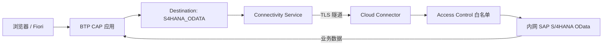

## 6. 功能是什么？

**Cloud Connector** 是安装在企业内网的反向隧道代理。它**主动**向 BTP Subaccount 建立 TLS 连接，因此企业防火墙不需要开放入站端口。BTP 应用通过 **Connectivity Service** 提供的代理把请求送达 Cloud Connector，再由它转发到内网 SAP 系统。

完整链路：

```text
BTP 应用 → Destination（OnPremise）→ Connectivity Service → TLS 隧道 → Cloud Connector → 内网 S/4HANA
```

<Callout type="info" title="Location ID 是什么">
当同一 Subaccount 连接了多个 Cloud Connector 时，Location ID 用于把请求路由到正确的那个。若配置了非空 Location ID，Destination 中必须填写完全相同的值。
</Callout>

## 7. 为什么需要这个功能？

企业内部 SAP 系统通常不对外暴露，也没有公网地址。直接把数据库或 OData 服务暴露到公网不可接受。Cloud Connector 提供「内网主动出栈 + 资源白名单 + 证书信任」的安全通道，是企业集成的标准做法。

## 8. 实际业务应用场景

- CAP 扩展应用读取 S/4HANA 业务伙伴、销售订单数据。
- Fiori 前端展示内网系统数据。
- 通过 Principal Propagation 让内网系统沿用云上登录用户身份做权限判断。
- 多分公司、多数据中心场景用 Location ID 区分隧道。

## 10. 操作前需要准备什么？

| 准备项 | 说明 |
| --- | --- |
| 内网主机 | 可安装 Cloud Connector 且能访问目标 S/4HANA |
| Subaccount | 已启用 Cloud Foundry 环境 |
| 服务配额 | `connectivity`、`destination` 计划已分配 |
| 内网信息 | `<INTERNAL_HOST>`、`<INTERNAL_PORT>`、OData 路径 |
| S/4HANA 账号 | 具备 OData 服务访问权限（或使用 Principal Propagation） |
| 证书 | 按所选认证方式准备（不入库） |

## 11. 详细操作步骤

### 11.1 安装与初始登录

1. 从 SAP 官方渠道获取与操作系统匹配的 Cloud Connector 安装包并安装到内网主机。
2. 打开本地管理界面（默认通过 HTTPS 访问），完成初始管理员账号设置。
3. 检查系统证书状态，按界面提示完成初始化（字段名以当前版本为准，**待验证**）。

### 11.2 连接到 Subaccount

4. 在管理界面中添加与 BTP Subaccount 的连接，填写 Subaccount 相关信息、Region 与认证凭据。
5. 若使用多个 Cloud Connector，配置 `Location ID` = `<LOCATION_ID>`；单个连接器可留空。
6. 确认隧道状态显示为已连接，并在 Cockpit → **Connectivity → Cloud Connectors** 中看到该连接器。

### 11.3 配置资源白名单

7. 在 Cloud Connector 的 Access Control（访问控制）中添加一条资源映射：主机 `<INTERNAL_HOST>`、端口 `<INTERNAL_PORT>`、协议 HTTPS/HTTP。
8. 只开放必要的 OData 路径前缀，例如 `/sap/opu/odata/`，不要开放整网或全部路径。
9. 保存后在内网侧确认目标服务确实可达。

### 11.4 创建服务实例与 Destination

10. 用 CF CLI 创建 `connectivity` 与 `destination` 服务实例并绑定到 CAP 应用。
11. 在 Cockpit → **Connectivity → Destinations** 新建目标：`Name` = `S4HANA_ODATA`，`Type` = `HTTP`，`URL` 指向内网主机与端口，`ProxyType` = `OnPremise`。
12. 填写 `CloudConnectorLocationId` = `<LOCATION_ID>`（若使用）。
13. 选择 `Authentication`：生产推荐 `PrincipalPropagation`，系统到系统调用可用 `OAuth2ClientCredentials`；BasicAuthentication 仅用于受控测试。
14. 按界面提示填写该认证方式所需字段，使用连接检查能力验证可达性。

### 11.5 CAP 调用与前端展示

15. 在 CAP 服务中按目标名 `S4HANA_ODATA` 调用 OData 服务（第 15 节）。
16. 在 UI5 页面绑定返回数据（第 15 节）。
17. 部署应用并绑定 connectivity / destination 实例后 `cf restage`。

### 11.6 验证与排错

18. 调用 `/api/business-partners` 检查返回数据。
19. 在 Cloud Connector 日志中确认资源访问记录。
20. 按隧道状态 → 白名单 → Location ID → 认证 → 证书 → 后端授权的顺序排查问题。

## 12. 每一步需要填写的参数

| 步骤 | 参数 | 占位符 | 说明 |
| --- | --- | --- | --- |
| 4 | Subaccount 信息 | `<SUBDOMAIN>` / `<REGION>` | 与 Cockpit 一致 |
| 5 | Location ID | `<LOCATION_ID>` | Destination 中必须一致 |
| 7 | 内网主机 | `<INTERNAL_HOST>` | 仅白名单必要主机 |
| 7 | 端口 | `<INTERNAL_PORT>` | 与 OData 服务一致 |
| 7 | 路径前缀 | `/sap/opu/odata/` | 按最小范围开放 |
| 11 | Destination 名 | `S4HANA_ODATA` | 代码引用 |
| 11 | ProxyType | `OnPremise` | 内网系统必填 |
| 13 | Authentication | `PrincipalPropagation` | 生产推荐 |
| 13 | 客户端凭据 | `<CLIENT_ID>` / `<CLIENT_SECRET>` | 不入库 |

## 13. 配置截图或界面示意图



## 14. 完整配置文件

Destination 定义清单（字段以当前 Cockpit 界面为准）：

```json
{
  "Name": "S4HANA_ODATA",
  "Type": "HTTP",
  "URL": "https://<INTERNAL_HOST>:<INTERNAL_PORT>",
  "ProxyType": "OnPremise",
  "Authentication": "PrincipalPropagation",
  "CloudConnectorLocationId": "<LOCATION_ID>",
  "Description": "SAP BTP 中文学习中心 - 内网 S/4HANA OData 示例"
}
```

`xs-app.json` 中把 OData 请求转发到该目标：

```json
{
  "welcomeFile": "/index.html",
  "authenticationMethod": "route",
  "routes": [
    {
      "source": "^/s4/(.*)$",
      "target": "/$1",
      "destination": "S4HANA_ODATA",
      "authenticationType": "xsuaa"
    }
  ]
}
```

`mta.yaml` 中的相关 resources：

```yaml
resources:
  - name: btp-learning-connectivity
    type: org.cloudfoundry.managed-service
    parameters:
      service: connectivity
      service-plan: <CONNECTIVITY_PLAN>
  - name: btp-learning-destination
    type: org.cloudfoundry.managed-service
    parameters:
      service: destination
      service-plan: <DESTINATION_PLAN>
```

## 15. 完整代码示例

CAP 服务中通过 Destination 调用远端 OData（Node.js 侧）：

```javascript
'use strict';

const cds = require('@sap/cds');
// SAP Cloud SDK 的实际包名与版本请以官方文档核对
const { executeHttpRequest } = require('@sap-cloud-sdk/http-client');

const DESTINATION_NAME = process.env.S4_DESTINATION || 'S4HANA_ODATA';

async function readBusinessPartners(top) {
  const response = await executeHttpRequest(
    { destinationName: DESTINATION_NAME },
    {
      method: 'get',
      url: '/sap/opu/odata/sap/API_BUSINESS_PARTNER/A_BusinessPartner',
      params: { $top: top || 5 },
      headers: { Accept: 'application/json' },
    }
  );
  return response.data && response.data.value ? response.data.value : [];
}

module.exports = cds.service.impl(async function () {
  this.on('readBusinessPartners', async (req) => {
    const top = Number(req.data.top || 5);
    if (!Number.isInteger(top) || top < 1 || top > 100) {
      return req.reject(400, 'top 必须是 1 到 100 之间的整数');
    }
    try {
      return await readBusinessPartners(top);
    } catch (error) {
      console.error('[s4] 调用失败：', error.message);
      return req.reject(502, '无法访问内部 S/4HANA 服务');
    }
  });
});
```

UI5 视图中展示数据（片段）：

```xml
<List items="{/readBusinessPartners}">
  <StandardListItem
    title="{BusinessPartner}"
    description="{BusinessPartnerFullName}" />
</List>
```

## 16. 命令行操作

```bash
# 1) 创建并绑定 Connectivity / Destination 服务实例
cf marketplace
cf create-service connectivity <CONNECTIVITY_PLAN> btp-learning-connectivity
cf create-service destination <DESTINATION_PLAN> btp-learning-destination
cf bind-service <APP> btp-learning-connectivity
cf bind-service <APP> btp-learning-destination
cf restage <APP>

# 2) 核对绑定
cf env <APP>
# Windows PowerShell：cf env <APP> | Select-String "connectivity|destination"

# 3) 部署含资源声明的 MTA
mbt build -p=cf
cf deploy mta_archives/<FILE>.mtar

# 4) 接口验证
curl -i -H "Authorization: Bearer <ACCESS_TOKEN>" \
  https://<APP_HOST>/api/business-partners
# Windows PowerShell：
# Invoke-WebRequest -Uri https://<APP_HOST>/api/business-partners -Headers @{ Authorization = "Bearer <ACCESS_TOKEN>" }

# 5) 排错
cf logs <APP> --recent
cf services
```

参数解释：`cf create-service connectivity` 创建 BTP 侧代理通道；`cf bind-service` 把代理凭据注入应用；`cf restage` 使环境变量生效；curl 中 `<ACCESS_TOKEN>` 为已登录用户 token，禁止入库。

## 17. 执行后的预期结果

- Cockpit → Connectivity → Cloud Connectors 中隧道状态为已连接，且 Location ID 一致。
- Destinations 中 `S4HANA_ODATA` 连接检查通过。
- `cf env <APP>` 中同时存在 `connectivity` 与 `destination` 凭据。
- `/api/business-partners` 返回 S/4HANA 业务伙伴列表 JSON。
- Cloud Connector 日志出现对应的资源访问记录。

示例响应结构：

```json
{
  "value": [
    { "BusinessPartner": "0000000001", "BusinessPartnerFullName": "示例客户 A" },
    { "BusinessPartner": "0000000002", "BusinessPartnerFullName": "示例客户 B" }
  ]
}
```

## 18. 如何验证是否成功

1. 隧道在线且 Cockpit 中可见 Cloud Connector。
2. Destination 的连接检查成功。
3. 应用接口返回 200 与真实业务数据。
4. Cloud Connector 日志显示请求只命中白名单路径。
5. 无 Location ID 或错误 Location ID 时能复现 502，修正后恢复。
6. 无权限用户返回 403，而不是被后端系统拒绝后返回模糊错误。

## 19. 常见错误及解决方案

| 现象 | 原因 | 排查顺序 |
| --- | --- | --- |
| 502 / 连接超时 | 隧道断开、主机不可达、白名单缺失 | 隧道状态 → 内网连通 → Access Control |
| 403（来自 Cloud Connector） | 请求路径未在白名单 | 补最小路径前缀 |
| Location ID 不匹配 | Destination 与 Cloud Connector 值不同 | 逐字比对 `<LOCATION_ID>` |
| 401 | Destination 认证方式或凭据错误 | 核对认证类型、clientId、tokenServiceURL |
| 证书错误 | 信任链或证书过期 | 检查 Destination Certificates / Trust、系统证书 |
| Principal Propagation 失败 | 用户映射或证书信任未配置 | 核对 IdP 用户属性与内网用户映射 |
| 应用读不到代理凭据 | 未绑定 connectivity / 未 restage | `cf env` + `cf restage` |

## 20. 安全注意事项

- Access Control 只开放必需主机、端口与路径，禁止整网开放。
- 生产优先 Principal Propagation 或 OAuth 类认证，避免 BasicAuthentication 明文密码。
- 证书、私钥与客户端凭据不入库、不贴日志，设置到期提醒。
- 隧道连接使用专用服务账号，定期轮换。
- 对外部暴露的接口仍要做 Scope 校验与速率限制。
- 审计记录包含谁在何时访问了哪个内网资源。

## 21. 本章总结

连接内网 S/4HANA 的关键是三层配合：**Cloud Connector 建立隧道并白名单资源 → Destination 描述 OnPremise 目标与认证 → 应用通过 Connectivity Service 代理发起请求**。排查时按「隧道 → 白名单 → Location ID → 认证 → 证书 → 后端授权」的顺序，绝大多数问题都能快速定位。

## 22. 实战练习

1. 故意把 Destination 的 Location ID 写错，观察错误并修复。
2. 缩小白名单路径，验证未授权路径被 Cloud Connector 拒绝。
3. 分别用 BasicAuthentication 与 PrincipalPropagation 调用同一 OData 服务，比较后端看到的用户身份。
4. 回到 [Destinations 教程](/docs/destinations-overview) 复习认证类型选择。
