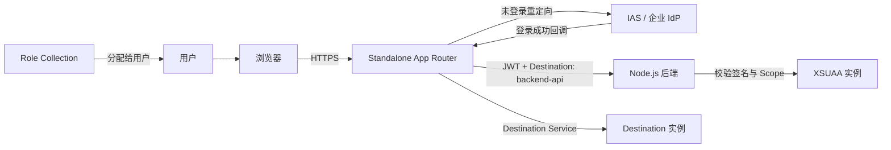

## 6. 功能是什么？

本项目交付一个**带完整认证与授权链路**的 BTP 应用，必须满足以下 8 项功能：

| # | 功能 | 实现方式 |
| --- | --- | --- |
| 1 | 用户访问应用，未登录自动跳转认证页 | `xs-app.json` 中 `authenticationType: xsuaa` |
| 2 | 登录成功后返回应用 | OAuth 回调 + App Router 会话 |
| 3 | 显示当前用户信息 | 后端从已校验的 JWT 中提取 `sub` / `email` |
| 4 | 按用户角色显示不同功能 | 前端根据 `/me` 返回的 scopes 渲染菜单 |
| 5 | 未授权用户无法访问管理员页 | `/admin` 路由 + 后端 Scope 校验，返回 403 |
| 6 | 实现 Logout | `logout.logoutEndpoint` + `/do/logout` |
| 7 | 实现 Token 验证 | `@sap/xssec` 校验签名、受众与过期时间 |
| 8 | 从本地开发到 BTP 部署 | 本地 Service Key 调试 + MTA 一次部署 |

<Callout type="info" title="组件职责">
- **App Router**（`@sap/approuter`）：应用统一入口，负责登录跳转、会话、把请求转发给后端。
- **XSUAA**：签发并校验 JWT，提供 Scope / Role 定义。
- **Destination Service**：让 App Router 通过逻辑名称 `backend-api` 找到后端，而不是硬编码 URL。
- **Node.js 后端**：业务逻辑、用户信息展示与权限校验。
- **Cloud Foundry**：承载上述应用与服务实例的运行环境。
</Callout>

## 7. 为什么需要这个功能？

企业应用上线前必须回答：谁能登录？登录后可看什么？越权访问会不会被挡住？退出登录后会话是否失效？

如果只在前端隐藏管理员按钮，攻击者直接请求 `/admin` 接口就能拿到数据。正确做法是**纵深防御**：App Router 在入口拦截未登录请求，后端在接口层再次校验 Scope，任何一层失效都不应导致越权。

## 8. 实际业务应用场景

- 企业内部订单/审批应用，区分查看者、编辑者、管理员。
- 供应商门户，外部用户只能看到自己的数据。
- 运维控制台，只有管理员能触发敏感操作。
- 作为 [CAP + HANA Cloud 项目](/docs/project-cap-hana) 的安全基础。

## 10. 操作前需要准备什么？

| 准备项 | 说明 / 占位符 |
| --- | --- |
| Subaccount 与 Space | 已完成项目一，`cf target` 可用 |
| Entitlements | `xsuaa`、`destination` 计划已分配；计划名以 `cf marketplace` 为准 |
| `xsappname` | `btp-learning-<SUBDOMAIN>`，租户内唯一 |
| 应用域名 | `<APP_HOST>`（部署后由 `cf routes` 得到，用于回调地址） |
| 测试用户 | `<VIEWER_EMAIL>`（仅 Viewer）、`<ADMIN_EMAIL>`（含 Administrator） |
| 本地工具 | Node.js 20+、CF CLI v8、MTA Build Tool、`cf` MultiApps 插件 |

## 11. 详细操作步骤

### 11.1 项目目录结构

```text
btp-secure-app/
├── app/                          # Node.js 后端模块
│   ├── app.js                    # 业务逻辑、/me、/admin、/health
│   ├── package.json              # 后端依赖与启动脚本
│   ├── xs-security.json          # XSUAA 安全描述（Scope / Role Template）
│   └── manifest.yml              # 单模块 cf push 用的部署清单
├── approuter/                    # Standalone App Router 模块
│   ├── package.json              # 仅依赖 @sap/approuter
│   ├── xs-app.json               # 路由与认证配置
│   └── manifest.yml              # App Router 独立部署清单
├── mta.yaml                      # 多模块 MTA 部署描述（推荐）
├── .env.example                  # 本地开发环境变量模板（不含真实值）
└── README.md                     # 运行与部署说明
```

<Callout type="warning" title="每个文件的作用，不要弄混">
- `xs-security.json`：**给 XSUAA 看**，定义权限点与角色模板。
- `xs-app.json`：**给 App Router 看**，定义哪些路径要登录、转发到哪里。
- `manifest.yml`：**给 cf push 看**，单应用部署参数。
- `mta.yaml`：**给 MTA 部署看**，把多个模块与服务实例编排到一次部署，并自动创建服务实例。
- `package.json`：**给 Node.js 看**，声明依赖与启动脚本。
</Callout>

### 11.2 前端托管方案的取舍

本教程主路径使用 **Standalone App Router + 后端返回 HTML 页面**：App Router 统一入口，后端 `/` 返回带菜单的页面。这样做可以让 8 项功能在一个可运行的最小项目里完整呈现。

另一种常见方案是把前端静态内容部署到 **HTML5 Application Repository**，再由 App Router 或 SAP Build Work Zone 暴露入口。两者的差异：

| 方案 | 前端存放位置 | 适用 | 本文处理 |
| --- | --- | --- | --- |
| Standalone App Router + 后端页面 | 后端应用内 | 教学、小型应用、需要完全控制路由 | **主路径，完整代码** |
| Managed App Router / Work Zone + HTML5 Repo | HTML5 Application Repository（Host/Runtime） | 企业 Fiori / SAPUI5 应用发布 | 见 [HTML5 应用部署教程](/docs/project-fiori-deploy)，配置不混用 |

<Callout type="info" title="为什么不把两种方案混在一起">
HTML5 Repository 的 Host / Runtime 服务计划、MTA content 模块写法与 Managed App Router 订阅步骤，在不同账号类型和产品版本下差异较大。把它们与 Standalone App Router 的配置混写会导致部署失败。本站按方案分别教学，避免误导。
</Callout>

### 11.3 编写配置文件与代码

1. 创建 `app/xs-security.json`（第 14 节），定义 `Display` 与 `Admin` Scope、两个 Role Template。
2. 创建 `approuter/xs-app.json`（第 14 节），注意**精确路由要写在通配路由前面**。
3. 创建 `app/app.js`（第 15 节），实现 `/`、`/health`、`/me`、`/api/admin`、`/do/logout` 相关逻辑。
4. 创建两个 `package.json` 与两个 `manifest.yml`（第 14 节）。
5. 创建 `mta.yaml`（第 14 节），把 App Router、后端、XSUAA、Destination 编排在一起。
6. 创建 `.env.example` 与 `README.md`。

### 11.4 本地开发调试

7. 在项目根目录执行 `npm install`（分别在 `app/` 与 `approuter/` 目录执行）。
8. 创建 XSUAA 实例并导出 Service Key（第 16 节步骤 3）。
9. 把 Service Key 的 `clientid` / `clientsecret` / `url` / `xsappname` 写入本地环境变量（参考 `.env.example`），**不要提交**。
10. 以 `PORT=3001 node app/app.js` 启动后端，用 `curl http://localhost:3001/health` 验证。
11. 本地无 App Router 会话时可用 Postman 以 Client Credentials 获取 token 调用 `/me` 做接口级验证。

### 11.5 在 Cockpit 中配置 Role Collection

12. 部署后打开 Subaccount → **Security → Role Collections**，新建一个 Role Collection，例如 `BTP-Learning-Viewer`，把应用发布的 `Viewer` Role 加入其中。
13. 再建 `BTP-Learning-Administrator`，加入 `Administrator` Role。
14. 打开 **Security → Users**，给 `<VIEWER_EMAIL>` 分配 `BTP-Learning-Viewer`，给 `<ADMIN_EMAIL>` 分配 `BTP-Learning-Administrator`。
15. 若用户不在列表中，先确认 Trust Configuration 中的身份提供方与用户来源。

### 11.6 部署到 BTP

16. 执行 `cf target -o <ORG> -s <SPACE>` 确认目标。
17. 执行 `mbt build -p=cf` 生成 `.mtar`。
18. 执行 `cf deploy mta_archives/<FILE>.mtar`，等待所有模块与服务实例创建完成。
19. 执行 `cf apps` 查看 App Router 与后端应用，执行 `cf routes` 获取访问域名 `<APP_HOST>`。
20. 若 `xs-security.json` 中的 `redirect-uris` 使用了 `<APP_HOST>` 占位符，替换为实际域名后执行 `cf update-service <XSUAA_INSTANCE> -c app/xs-security.json`，再 `cf restage` 相关应用。

### 11.7 四种场景测试

21. 用无痕窗口访问 `https://<APP_HOST>/`，应自动跳转到身份认证页（场景 1）。
22. 用 `<VIEWER_EMAIL>` 登录，应返回应用并显示用户信息与基础菜单（场景 2）。
23. 同一用户访问 `/api/admin`，应返回 403（场景 3）。
24. 退出并用 `<ADMIN_EMAIL>` 登录，`/api/admin` 应正常返回管理员数据（场景 4）。
25. 点击 `/do/logout`，再次访问应用应要求重新登录。

## 12. 每一步需要填写的参数

| 步骤 | 参数 | 占位符 / 示例 | 说明 |
| --- | --- | --- | --- |
| 1 | `xsappname` | `btp-learning-<SUBDOMAIN>` | 租户内唯一，Scope 前缀 |
| 1 | Scope | `$XSAPPNAME.Display` / `$XSAPPNAME.Admin` | 两个最小权限点 |
| 2 | `destination` | `backend-api` | MTA 中由 provides/properties 注入 |
| 2 | 认证类型 | `xsuaa` | 受保护路由必须设置 |
| 5 | 服务计划 | `<XSUAA_PLAN>` / `<DESTINATION_PLAN>` | 以 `cf marketplace` 为准 |
| 12 | Role Collection | `BTP-Learning-Viewer` | 名称可自定义 |
| 14 | 测试用户 | `<VIEWER_EMAIL>` / `<ADMIN_EMAIL>` | 来自已配置 IdP |
| 19 | 应用域名 | `<APP_HOST>` | `cf routes` 输出 |
| 20 | 回调地址 | `https://<APP_HOST>/login/callback` | 必须与实际域名一致 |

## 13. 配置截图或界面示意图



## 14. 完整配置文件

### 14.1 `app/xs-security.json`

```json
{
  "xsappname": "btp-learning-<SUBDOMAIN>",
  "tenant-mode": "dedicated",
  "description": "SAP BTP 中文学习中心 - 带登录功能的应用",
  "scopes": [
    {
      "name": "$XSAPPNAME.Display",
      "description": "查看业务数据与个人信息"
    },
    {
      "name": "$XSAPPNAME.Admin",
      "description": "访问管理员功能"
    }
  ],
  "role-templates": [
    {
      "name": "Viewer",
      "description": "业务查看者",
      "scope-references": ["$XSAPPNAME.Display"]
    },
    {
      "name": "Administrator",
      "description": "管理员",
      "scope-references": ["$XSAPPNAME.Display", "$XSAPPNAME.Admin"]
    }
  ],
  "oauth2-configuration": {
    "redirect-uris": [
      "https://<APP_HOST>/login/callback",
      "http://localhost:5000/login/callback"
    ]
  }
}
```

**逐字段解释**：`xsappname` 生成 OAuth Client 与所有 Scope 的前缀；`scopes` 定义两个权限点；`role-templates` 把它们组合成 `Viewer`（仅 Display）与 `Administrator`（Display + Admin）；`redirect-uris` 是登录回调白名单，本地地址仅供开发，生产应移除。详细讲解见 [xs-security.json 完整配置](/docs/xsuaa-xs-security-json)。

### 14.2 `approuter/xs-app.json`

```json
{
  "welcomeFile": "/",
  "authenticationMethod": "route",
  "logout": {
    "logoutEndpoint": "/do/logout",
    "logoutPage": "/"
  },
  "routes": [
    {
      "source": "^/api/admin/(.*)$",
      "target": "/api/admin/$1",
      "destination": "backend-api",
      "authenticationType": "xsuaa"
    },
    {
      "source": "^/api/(.*)$",
      "target": "/api/$1",
      "destination": "backend-api",
      "authenticationType": "xsuaa"
    },
    {
      "source": "^/health$",
      "target": "/health",
      "destination": "backend-api",
      "authenticationType": "none"
    },
    {
      "source": "^/(.*)$",
      "target": "/$1",
      "destination": "backend-api",
      "authenticationType": "xsuaa"
    }
  ]
}
```

**逐字段解释**：

- `welcomeFile`：访问根路径时默认打开的页面。
- `authenticationMethod: route`：按每条路由的 `authenticationType` 决定是否要求登录。
- `logout.logoutEndpoint`：用户访问 `/do/logout` 时触发登出；`logoutPage` 是登出后返回页面。
- `routes[].source`：正则匹配浏览器请求路径；**顺序敏感**，精确路径必须放在 `^/(.*)$` 之前。
- `routes[].target`：转发给目标时使用的路径，`$1` 引用正则捕获组。
- `destination`：Destination 名称，由 MTA 的 `destinations` 属性注入，指向后端应用 URL。
- `authenticationType`：`xsuaa` 要求登录并传递 JWT；`none` 表示公开路径（仅健康检查这类无数据接口）。

<Callout type="warning" title="为什么 /api/admin 不在这里限制 Scope">
可以在 App Router 层用 `scope` 字段做第一道拦截，但**后端必须再校验一次**。本教程把 Scope 校验放在后端接口，以便清楚展示 403 的产生位置；生产环境建议两层都配置（纵深防御）。
</Callout>

### 14.3 `app/package.json`

```json
{
  "name": "btp-secure-app-api",
  "version": "1.0.0",
  "private": true,
  "description": "SAP BTP 中文学习中心 - 带登录功能的应用后端",
  "scripts": {
    "start": "node app.js"
  },
  "engines": {
    "node": ">=20"
  },
  "dependencies": {
    "@sap/xsenv": "^4.0.0",
    "@sap/xssec": "^3.0.0"
  }
}
```

**逐字段解释**：`scripts.start` 是 Cloud Foundry 启动应用的入口；`engines.node` 帮助 buildpack 选择运行时；`@sap/xsenv` 用于从 `VCAP_SERVICES` 读取绑定服务凭据；`@sap/xssec` 用于校验 JWT。版本为示例范围，请以 npm 上当前稳定版本与官方文档核对（`待验证`）。

### 14.4 `approuter/package.json`

```json
{
  "name": "btp-secure-app-approuter",
  "version": "1.0.0",
  "private": true,
  "description": "SAP BTP 中文学习中心 - Standalone App Router",
  "scripts": {
    "start": "node node_modules/@sap/approuter/approuter.js"
  },
  "engines": {
    "node": ">=20"
  },
  "dependencies": {
    "@sap/approuter": "^16.0.0"
  }
}
```

**逐字段解释**：App Router 无需业务代码，`start` 直接启动 `@sap/approuter` 自带入口；它会自动读取同目录的 `xs-app.json` 与环境变量中的 `destinations`、`VCAP_SERVICES`。版本号为示例，请以当前稳定版核对（`待验证`）。

### 14.5 `app/manifest.yml`（单模块部署用）

```yaml
---
applications:
  - name: btp-secure-app-api
    memory: 512M
    disk_quota: 512M
    instances: 1
    buildpacks:
      - nodejs_buildpack
    command: node app.js
    random-route: true
    env:
      NODE_ENV: production
    services:
      - btp-secure-app-xsuaa
```

**逐字段解释**：`services` 列出的实例必须已存在，否则 `cf push` 失败；App Router 的 `manifest.yml` 同理，需绑定 XSUAA 与 Destination 实例并配置 `destinations` 环境变量。

### 14.6 `approuter/manifest.yml`（单模块部署用）

```yaml
---
applications:
  - name: btp-secure-app-approuter
    memory: 256M
    disk_quota: 256M
    instances: 1
    buildpacks:
      - nodejs_buildpack
    command: node node_modules/@sap/approuter/approuter.js
    random-route: true
    services:
      - btp-secure-app-xsuaa
      - btp-secure-app-destination
    env:
      destinations: >-
        [
          {"name":"backend-api","url":"<BACKEND_URL>","forwardAuthToken":true}
        ]
```

`destinations` 是 App Router 读取的 JSON 环境变量：`name` 与 `xs-app.json` 的 `destination` 对应，`url` 是后端应用地址，`forwardAuthToken: true` 表示把已校验的 JWT 转发给后端。使用 MTA 部署时该值由 `mta.yaml` 自动注入，无需手工填写。

### 14.7 `mta.yaml`（推荐的多模块部署描述）

```yaml
_schema-version: '3.1'
ID: btp-secure-app
version: 1.0.0

modules:
  - name: btp-secure-app-api
    type: nodejs
    path: app
    parameters:
      memory: 512M
      disk-quota: 512M
    provides:
      - name: backend-api
        properties:
          url: ${default-url}
    requires:
      - name: btp-secure-app-xsuaa

  - name: btp-secure-app-approuter
    type: approuter.nodejs
    path: approuter
    parameters:
      memory: 256M
      disk-quota: 256M
    requires:
      - name: btp-secure-app-xsuaa
      - name: btp-secure-app-destination
      - name: backend-api
        group: destinations
        properties:
          name: backend-api
          url: '~{url}'
          forwardAuthToken: true

resources:
  - name: btp-secure-app-xsuaa
    type: org.cloudfoundry.managed-service
    parameters:
      service: xsuaa
      service-plan: <XSUAA_PLAN>
      path: ./app/xs-security.json

  - name: btp-secure-app-destination
    type: org.cloudfoundry.managed-service
    parameters:
      service: destination
      service-plan: <DESTINATION_PLAN>
```

**逐字段解释**：

- `modules`：两个运行模块。`provides.properties.url` 用 `${default-url}` 暴露后端实际地址。
- `requires` + `group: destinations`：把后端地址注入 App Router 的 `destinations` 环境变量，`~{url}` 引用上面提供的属性。
- `resources`：`org.cloudfoundry.managed-service` 表示部署时自动创建服务实例；`path` 指向 `xs-security.json`。
- `service-plan`：必须替换为 `cf marketplace` 中实际存在的计划名，例如 XSUAA 常用 `application`；Destination 的计划名在不同账号类型下不同。

<Callout type="danger" title="占位符必须替换">
`<XSUAA_PLAN>`、`<DESTINATION_PLAN>`、`<SUBDOMAIN>`、`<APP_HOST>`、`<BACKEND_URL>` 都是占位符。YAML 中带尖括号的值不是合法的实际配置，部署前必须替换为租户实际值，否则 MTA 部署会失败。
</Callout>

### 14.8 `.env.example` 与 `README.md`

```ini
; 本地开发环境变量模板。复制为 .env.local 后填写真实值，并把 .env.local 加入 .gitignore
; 禁止把任何真实 clientsecret / token 提交到仓库
XSUAA_CLIENTID=<CLIENTID_FROM_SERVICE_KEY>
XSUAA_CLIENTSECRET=<CLIENTSECRET_FROM_SERVICE_KEY>
XSUAA_URL=<URL_FROM_SERVICE_KEY>
XSUAA_XSAPPNAME=<XSAPPNAME_FROM_SERVICE_KEY>
PORT=3001
```

```markdown
# btp-secure-app

SAP BTP 中文学习中心 · 项目三：带登录功能的应用（XSUAA 完整实战）

## 目录
- app/         Node.js 后端 + xs-security.json
- approuter/   Standalone App Router + xs-app.json
- mta.yaml     多模块部署描述

## 本地
    cd app && npm install
    cd ../approuter && npm install
    # 使用 .env.example 中的变量（.env.local 不入库）
    cd ../app && PORT=3001 node app.js

## 部署
    cf target -o <ORG> -s <SPACE>
    mbt build -p=cf
    cf deploy mta_archives/btp-secure-app_1.0.0.mtar
    cf apps
    cf routes

## 授权
    # Cockpit → Security → Role Collections
    # 创建 BTP-Learning-Viewer（含 Viewer）与 BTP-Learning-Administrator（含 Administrator）
    # Cockpit → Security → Users 分别分配给两个测试用户

## 测试
- 未登录访问 / → 跳转认证页
- Viewer 登录 → /me 可见，/api/admin 返回 403
- Administrator 登录 → /api/admin 返回 200
- /do/logout → 会话失效
```

## 15. 完整代码示例

### 15.1 `app/app.js`（完整后端）

```javascript
'use strict';

const http = require('node:http');
const xsenv = require('@sap/xsenv');
const xssec = require('@sap/xssec');

const port = Number(process.env.PORT || 3001);
const appName = 'btp-secure-app';

// 从 VCAP_SERVICES 读取 XSUAA 凭据；本地开发时回落到环境变量
function loadXsuaaCredentials() {
  try {
    const services = xsenv.getServices({ xsuaa: { label: 'xsuaa' } });
    return services.xsuaa;
  } catch (error) {
    const local = {
      clientid: process.env.XSUAA_CLIENTID,
      clientsecret: process.env.XSUAA_CLIENTSECRET,
      url: process.env.XSUAA_URL,
      xsappname: process.env.XSUAA_XSAPPNAME,
    };
    if (!local.clientid || !local.url || !local.xsappname) {
      console.error('[config] 缺少 XSUAA 凭据，请检查服务绑定或本地环境变量');
      return null;
    }
    return local;
  }
}

const xsuaa = loadXsuaaCredentials();
const adminScope = xsuaa ? `${xsuaa.xsappname}.Admin` : '';
const displayScope = xsuaa ? `${xsuaa.xsappname}.Display` : '';

/**
 * 校验 JWT。@sap/xssec 会检查签名、受众、签发方与过期时间。
 * 注意：@sap/xssec 不同主版本的 API 有差异，请以所安装版本的官方文档核对（待验证）。
 */
async function validateToken(token) {
  if (!xsuaa) throw new Error('XSUAA 凭据未配置');
  return xssec.createSecurityContext(token, xsuaa);
}

function extractBearer(req) {
  const header = req.headers.authorization || '';
  const match = /^Bearer\s+(.+)$/i.exec(header);
  return match ? match[1] : null;
}

function sendJson(res, status, payload) {
  res.writeHead(status, { 'Content-Type': 'application/json; charset=utf-8' });
  res.end(JSON.stringify(payload));
}

function page(user) {
  const isAdmin = user.scopes.includes(adminScope);
  const adminLink = isAdmin
    ? '<li><a href="/api/admin/summary">管理员数据</a></li>'
    : '<li>管理员数据（无权限，访问将返回 403）</li>';
  return `<!doctype html>
<html lang="zh-CN"><head><meta charset="utf-8"><title>${appName}</title>
<style>body{font-family:system-ui,"Microsoft YaHei",sans-serif;margin:40px;color:#1f2937}
a{color:#0a6ed1}code{background:#f1f5f9;padding:2px 5px;border-radius:4px}</style></head>
<body>
  <h1>SAP BTP 中文学习中心 · 安全示例应用</h1>
  <p>当前用户：<code>${user.id}</code></p>
  <p>已获得的 Scope：<code>${user.scopes.join(', ') || '无'}</code></p>
  <ul>
    <li><a href="/api/orders">查看业务数据</a></li>
    ${adminLink}
    <li><a href="/do/logout">退出登录（Logout）</a></li>
  </ul>
</body></html>`;
}

const server = http.createServer(async (req, res) => {
  const path = (req.url || '/').split('?')[0];

  // 健康检查：公开路径，不返回任何用户数据
  if (path === '/health') {
    sendJson(res, 200, { status: 'UP', xsuaaConfigured: Boolean(xsuaa) });
    return;
  }

  const token = extractBearer(req);
  if (!token) {
    // 场景 1：没有 token。App Router 通常会在入口就重定向到 IdP；
    // 直接访问后端时必须在接口层拒绝，不能放行。
    sendJson(res, 401, { error: 'Unauthorized', message: '请先登录' });
    return;
  }

  let context;
  try {
    context = await validateToken(token);
  } catch (error) {
    console.error('[auth] token 校验失败：', error.message);
    sendJson(res, 401, { error: 'Unauthorized', message: 'Token 无效或已过期' });
    return;
  }

  // 只读取非敏感的用户信息；不要输出完整 token
  const tokenInfo = context.getTokenInfo ? context.getTokenInfo() : {};
  const userId = tokenInfo.getFieldValue
    ? tokenInfo.getFieldValue('email') || tokenInfo.getFieldValue('sub') || 'unknown'
    : (tokenInfo.sub || 'unknown');
  const scopes = context.getTokenInfo
    ? (tokenInfo.getFieldValue('scope') || '').split(' ').filter(Boolean)
    : (tokenInfo.scope || '').split(' ').filter(Boolean);

  const user = { id: userId, scopes };

  if (path === '/') {
    res.writeHead(200, { 'Content-Type': 'text/html; charset=utf-8' });
    res.end(page(user));
    return;
  }

  if (path === '/me') {
    sendJson(res, 200, { user: userId, scopes, isAdmin: scopes.includes(adminScope) });
    return;
  }

  if (path === '/api/orders') {
    if (!scopes.includes(displayScope)) {
      sendJson(res, 403, { error: 'Forbidden', requiredScope: displayScope });
      return;
    }
    sendJson(res, 200, { orders: [{ id: '001', amount: 100 }, { id: '002', amount: 250 }] });
    return;
  }

  if (path.startsWith('/api/admin')) {
    // 场景 3 / 4：后端强制校验 Admin Scope，不能只靠前端隐藏菜单
    if (!scopes.includes(adminScope)) {
      sendJson(res, 403, { error: 'Forbidden', requiredScope: adminScope });
      return;
    }
    sendJson(res, 200, { message: '管理员数据', activeUsers: 2, environment: process.env.NODE_ENV || 'local' });
    return;
  }

  sendJson(res, 404, { error: 'Not Found', path });
});

server.listen(port, () => {
  console.log(`[startup] ${appName} listening on port ${port}`);
});

process.on('SIGTERM', () => {
  server.close(() => process.exit(0));
});
```

<Callout type="warning" title="关于 @sap/xssec 版本">
上面 `xssec.createSecurityContext(token, credentials)` 与 SecurityContext 的读取方法在不同主版本中有所变化。请以项目实际安装版本的官方文档为准核对（本站标注为 **待验证**）。无论用哪个版本，**必须校验签名、受众、签发方与过期时间**，不能只 base64 解码 Payload 后信任。
</Callout>

### 15.2 CAP 项目中的等价做法

CAP 用 CDS 注解声明权限，部署时生成 XSUAA 配置：

```cds
// srv/orders-service.cds
using { sap.btp.learning as db } from '../db/schema';

service OrdersService @(requires: 'authenticated-user') {
  entity Orders as projection on db.Orders
    actions {
      @(restrict: [{ grant: 'READ', to: 'Viewer' }])
      function summary() returns String;
    };
}

annotate OrdersService.Orders with @(restrict: [
  { grant: 'READ', to: 'Viewer' },
  { grant: ['CREATE', 'UPDATE'], to: 'Editor' },
  { grant: '*', to: 'Administrator' }
]);
```

要点：`@requires: 'authenticated-user'` 要求登录；`@restrict` 把角色名映射到允许的操作；角色名来自 Role Template / Role Collection。详见 [CAP 官方安全文档](https://cap.cloud.sap/docs/guides/security/) 与 [CAP + HANA Cloud 项目](/docs/project-cap-hana)。

### 15.3 Java（Spring）中的权限控制

Java 应用通常使用 Spring Security 配合 SAP 提供的 XSUAA 集成库。下面是方法级权限检查的等价写法（依赖坐标与类名请按当前官方文档核对，标注为 **待验证**）：

```java
import com.sap.cloud.security.token.Token;
import org.springframework.security.core.annotation.AuthenticationPrincipal;
import org.springframework.web.bind.annotation.GetMapping;
import org.springframework.web.bind.annotation.RestController;
import org.springframework.http.HttpStatus;
import org.springframework.web.server.ResponseStatusException;

@RestController
public class AdminController {

    @GetMapping("/api/admin/summary")
    public String summary(@AuthenticationPrincipal Token token) {
        // hasLocalScope 会检查当前应用的本地 Scope（不含 xsappname 前缀）
        if (token == null || !token.hasLocalScope("Admin")) {
            throw new ResponseStatusException(HttpStatus.FORBIDDEN, "缺少 Admin Scope");
        }
        return "管理员数据";
    }
}
```

要点：依赖 SAP 官方提供的 Spring Security 集成库完成 JWT 校验；业务代码只做 Scope 判断；`hasLocalScope` 检查的是去掉应用前缀后的本地 Scope 名。

## 16. 命令行操作

```bash
# ---------- 1. 本地准备 ----------
cf version
node --version
cf target

# ---------- 2. 安装依赖（两个模块分别执行） ----------
cd app
npm install
cd ../approuter
npm install
cd ..

# ---------- 3. 创建服务实例并导出本地调试凭据 ----------
cf marketplace
cf create-service xsuaa <XSUAA_PLAN> btp-secure-app-xsuaa -c app/xs-security.json
cf create-service destination <DESTINATION_PLAN> btp-secure-app-destination
cf create-service-key btp-secure-app-xsuaa local-dev-key
cf service-key btp-secure-app-xsuaa local-dev-key

# ---------- 4. 本地启动后端（先按 .env.example 设置环境变量） ----------
PORT=3001 node app/app.js
curl http://localhost:3001/health
# Windows PowerShell:
# $env:PORT="3001"; node app/app.js
# Invoke-WebRequest http://localhost:3001/health

# ---------- 5. 构建 MTA 归档 ----------
mbt build -p=cf
# 产物位于 mta_archives/ 目录，文件名类似 btp-secure-app_1.0.0.mtar

# ---------- 6. 部署（需安装 MultiApps CF CLI 插件） ----------
cf deploy mta_archives/btp-secure-app_1.0.0.mtar

# ---------- 7. 查看部署结果 ----------
cf mtas
cf apps
cf services
cf routes
cf env btp-secure-app-api

# ---------- 8. 用实际域名更新回调地址 ----------
# 编辑 app/xs-security.json，把 <APP_HOST> 替换为 cf routes 输出的域名
cf update-service btp-secure-app-xsuaa -c app/xs-security.json
cf restage btp-secure-app-api
cf restage btp-secure-app-approuter

# ---------- 9. 日志与排错 ----------
cf logs btp-secure-app-approuter --recent
cf logs btp-secure-app-api --recent

# ---------- 10. 清理（不可逆） ----------
cf undeploy btp-secure-app --delete-services
```

参数解释：

- `cf create-service xsuaa <PLAN> <INSTANCE> -c app/xs-security.json`：以安全描述创建 XSUAA 实例。
- `cf create-service-key`：为本地调试导出凭据；输出含 `clientsecret`，务必保密。
- `mbt build -p=cf`：Cloud MTA Build Tool 按 `mta.yaml` 打包；工具安装方式以官方文档为准。
- `cf deploy`：MultiApps 插件提供的 MTA 部署命令，会同时创建模块与服务实例。
- `cf update-service -c`：把修正后的回调地址应用到 XSUAA 实例。
- `cf restage`：让应用重新读取更新后的绑定。
- `cf undeploy --delete-services`：卸载 MTA 并删除关联服务实例，操作不可逆。

## 17. 执行后的预期结果

`cf apps` 结构示意（字段随 CLI 版本变化）：

```text
name                        requested state   instances   routes
btp-secure-app-api          started           1/1         <BACKEND_ROUTE>
btp-secure-app-approuter    started           1/1         <APP_HOST>
```

`cf services` 中 `btp-secure-app-xsuaa` 与 `btp-secure-app-destination` 的 last operation 为成功，且绑定到两个应用。

四种场景的预期 HTTP 结果：

| 场景 | 操作 | 预期 |
| --- | --- | --- |
| 1 未登录 | 无痕窗口访问 `/` | 302 跳转到身份提供方登录页 |
| 2 已登录（Viewer） | `<VIEWER_EMAIL>` 登录后访问 `/me` | 200，返回用户与 `Display` Scope |
| 3 无权限 | Viewer 访问 `/api/admin/summary` | 403，`{"error":"Forbidden","requiredScope":"<XSAPPNAME>.Admin"}` |
| 4 有权限 | Administrator 访问同一路径 | 200，返回管理员数据 |

`/do/logout` 后再次访问 `/` 应重新要求登录。

## 18. 如何验证是否成功

1. `cf apps` 中两个应用均为 `started`，`cf routes` 能拿到 App Router 域名。
2. `cf env btp-secure-app-api` 的 `VCAP_SERVICES` 中含 `xsuaa`。
3. Cockpit → Security → Roles 中可见 `Viewer` 与 `Administrator`。
4. 两个测试用户分别被分配 `BTP-Learning-Viewer` / `BTP-Learning-Administrator`。
5. 四种场景的 HTTP 状态与页面内容完全符合第 17 节表格。
6. `cf logs btp-secure-app-api --recent` 中没有 token 校验异常堆栈。

## 19. 常见错误及解决方案

| 现象 | 原因 | 处理顺序 |
| --- | --- | --- |
| 访问应用不跳转登录页 | `xs-app.json` 路由 `authenticationType` 写成 `none` 或被前面通配路由拦截 | 检查 routes 顺序与认证类型 |
| 登录后回调报 redirect_uri 不匹配 | `xs-security.json` 的 `redirect-uris` 未包含实际域名 | 更新为 `https://<APP_HOST>/login/callback` 并 `cf update-service` |
| 所有接口 401 | 后端未收到 JWT / `forwardAuthToken` 未设置 | 检查 `destinations` 的 `forwardAuthToken: true` 与 `cf env` |
| 管理员用户仍 403 | 未分配 Role Collection / 实例未更新 / Scope 全名不一致 | 核对 Role Collection → Role → Scope 三层，再 `cf update-service` |
| `cf deploy` 报服务计划不存在 | `<XSUAA_PLAN>` / `<DESTINATION_PLAN>` 未替换或账号无该计划 | `cf marketplace` 核对后替换 |
| App Router 404 | 通配路由写在了精确路由之前 | 调整 `routes` 顺序并重新部署 |
| 本地调试无法校验 token | 用了云上 token 与本地凭据不匹配 | 使用同一 XSUAA 实例的 Service Key |
| 页面显示旧角色 | 浏览器会话缓存 | 退出登录或用无痕窗口重测 |

## 20. 安全注意事项

- `clientsecret`、`Service Key`、完整 JWT 一律不入库、不入日志、不贴工单。
- 后端必须校验 Scope，**不能只在前端隐藏菜单**。
- 生产环境把 App Router 与后端两层都配置权限约束（纵深防御）。
- 本地 `localhost` 回调与测试用户不得出现在生产 `xs-security.json`。
- 生产与测试使用不同 `xsappname` 与不同 XSUAA 实例，避免 token 跨环境互认。
- Role Collection 按最小权限分配，管理员授权变更要记入审计。

## 21. 本章总结与 XSUAA 16 问索引

本项目把 XSUAA 的完整链路串了起来：`xs-security.json` 定义权限 → 创建 XSUAA 实例 → App Router 处理登录 → Destination 转发 → 后端校验 JWT 与 Scope → Cockpit 分配 Role Collection → 四场景测试。

用户要求的 16 个重点问题在本站的位置：

| # | 问题 | 本教程章节 / 专文 |
| --- | --- | --- |
| 1 | 什么是 XSUAA | [XSUAA 是什么](/docs/xsuaa-what-is) 第 6 节 |
| 2 | 为什么应用需要 XSUAA | 本教程第 7 节 |
| 3 | 如何创建 XSUAA 实例 | 第 11.6 / 16 节 |
| 4 | 如何编写 xs-security.json | 第 14.1 节、[专文](/docs/xsuaa-xs-security-json) |
| 5 | 如何定义 Scope | 第 14.1 节 `scopes` |
| 6 | 如何定义 Role Template | 第 14.1 节 `role-templates` |
| 7 | 如何创建 Role Collection | 第 11.5 节、[专文](/docs/xsuaa-role-collections) |
| 8 | 如何把 Scope 分配给 Role Template | 第 14.1 节 `scope-references` |
| 9 | 如何创建和分配 Role Collection | 第 11.5 节 |
| 10 | 如何把用户映射到 Role Collection | 第 11.5 节 |
| 11 | 如何通过 xs-app.json 配置认证 | 第 14.2 节 |
| 12 | 如何在 App Router 中使用 XSUAA | 第 11.2 / 14.4 / 14.7 节 |
| 13 | 如何在 CAP 项目中使用 XSUAA | 第 15.2 节 |
| 14 | 如何在 Node.js 中验证 Token | 第 15.1 节 `validateToken` |
| 15 | 如何在 Java 中实现权限控制 | 第 15.3 节 |
| 16 | 如何测试四种登录/权限情况 | 第 11.7 / 17 节、[专文](/docs/xsuaa-q16-four-cases) |

## 22. 实战练习

1. 给 `xs-app.json` 的 `/api/admin` 路由加上 `scope` 约束，比较「入口拦截」与「后端拦截」的错误表现。
2. 增加一个 `Editor` Role Template，并为第三个测试用户分配，验证权限矩阵。
3. 用 Postman 以 Client Credentials 获取 token 调用 `/me`，观察系统到系统 token 与用户登录 token 的 Scope 差异。
4. 故意删除用户的 Role Collection 分配，确认 403 立即生效，再恢复分配。
5. 继续 [CAP + HANA Cloud 完整项目](/docs/project-cap-hana) 与 [SAPUI5 应用部署](/docs/project-fiori-deploy)。
