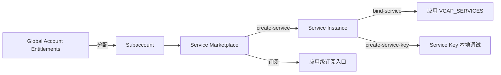

## 6. 功能是什么？

BTP 中「使用一项服务」有两种不同形态：

| 形态 | 说明 | 典型例子 | 管理位置 |
| --- | --- | --- | --- |
| **订阅（Subscription）** | 开通一个多租户应用，获得应用入口，通常一个 Subaccount 只订阅一次 | Integration Suite、SAP Build Work Zone | Instances and Subscriptions → Subscriptions |
| **实例（Instance）** | 按某个服务计划创建一个具体资源对象，可创建多个并绑定给应用 | XSUAA、Destination、HANA HDI | Instances and Subscriptions → Instances / `cf services` |

**Service Plan（服务计划）** 决定能力档位与计费方式，**Service Instance（服务实例）** 是计划的具体对象，**Binding（绑定）** 把实例凭据注入应用，**Service Key** 则是不绑定应用也能导出的凭据。

<Callout type="info" title="VCAP_SERVICES 是什么">
Cloud Foundry 会把所有已绑定服务的凭据以 JSON 形式放进应用的 `VCAP_SERVICES` 环境变量。应用运行时从这里读取 `clientid`、`url`、`clientsecret` 等，不需要把凭据写进代码。
</Callout>

## 7. 为什么需要这个功能？

应用需要数据库、认证、目标地址、日志等能力，但把这些凭据硬编码在代码里既不安全也无法跨环境迁移。服务实例 + 绑定的模型让「代码」与「环境配置」解耦：同一份代码部署到 Dev / Prod，只需绑定不同的服务实例。

## 8. 实际业务应用场景

- 为项目创建 XSUAA 实例实现登录。
- 创建 Destination 实例读取后端目标地址。
- 用 Service Key 在本地开发时连接云上 HANA 实例。
- 订阅 Integration Suite 后配置集成流程。
- 通过 `cf services` 盘点配额消费，做成本优化。

## 10. 操作前需要准备什么？

| 准备项 | 说明 |
| --- | --- |
| Entitlements | Global Account 已把目标服务计划分配到 Subaccount |
| Region 可用性 | 在 Discovery Center 确认该区域提供该服务 |
| Space 角色 | Space Developer 或同等权限 |
| 命名规范 | `<PROJECT>-<SERVICE>` 形式的实例名 |
| 应用 | 已有一个可绑定的应用（项目二即可） |

## 11. 详细操作步骤

1. 打开 Global Account → **Entitlements**，确认目标服务的可用数量与已分配量。
2. 若尚未分配，把该服务计划分配到目标 Subaccount，数量填 `<ASSIGNED_AMOUNT>`。
3. 打开 Subaccount → **Services → Service Marketplace**，找到目标服务并查看可用计划。
4. 用 CF CLI 执行 `cf marketplace` 交叉核对计划名。
5. 执行 `cf create-service <SERVICE> <PLAN> <INSTANCE>` 创建实例；XSUAA 等需要额外参数的实例用 `-c` 传入配置文件。
6. 执行 `cf service <INSTANCE>` 等待创建完成。
7. 执行 `cf bind-service <APP> <INSTANCE>` 绑定应用，再 `cf restage <APP>`。
8. 执行 `cf env <APP>` 核对 `VCAP_SERVICES` 中出现该服务凭据。
9. 若需本地调试，执行 `cf create-service-key <INSTANCE> <KEY_NAME>` 并导出凭据到本地环境变量。
10. 在 Cockpit 的 **Instances and Subscriptions** 中确认实例状态与订阅列表。

## 12. 每一步需要填写的参数

| 参数 | 占位符 | 说明 |
| --- | --- | --- |
| 服务名 | `<SERVICE>` | 与 `cf marketplace` 输出一致 |
| 计划名 | `<PLAN>` | 不同账号类型可用计划不同 |
| 实例名 | `<INSTANCE>` | 自定义，绑定时引用 |
| 应用名 | `<APP>` | `cf apps` 输出 |
| Service Key 名 | `<KEY_NAME>` | 例如 `local-dev-key` |
| 配置参数文件 | `<CONFIG_JSON_FILE>` | 例如 `xs-security.json` |
| 分配量 | `<ASSIGNED_AMOUNT>` | 不超过 Global Account 可用量 |

## 13. 配置截图或界面示意图



## 14. 完整配置文件

服务实例本身通常由 `mta.yaml` 的 resources 声明，部署时自动创建。下面是完整示例：

```yaml
_schema-version: '3.1'
ID: btp-service-demo
version: 1.0.0

modules:
  - name: btp-service-demo-api
    type: nodejs
    path: .
    parameters:
      memory: 512M
      disk-quota: 512M
    requires:
      - name: btp-service-demo-xsuaa
      - name: btp-service-demo-destination

resources:
  - name: btp-service-demo-xsuaa
    type: org.cloudfoundry.managed-service
    parameters:
      service: xsuaa
      service-plan: <PLAN>
      path: ./xs-security.json

  - name: btp-service-demo-destination
    type: org.cloudfoundry.managed-service
    parameters:
      service: destination
      service-plan: <PLAN>
```

## 15. 完整代码示例

下面脚本读取 `VCAP_SERVICES`，列出**已绑定服务的名称与凭据键名**（不输出任何凭据值）：

```javascript
'use strict';

const raw = process.env.VCAP_SERVICES;
if (!raw) {
  console.error('未找到 VCAP_SERVICES：请执行 cf bind-service 并 cf restage。');
  process.exit(1);
}

let services;
try {
  services = JSON.parse(raw);
} catch (error) {
  console.error('VCAP_SERVICES 不是合法 JSON：' + error.message);
  process.exit(1);
}

const labels = Object.keys(services);
if (labels.length === 0) {
  console.log('当前应用没有绑定任何服务实例。');
  process.exit(0);
}

for (const label of labels) {
  for (const instance of services[label]) {
    const keys = Object.keys(instance.credentials || {});
    console.log(`service label: ${label}`);
    console.log(`  instance name: ${instance.name || '(not provided)'}`);
    console.log(`  credential keys: ${keys.join(', ')}`);
  }
}
console.log('检查完成：以上仅输出键名，未输出任何凭据值。');
```

## 16. 命令行操作

```bash
# 1) 查看可用服务与计划
cf marketplace

# 2) 创建服务实例
cf create-service <SERVICE> <PLAN> <INSTANCE>

# 3) 创建需要额外参数的实例（例如 XSUAA）
cf create-service xsuaa <PLAN> <XSUAA_INSTANCE> -c xs-security.json

# 4) 查看创建进度与全部实例
cf service <INSTANCE>
cf services

# 5) 绑定与解绑
cf bind-service <APP> <INSTANCE>
cf restage <APP>
cf unbind-service <APP> <INSTANCE>

# 6) Service Key（本地调试）
cf create-service-key <INSTANCE> <KEY_NAME>
cf service-keys <INSTANCE>
cf service-key <INSTANCE> <KEY_NAME>
cf delete-service-key <INSTANCE> <KEY_NAME> -f

# 7) 检查应用环境变量
cf env <APP>

# 8) 删除实例（必须先解绑）
cf delete-service <INSTANCE> -f
```

参数解释：

- `cf create-service <SERVICE> <PLAN> <INSTANCE>`：三个位置参数顺序固定。
- `-c <FILE>`：把 JSON 文件作为服务实例配置参数传入，XSUAA 用它生成 OAuth Client。
- `cf bind-service`：建立应用与实例的凭据注入关系；**绑定后必须 restage**。
- `cf service-key`：输出含 `clientsecret` 等敏感值，注意保管。
- `cf delete-service -f`：跳过确认删除实例，删除前必须先 `cf unbind-service`。

## 17. 执行后的预期结果

`cf services` 结构示意：

```text
name             service       plan     bound apps     last operation
<INSTANCE>       <SERVICE>     <PLAN>   <APP>          create succeeded
```

`cf env <APP>` 的 `VCAP_SERVICES` 中出现对应服务条目。检查脚本输出：

```text
service label: xsuaa
  instance name: <INSTANCE>
  credential keys: clientid, clientsecret, url, xsappname, uaadomain, ...
检查完成：以上仅输出键名，未输出任何凭据值。
```

## 18. 如何验证是否成功

1. `cf marketplace` 中目标服务与计划可见（说明 Entitlement 已分配）。
2. `cf service <INSTANCE>` 显示创建成功。
3. `cf services` 的 bound apps 列包含目标应用。
4. `cf env <APP>` 中出现服务凭据。
5. 应用日志中出现「已读取服务配置」之类的启动信息，无凭据缺失错误。
6. Cockpit 的 Instances and Subscriptions 中状态一致。

## 19. 常见错误及解决方案

| 现象 | 原因 | 处理 |
| --- | --- | --- |
| Marketplace 找不到服务 | Entitlement 未分配 / 区域不提供 | Global Account → Entitlements 分配；Discovery Center 核对 |
| 报计划不存在 | 计划名写错或账号类型不支持 | `cf marketplace` 核对实际名称 |
| 服务实例创建长时间进行中 | 后端异步创建或配额不足 | `cf service` 查看状态，核对配额 |
| 应用读不到凭据 | 未绑定或未 restage | `cf bind-service` + `cf restage` |
| 删除实例失败 | 仍有应用绑定 | 先 `cf unbind-service` |
| 把订阅当实例用 | 概念混淆 | 订阅是应用入口，不是可绑定的服务实例 |

## 20. 安全注意事项

- `cf env` 与 `cf service-key` 输出含敏感凭据，禁止粘贴到工单、日志或仓库。
- Service Key 用完及时删除，定期轮换。
- 生产与测试使用不同服务实例，避免共享凭据。
- 通过 `mta.yaml` 管理实例创建，避免手工创建导致环境漂移。
- 定期用 `cf services` 盘点闲置实例，控制成本。

## 21. 本章总结

服务管理的主线是：**Entitlements 分配 → Marketplace 可见 → 创建实例 → 绑定应用 → VCAP_SERVICES 读取凭据**。订阅与实例是两种不同形态，Service Key 用于本地调试，Binding 用于运行时。记住绑定后 `cf restage`，删除前 `cf unbind-service`。

## 22. 实战练习

1. 创建一个 XSUAA 实例并绑定到项目二的应用，观察 `cf env` 的变化。
2. 用第 15 节脚本输出凭据键名（不输出值），确认符合预期。
3. 故意不分配某服务的 Entitlement，观察 `cf marketplace` 与创建实例的报错差异。
4. 继续 [常用 BTP 服务详解](/docs/service-xsuaa) 与 [项目三 XSUAA 实战](/docs/project-xsuaa-login)。
