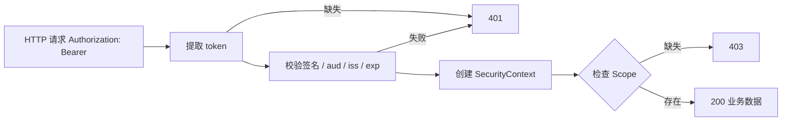

## 6. 功能是什么？

**JWT**（JSON Web Token）是由 `Header.Payload.Signature` 三段组成的字符串。BTP 中 App Router 完成登录后，会把 JWT 通过 `Authorization: Bearer <TOKEN>` 转发给后端。

后端必须校验四件事：

1. **签名（Signature）**：token 确实由可信的 XSUAA 签发且未被篡改。
2. **受众（aud）**：token 是签发给本应用的。
3. **签发方（iss）**：来自预期的身份域。
4. **过期时间（exp）**：token 仍然有效。

<Callout type="danger" title="最常见的严重错误">
把 token 用 base64 解码后直接读取 `scope` 或 `email` 字段就放行请求，等于允许任何人伪造身份。解码只可用于**调试**，绝不能替代签名校验。
</Callout>

## 7. 为什么需要这个功能？

App Router 已经在入口拦截了未登录请求，为什么后端还要校验？因为后端接口可能被其他路径直接访问，且企业内部通常要求**纵深防御**：每一层都独立验证，任一层失效不应导致越权。

## 8. 实际业务应用场景

- 后端 API 校验用户身份并按 Scope 返回不同数据。
- 记录审计日志时使用已校验的用户标识。
- 多应用共享一套 XSUAA 时按 `aud` 区分目标应用。
- 定时任务的 Client Credentials token 与用户登录 token 的区分。

## 10. 操作前需要准备什么？

| 准备项 | 说明 |
| --- | --- |
| XSUAA 实例 | 与签发 token 的实例是同一个 |
| Service Key | 本地调试用的 `clientid` / `clientsecret` / `url` / `xsappname` |
| Node.js 20+ | 与 `@sap/xssec` 版本兼容 |
| 测试 token | 通过 App Router 登录或 OAuth 获取，不落盘 |

## 11. 详细操作步骤

1. 用 `@sap/xsenv` 从 `VCAP_SERVICES` 读取 XSUAA 凭据（本地回落到环境变量）。
2. 从请求头提取 `Bearer` token，缺失直接返回 401。
3. 调用 `@sap/xssec` 创建安全上下文，完成签名与 claim 校验。
4. 从安全上下文读取用户标识与 Scope 列表。
5. 用 `requireScope` 中间件保护敏感接口，缺失 Scope 返回 403。
6. 把校验失败写入日志（只记录原因，不记录完整 token）。
7. 用 `four-cases-test.js` 验证 401 / 403 / 200 行为。

## 12. 每一步需要填写的参数

| 参数 | 占位符 | 说明 |
| --- | --- | --- |
| XSUAA 客户端 ID | `<CLIENTID_FROM_SERVICE_KEY>` | Service Key 导出 |
| XSUAA 客户端密钥 | `<CLIENTSECRET_FROM_SERVICE_KEY>` | 敏感，禁止入库 |
| XSUAA URL | `<URL_FROM_SERVICE_KEY>` | 用于获取验签公钥 |
| 应用标识 | `<XSAPPNAME_FROM_SERVICE_KEY>` | 拼接完整 Scope 名 |
| 完整 Scope 名 | `<XSAPPNAME>.Admin` | 后端校验目标 |
| 访问令牌 | `<ACCESS_TOKEN>` | 仅存于内存/环境变量 |

## 13. 配置截图或界面示意图



## 14. 完整配置文件

`.env.example`（本地调试模板，禁止填入真实值后提交）：

```ini
; 本地调试环境变量模板；真实值放入 .env.local 并加入 .gitignore
XSUAA_CLIENTID=<CLIENTID_FROM_SERVICE_KEY>
XSUAA_CLIENTSECRET=<CLIENTSECRET_FROM_SERVICE_KEY>
XSUAA_URL=<URL_FROM_SERVICE_KEY>
XSUAA_XSAPPNAME=<XSAPPNAME_FROM_SERVICE_KEY>
ADMIN_SCOPE=<XSAPPNAME>.Admin
DISPLAY_SCOPE=<XSAPPNAME>.Display
PORT=3001
```

`package.json`：

```json
{
  "name": "btp-token-validation",
  "version": "1.0.0",
  "private": true,
  "scripts": { "start": "node server.js" },
  "engines": { "node": ">=20" },
  "dependencies": {
    "express": "^4.21.0",
    "@sap/xsenv": "^4.0.0",
    "@sap/xssec": "^3.0.0"
  }
}
```

## 15. 完整代码示例

`server.js`（完整可运行，含 token 校验与 Scope 中间件）：

```javascript
'use strict';

const express = require('express');
const xsenv = require('@sap/xsenv');
const xssec = require('@sap/xssec');

const app = express();
const port = Number(process.env.PORT || 3001);

function loadCredentials() {
  try {
    return xsenv.getServices({ xsuaa: { label: 'xsuaa' } }).xsuaa;
  } catch (error) {
    return {
      clientid: process.env.XSUAA_CLIENTID,
      clientsecret: process.env.XSUAA_CLIENTSECRET,
      url: process.env.XSUAA_URL,
      xsappname: process.env.XSUAA_XSAPPNAME,
    };
  }
}

const credentials = loadCredentials();
const adminScope = process.env.ADMIN_SCOPE || `${credentials.xsappname}.Admin`;
const displayScope = process.env.DISPLAY_SCOPE || `${credentials.xsappname}.Display`;

if (!credentials.clientid || !credentials.url || !credentials.xsappname) {
  console.error('缺少 XSUAA 凭据，请检查服务绑定或 .env.local');
  process.exit(1);
}

/**
 * 校验 JWT 并把安全上下文挂到 req.securityContext。
 * 注意：@sap/xssec 各主版本 API 有差异，请以所装版本官方文档核对（待验证）。
 */
async function authenticate(req, res, next) {
  const match = /^Bearer\s+(.+)$/i.exec(req.headers.authorization || '');
  if (!match) {
    return res.status(401).json({ error: 'Unauthorized', message: '缺少 Bearer token' });
  }
  try {
    req.securityContext = await xssec.createSecurityContext(match[1], credentials);
    return next();
  } catch (error) {
    // 只记录错误类型，不记录完整 token
    console.warn('[auth] token 校验失败：', error.message);
    return res.status(401).json({ error: 'Unauthorized', message: 'Token 无效或已过期' });
  }
}

function scopesOf(context) {
  const info = context.getTokenInfo ? context.getTokenInfo() : {};
  const raw = info.getFieldValue
    ? info.getFieldValue('scope')
    : info.scope;
  return String(raw || '').split(' ').filter(Boolean);
}

function requireScope(scope) {
  return (req, res, next) => {
    const granted = scopesOf(req.securityContext);
    if (!granted.includes(scope)) {
      return res.status(403).json({ error: 'Forbidden', requiredScope: scope });
    }
    return next();
  };
}

app.get('/health', (req, res) => res.json({ status: 'UP' }));

app.get('/me', authenticate, (req, res) => {
  const scopes = scopesOf(req.securityContext);
  res.json({ scopes, isAdmin: scopes.includes(adminScope) });
});

app.get('/api/orders', authenticate, requireScope(displayScope), (req, res) => {
  res.json({ orders: [{ id: '001', amount: 100 }] });
});

app.get('/api/admin/summary', authenticate, requireScope(adminScope), (req, res) => {
  res.json({ message: '管理员数据' });
});

app.listen(port, () => {
  console.log(`[startup] token-validation listening on ${port}`);
});
```

**调试用**解码脚本（仅供本地查看 token 结构，禁止用于授权判断）：

```javascript
'use strict';

// 仅用于调试：解码 Payload 查看结构，不做任何安全判断
const token = process.env.DEBUG_TOKEN;
if (!token) {
  console.error('请设置 DEBUG_TOKEN（仅本地调试使用）');
  process.exit(1);
}

const parts = token.split('.');
if (parts.length !== 3) {
  console.error('不是合法的三段式 JWT');
  process.exit(1);
}

const payload = JSON.parse(Buffer.from(parts[1], 'base64url').toString('utf8'));
for (const key of ['sub', 'aud', 'iss', 'exp', 'scope']) {
  console.log(`${key}: ${JSON.stringify(payload[key])}`);
}
console.log('提醒：这里没有校验签名，绝不能据此授权。');
```

## 16. 命令行操作

```bash
# 1) 本地安装依赖
npm install

# 2) 导出 XSUAA Service Key（输出含敏感信息，注意保管）
cf create-service-key <XSUAA_INSTANCE> <KEY_NAME>
cf service-key <XSUAA_INSTANCE> <KEY_NAME>

# 3) 按 .env.example 设置环境变量后启动
PORT=3001 node server.js

# 4) 未携带 token（预期 401）
curl -i http://localhost:3001/me

# 5) 携带 token 做接口测试（预期 200 / 403）
curl -i -H "Authorization: Bearer <ACCESS_TOKEN>" http://localhost:3001/me
curl -i -H "Authorization: Bearer <ACCESS_TOKEN>" http://localhost:3001/api/admin/summary

# 6) 仅调试：查看 token Payload 结构
DEBUG_TOKEN=<ACCESS_TOKEN> node decode-token-debug.js

# 7) 云端排错
cf env <APP>
cf logs <APP> --recent
```

参数解释：`cf service-key` 输出用于本地校验的 XSUAA 凭据；`curl -H` 携带 Bearer token；`DEBUG_TOKEN` 只用于解码脚本，输出可能包含用户标识，请勿外传。

## 17. 执行后的预期结果

```text
[startup] token-validation listening on 3001
```

未带 token 请求 `/me` 返回 `401 {"error":"Unauthorized"}`；有效 Viewer token 请求 `/me` 返回 `200` 且 `isAdmin: false`；请求 `/api/admin/summary` 返回 `403` 与 `requiredScope`；Admin token 返回 `200`。

调试脚本输出类似：

```text
sub: "<USER_ID>"
aud: ["<XSAPPNAME>"]
iss: "<ISSUER_URL>"
exp: 1730000000
scope: ["<XSAPPNAME>.Display"]
提醒：这里没有校验签名，绝不能据此授权。
```

## 18. 如何验证是否成功

1. 401 / 403 / 200 三类响应符合预期。
2. 用一个过期或篡改过的 token 请求，必须返回 401。
3. 用另一 XSUAA 实例签发的 token 请求，必须返回 401（aud 不匹配）。
4. `cf env <APP>` 中 `xsappname` 与 `ADMIN_SCOPE` 的前缀一致。
5. 日志中没有任何完整 token 或 clientsecret。

## 19. 常见错误及解决方案

| 现象 | 原因 | 处理 |
| --- | --- | --- |
| `invalid signature` | token 与校验凭据来自不同 XSUAA 实例 | 用同一实例的 Service Key |
| `invalid audience` | `aud` 与 `xsappname` 不匹配 | 检查应用绑定与 Scope 前缀 |
| `token expired` | 超过 `exp` | 重新登录获取新 token |
| Scope 校验失败 | 用了 `$XSAPPNAME.Admin` 字面量 | 使用完整 Scope 名 |
| `createSecurityContext is not a function` | @sap/xssec 主版本 API 不同 | 按所装版本官方文档调整（待验证） |
| 401 但浏览器已登录 | App Router 未转发 token | 检查 destinations 的 `forwardAuthToken: true` |

## 20. 安全注意事项

- 只使用官方库校验签名、aud、iss、exp；不自行实现 JWT 验证。
- 日志只记录错误类型，不记录完整 token、clientsecret 或用户信息明文。
- 本地调试凭据与生产凭据分离，调试结束删除 Service Key。
- 对管理接口同时在 App Router 与后端做 Scope 校验。
- 定期升级安全依赖，关注官方安全公告。

## 21. 本章总结

Token 校验的核心是「**不要信任未验证的内容**」：用 `@sap/xssec` 完成签名与 claim 校验，再从安全上下文读取 Scope 做授权。401 表示校验失败，403 表示校验通过但权限不足。调试解码脚本只是观察工具，永远不是安全边界。

## 22. 实战练习

1. 把 token 的 Payload 改一个字符后重新签名（不合法签名），确认返回 401。
2. 用 Client Credentials 获取的 token 调用 `/me`，观察它与用户登录 token 的 Scope 差异。
3. 给 `/api/admin/summary` 增加第二层 Scope 校验，实现纵深防御。
4. 回到 [项目三完整实战](/docs/project-xsuaa-login) 与 [四场景测试](/docs/xsuaa-q16-four-cases)。
