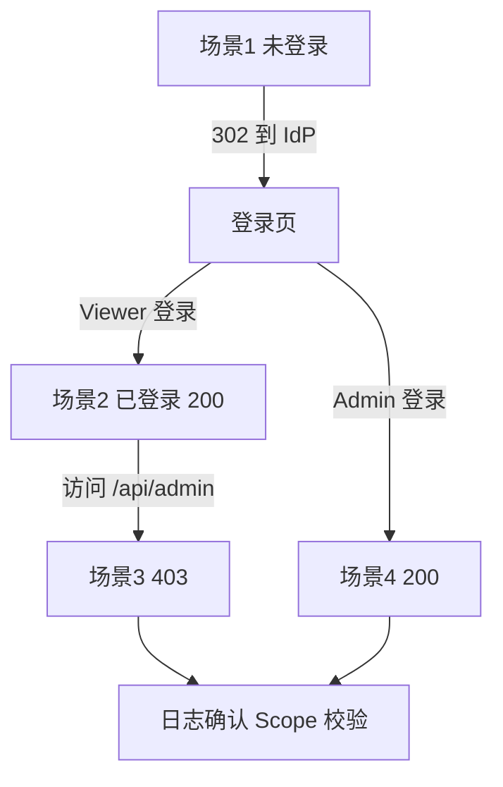

## 6. 功能是什么？

四种场景是 XSUAA 应用上线前的**最小验收集**：

| 场景 | 用户状态 | 目标 | 预期 |
| --- | --- | --- | --- |
| 1 未登录 | 无会话、无 token | 访问受保护页面 | 跳转身份提供方登录页（302）或直接 401 |
| 2 已登录 | 有 Viewer Role | 访问基础页面与 `/me` | 200，返回用户信息与 `Display` Scope |
| 3 无权限 | 有 Viewer，无 Admin | 访问 `/api/admin` | 403 Forbidden |
| 4 有权限 | 有 Administrator | 访问 `/api/admin` | 200，返回管理员数据 |

<Callout type="info" title="401 与 403 的区别">
**401 Unauthorized** = 不知道你是谁（未认证）；**403 Forbidden** = 知道你是谁，但你不能做这件事（未授权）。这个区分决定了排查方向：401 查登录链路，403 查 Scope 与 Role Collection。
</Callout>

## 7. 为什么需要这个功能？

只测「能登录」远远不够。真实事故往往是：前端隐藏了管理员按钮，但后端接口没有校验 Scope，导致普通用户直接请求管理员 API 拿到数据。四种场景覆盖了认证与授权两条链路的正反两面，是最小但有效的安全回归测试。

## 8. 实际业务应用场景

- 上线前的安全验收清单。
- 每次修改 `xs-security.json` 后的回归测试。
- CI/CD 中自动化的接口权限冒烟测试。
- 权限工单处理后的验证步骤。

## 10. 操作前需要准备什么？

| 准备项 | 示例 / 占位符 |
| --- | --- |
| 应用域名 | `<APP_HOST>`，来自 `cf routes` |
| 测试用户 A | `<VIEWER_EMAIL>`，只分配 `BTP-Learning-Viewer` |
| 测试用户 B | `<ADMIN_EMAIL>`，分配 `BTP-Learning-Administrator` |
| 浏览器 | 两个独立无痕窗口，避免会话互相覆盖 |
| 接口工具 | curl / Postman / 浏览器开发者工具 |
| 日志通道 | `cf logs <APP> --recent` |

## 11. 详细操作步骤

### 场景 1：未登录

1. 打开一个全新的无痕窗口，确保没有该应用会话。
2. 访问 `https://<APP_HOST>/`。
3. 观察网络请求：应出现到身份提供方登录页的 302 跳转，最终停在登录页。
4. 用 curl 直接请求接口（不携带 Authorization 头），确认返回 401。

### 场景 2：已登录（Viewer）

5. 用 `<VIEWER_EMAIL>` 完成登录，回到应用首页。
6. 检查页面是否显示当前用户标识与基础菜单。
7. 访问 `/me`，记录返回的 scopes 列表，应包含 `Display`，不包含 `Admin`。
8. 访问 `/api/orders`，确认返回 200。

### 场景 3：无权限

9. 保持 Viewer 会话，访问 `/api/admin/summary`。
10. 确认返回 403，响应体包含 `requiredScope: <XSAPPNAME>.Admin`。
11. 查看 `cf logs <APP> --recent`，确认 403 来自后端 Scope 校验而非 token 校验失败。

### 场景 4：有权限

12. 访问 `/do/logout` 退出登录。
13. 用 `<ADMIN_EMAIL>` 重新登录。
14. 访问 `/me`，确认 scopes 同时包含 `Display` 与 `Admin`。
15. 访问 `/api/admin/summary`，确认返回 200 与管理员数据。
16. 再次访问 `/do/logout`，确认会话失效。

## 12. 每一步需要填写的参数

| 参数 | 占位符 | 说明 |
| --- | --- | --- |
| 应用域名 | `<APP_HOST>` | `cf routes` 输出 |
| 应用名 | `<APP>` | `cf apps` 输出 |
| Viewer 用户 | `<VIEWER_EMAIL>` | 只含 Display Scope |
| Admin 用户 | `<ADMIN_EMAIL>` | 含 Admin Scope |
| 完整 Scope 名 | `<XSAPPNAME>.Admin` | `xsappname` + `.Admin` |
| 访问令牌 | `<ACCESS_TOKEN>` | 仅用于接口级测试，禁止外泄 |

## 13. 配置截图或界面示意图



## 14. 完整配置文件

测试不需要新增配置文件，但需要一份测试用例清单 `security-test-cases.md`：

```markdown
# XSUAA 四场景验收清单

| 编号 | 前置状态 | 请求 | 预期状态 | 预期内容 |
| --- | --- | --- | --- | --- |
| TC-01 | 无会话 | GET / | 302 → 登录页 | 不返回任何业务数据 |
| TC-02 | 无 token | GET /me（直接请求后端） | 401 | {"error":"Unauthorized"} |
| TC-03 | Viewer 登录 | GET /me | 200 | scopes 含 Display，不含 Admin |
| TC-04 | Viewer 登录 | GET /api/orders | 200 | 订单列表 |
| TC-05 | Viewer 登录 | GET /api/admin/summary | 403 | requiredScope = <XSAPPNAME>.Admin |
| TC-06 | Admin 登录 | GET /me | 200 | scopes 含 Display 与 Admin |
| TC-07 | Admin 登录 | GET /api/admin/summary | 200 | 管理员数据 |
| TC-08 | 任意已登录 | GET /do/logout | 302 / 200 | 会话失效，再次访问要求登录 |
```

## 15. 完整代码示例

下面的 `four-cases-test.js` 用于对**接口层**做自动化冒烟测试（不处理浏览器登录，token 由调用方以环境变量提供）：

```javascript
'use strict';

const baseUrl = process.env.APP_BASE_URL;
const viewerToken = process.env.VIEWER_TOKEN;
const adminToken = process.env.ADMIN_TOKEN;

if (!baseUrl) {
  console.error('缺少 APP_BASE_URL，例如 https://<APP_HOST>');
  process.exit(1);
}

async function request(path, token) {
  const headers = token ? { Authorization: `Bearer ${token}` } : {};
  const response = await fetch(`${baseUrl}${path}`, { headers });
  let body = '';
  try { body = await response.text(); } catch (error) { body = ''; }
  return { status: response.status, body };
}

const cases = [
  { name: 'TC-02 未携带 token 访问 /me', path: '/me', token: null, expected: 401 },
  { name: 'TC-03 Viewer 访问 /me', path: '/me', token: viewerToken, expected: 200 },
  { name: 'TC-05 Viewer 访问管理员接口', path: '/api/admin/summary', token: viewerToken, expected: 403 },
  { name: 'TC-07 Admin 访问管理员接口', path: '/api/admin/summary', token: adminToken, expected: 200 },
];

(async () => {
  let failed = 0;
  for (const testCase of cases) {
    if (testCase.token === undefined) {
      console.log(`SKIP ${testCase.name}：未提供 token`);
      continue;
    }
    const result = await request(testCase.path, testCase.token);
    const ok = result.status === testCase.expected;
    console.log(`${ok ? 'PASS' : 'FAIL'} ${testCase.name} → ${result.status} (期望 ${testCase.expected})`);
    if (!ok) {
      console.log('  响应片段：' + result.body.slice(0, 160));
      failed += 1;
    }
  }
  if (failed) {
    console.error(`${failed} 个用例失败，请按教程第 19 节排查。`);
    process.exit(1);
  }
  console.log('四场景接口测试全部通过。');
})();
```

<Callout type="danger" title="Token 属于敏感凭据">
`VIEWER_TOKEN` / `ADMIN_TOKEN` 只放在本地环境变量中，绝不写入仓库、日志或截图。测试完及时让 token 过期或退出登录。
</Callout>

## 16. 命令行操作

```bash
# 1) 获取应用访问域名
cf apps
cf routes

# 2) 场景 1：不携带 token 直接请求（预期 401）
curl -i https://<APP_HOST>/me
# Windows PowerShell：Invoke-WebRequest -Uri https://<APP_HOST>/me

# 3) 场景 2/3/4：携带浏览器登录后取得的 token 做接口级测试
curl -i -H "Authorization: Bearer <ACCESS_TOKEN>" https://<APP_HOST>/me
curl -i -H "Authorization: Bearer <ACCESS_TOKEN>" https://<APP_HOST>/api/admin/summary

# 4) 运行自动化冒烟测试
export APP_BASE_URL="https://<APP_HOST>"
export VIEWER_TOKEN="<VIEWER_ACCESS_TOKEN>"
export ADMIN_TOKEN="<ADMIN_ACCESS_TOKEN>"
node four-cases-test.js

# 5) 查看后端日志确认 401 / 403 来源
cf logs <APP> --recent

# 6) 权限变更后强制刷新会话（浏览器端）
#    访问 https://<APP_HOST>/do/logout 后重新登录
```

参数解释：`-i` 让 curl 输出响应头与状态码；`-H "Authorization: Bearer ..."` 携带 JWT；`cf logs --recent` 用于确认拒绝发生在 token 校验阶段还是 Scope 校验阶段。

## 17. 执行后的预期结果

| 场景 | 预期状态 | 预期响应片段 |
| --- | --- | --- |
| 1 未登录访问页面 | 302 → 登录页 | 无业务数据 |
| 1 未带 token 请求接口 | 401 | `{"error":"Unauthorized","message":"请先登录"}` |
| 2 Viewer `/me` | 200 | `scopes` 含 `Display`，`isAdmin: false` |
| 3 Viewer `/api/admin/summary` | 403 | `{"error":"Forbidden","requiredScope":"<XSAPPNAME>.Admin"}` |
| 4 Admin `/api/admin/summary` | 200 | `{"message":"管理员数据"}` |

自动化脚本输出：

```text
PASS TC-02 未携带 token 访问 /me → 401 (期望 401)
PASS TC-03 Viewer 访问 /me → 200 (期望 200)
PASS TC-05 Viewer 访问管理员接口 → 403 (期望 403)
PASS TC-07 Admin 访问管理员接口 → 200 (期望 200)
四场景接口测试全部通过。
```

## 18. 如何验证是否成功

1. 八个用例（TC-01 至 TC-08）全部符合预期。
2. 浏览器开发者工具的 Network 面板能看到 302 登录跳转。
3. `cf logs --recent` 中 403 对应 Scope 校验日志，而不是 token 校验异常。
4. Logout 后再次访问应用会重新要求登录。
5. 任何接口都不曾在未授权情况下返回管理员数据。

## 19. 常见错误及解决方案

| 现象 | 可能层级 | 处理 |
| --- | --- | --- |
| 未登录直接看到页面 | App Router 路由 `authenticationType` 为 none | 检查 xs-app.json 路由顺序与认证类型 |
| 未登录返回 200 | 后端把无 token 请求放行 | 后端强制校验 `Authorization` 头 |
| Viewer 也返回 200 | 后端没校验 Admin Scope | 加 `requireScope` 中间件 |
| Admin 仍返回 403 | Role Collection 未分配 / Scope 全名错误 / token 未刷新 | 按授权链路逐层核对并重新登录 |
| 全部 401 | JWT 校验失败或 forwardAuthToken 未开启 | 检查 App Router destinations 与 XSUAA 绑定 |
| 浏览器结果不一致 | 会话缓存 | 用无痕窗口或先 Logout |

## 20. 安全注意事项

- 测试 token 不落盘、不入日志；自动化测试使用临时凭据并在结束后失效。
- 不要把管理员 token 粘贴到工单、聊天或截图。
- 测试账号使用独立用户，不要复用生产管理员。
- 401/403 响应不要泄露内部 Scope 全名之外的敏感信息（例如用户属性、数据库结构）。
- 上线前把四场景纳入回归测试，每次权限配置变更都重跑。

## 21. 本章总结

四场景测试的本质是分别验证「认证是否存在」与「授权是否生效」。记住：**302/401 看登录链路，403 看 Role Collection 与 Scope**。浏览器测试验证用户体验，接口测试验证服务端不可绕过，两者都要做。

## 22. 实战练习

1. 把 `four-cases-test.js` 接入你的 CI 流水线，权限变更时自动运行。
2. 故意删除后端的 `requireScope` 中间件，观察场景 3 是否变成 200，理解「前端隐藏 ≠ 后端授权」。
3. 给 Viewer 临时加上 Administrator Role Collection，记录 403 变为 200 的时点，再回收。
4. 回到 [项目三完整实战](/docs/project-xsuaa-login) 复习部署与配置细节。
