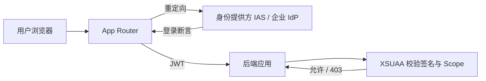
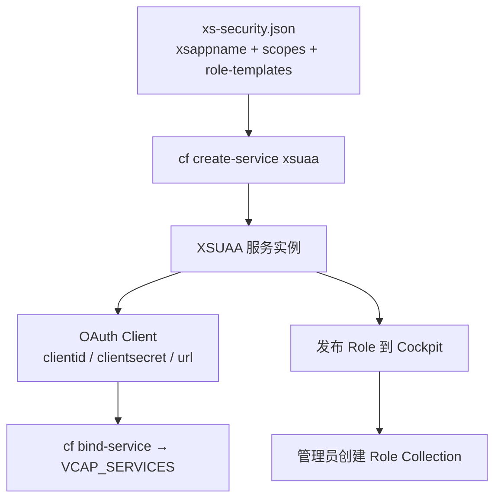

## 6. 功能是什么？

**XSUAA** 是 **Authorization and Trust Management Service** 在 Cloud Foundry 环境中的服务实例（服务键通常显示为 `xsuaa`）。它由 `xs-security.json` 描述，创建实例时会生成一个 **OAuth 2.0 客户端**，并为应用提供三件事：

1. **认证接入**：与 Subaccount 信任的身份提供方配合，让用户能登录应用。
2. **令牌签发与校验**：签发 **JWT**（JSON Web Token），后端可校验签名、受众与过期时间。
3. **授权模型**：把应用定义的 **Scope**（最小权限点）发布为 Role，供管理员通过 **Role Collection** 分配给用户。

<Callout type="info" title="术语解释">
- **认证（Authentication，AuthN）**：确认「你是谁」。
- **授权（Authorization，AuthZ）**：确认「你能做什么」。
- **JWT**：由 Header / Payload / Signature 三段组成的令牌，应用必须校验签名而不是只看 Payload。
- **Scope**：应用内自定义的权限点，例如 `Display`、`Admin`。
</Callout>

### XSUAA 与 IAS 不是一回事

| 对比项 | IAS（Identity Authentication） | XSUAA |
| --- | --- | --- |
| 所属 | SAP Cloud Identity Services（身份提供方） | Cloud Foundry 应用侧服务实例 |
| 主要职责 | 用户登录、单点登录、企业 IdP 集成、用户属性 | 生成 OAuth Client、签发/校验 JWT、管理 Scope 与 Role |
| 配置位置 | Subaccount → Security → Trust Configuration / IAS 租户管理 | `xs-security.json`、服务实例、Cockpit → Security → Roles |
| 是否要写代码 | 通常不需要 | 需要写 `xs-security.json` 与后端权限校验代码 |

<Callout type="warning" title="最常见的概念错误">
「用 IAS 替换 XSUAA」或「把 IAS 的组映射直接当成应用的 Scope」都是错误的。登录链路上两者前后衔接：IdP/IAS 负责证明身份，XSUAA 负责把身份转成应用可校验的令牌与权限。
</Callout>

## 7. 为什么需要这个功能？

如果应用不接 XSUAA：

- 没有可信的用户身份，只能靠自己写用户名密码（安全与合规不可接受）。
- 无法按角色区分功能，管理员页面只能靠前端隐藏（可被绕过）。
- 无法把用户上下文安全传递给 CAP 后端或内网 SAP 系统。
- 无法接入企业单点登录，员工需要维护第二套账号。

接入后的链路：



## 8. 实际业务应用场景

- 企业内部应用要求员工用企业账号单点登录。
- 按「查看者 / 管理员」区分菜单与接口。
- CAP 服务用 `@requires` / `@restrict` 声明权限。
- 通过 Principal Propagation 把云上用户身份传到内网 S/4HANA。
- 多应用共享一套 Role Collection，实现统一授权管理。

## 10. 操作前需要准备什么？

| 准备项 | 说明 |
| --- | --- |
| Cloud Foundry Space | 已创建且具备 Space Developer 角色 |
| Entitlement | Global Account 已把 `xsuaa` 服务计划分配到该 Subaccount |
| `xs-security.json` | 定义 `xsappname` 与 Scope，见第 14 节 |
| 唯一命名 | `xsappname` 在同一租户中必须唯一，建议包含项目与环境 |
| 本地工具 | CF CLI v8 |

计划名称（例如 `application`、`broker`）请以 `cf marketplace` 与 Service Marketplace 的实际输出为准，不要照抄本文示例。

## 11. 详细操作步骤

### 方法一：用 CF CLI 创建（推荐，可复现）

1. 在项目根目录编写第 14 节的 `xs-security.json`。
2. 执行 `cf target` 确认目标 Org / Space。
3. 执行 `cf marketplace` 确认 `xsuaa` 服务与可用计划。
4. 执行 `cf create-service xsuaa <PLAN> <XSUAA_INSTANCE> -c xs-security.json`。
5. 执行 `cf service <XSUAA_INSTANCE>` 等待创建完成。
6. 执行 `cf bind-service <APP> <XSUAA_INSTANCE>` 并 `cf restage <APP>`。
7. 执行 `cf env <APP>` 确认 `VCAP_SERVICES` 中出现 `xsuaa` 凭据。

### 方法二：用 Cockpit 创建

8. 打开 Subaccount → **Services → Service Marketplace**。
9. 找到 **Authorization and Trust Management Service**，选择创建实例入口。
10. 按向导选择服务计划、填写实例名，并在要求提供安全描述的位置上传或粘贴 `xs-security.json` 内容。
11. 完成创建后，在 **Instances and Subscriptions** 中确认实例状态。
12. 在应用绑定配置中把该实例绑定到目标应用，或在 CLI 中执行 `cf bind-service`。

### 导出 Service Key（本地开发用）

13. 执行 `cf create-service-key <XSUAA_INSTANCE> <KEY_NAME>`。
14. 执行 `cf service-key <XSUAA_INSTANCE> <KEY_NAME>` 查看 `clientid`、`clientsecret`、`url`、`xsappname`。
15. 把这些值放到本地环境变量或本地凭据文件中，**不要提交到 Git**。

## 12. 每一步需要填写的参数

| 参数 | 占位符 / 示例 | 说明 |
| --- | --- | --- |
| 应用标识 | `btp-learning-<SUBDOMAIN>` | `xsappname`，全局唯一，Scope 前缀来源 |
| 租户模式 | `dedicated` | 单租户学习应用常用；多租户方案需另行设计 |
| 服务计划 | `<PLAN>` | 以 `cf marketplace` 输出为准 |
| 实例名 | `<XSUAA_INSTANCE>` | 建议 `btp-learning-xsuaa` |
| Service Key 名 | `<KEY_NAME>` | 建议 `local-dev-key` |
| 回调地址 | `https://<APP_HOST>/login/callback` | 必须与实际访问域名一致 |

## 13. 配置截图或界面示意图



## 14. 完整配置文件

`xs-security.json`（最小可运行版本，后续教程会扩展 Attribute 与 OAuth 配置）：

```json
{
  "xsappname": "btp-learning-<SUBDOMAIN>",
  "tenant-mode": "dedicated",
  "description": "SAP BTP 中文学习中心 XSUAA 示例应用",
  "scopes": [
    {
      "name": "$XSAPPNAME.Display",
      "description": "查看业务数据"
    },
    {
      "name": "$XSAPPNAME.Admin",
      "description": "访问管理员功能"
    }
  ],
  "role-templates": [
    {
      "name": "Viewer",
      "description": "业务查看者",
      "scope-references": ["$XSAPPNAME.Display"]
    },
    {
      "name": "Administrator",
      "description": "管理员",
      "scope-references": ["$XSAPPNAME.Display", "$XSAPPNAME.Admin"]
    }
  ]
}
```

字段说明：

- `xsappname`：应用唯一标识；`$XSAPPNAME` 在运行时会被替换为它的值，形成完整 Scope 名。
- `tenant-mode`：`dedicated` 表示单租户应用；多租户（`shared`）需要额外的订阅与租户 onboarding 设计，本教程不涉及。
- `scopes`：权限点数组，代码中通过它们判断能否执行操作。
- `role-templates`：把一个或多个 Scope 组合成可在 Cockpit 中分配的角色模板。

## 15. 完整代码示例

下面代码从 `VCAP_SERVICES` 读取 XSUAA 凭据并打印「非敏感」的元信息，用来确认绑定是否成功。保存为 `check-xsuaa.js`：

```javascript
'use strict';

// 在 Cloud Foundry 中运行时，绑定服务的凭据由 VCAP_SERVICES 注入。
const raw = process.env.VCAP_SERVICES;
if (!raw) {
  console.error('未找到 VCAP_SERVICES：请确认应用已绑定 XSUAA 并执行过 cf restage。');
  process.exit(1);
}

let services;
try {
  services = JSON.parse(raw);
} catch (error) {
  console.error('VCAP_SERVICES 不是合法 JSON：', error.message);
  process.exit(1);
}

const list = services.xsuaa || [];
if (list.length === 0) {
  console.error('VCAP_SERVICES 中没有 xsuaa 实例，请执行 cf bind-service。');
  process.exit(1);
}

const credentials = list[0].credentials || {};
const keys = ['xsappname', 'clientid', 'url', 'uaadomain', 'identityzone'];
for (const key of keys) {
  // 只输出是否存在与公开字段，不输出 clientsecret 的完整值
  console.log(`${key}: ${credentials[key] ? 'SET' : 'NOT SET'}`);
}
console.log(`clientsecret: ${credentials.clientsecret ? 'SET (value hidden)' : 'NOT SET'}`);
console.log('XSUAA 绑定检查通过。');
```

<Callout type="danger" title="不要打印凭据">
生产代码与日志中绝不能输出 `clientsecret`、完整 JWT 或 Service Key。上面的脚本特意只输出 `SET / NOT SET`。
</Callout>

## 16. 命令行操作

```bash
# 1) 确认目标环境
cf target

# 2) 查看 xsuaa 服务与计划（计划名以实际输出为准）
cf marketplace

# 3) 以 xs-security.json 创建 XSUAA 实例
cf create-service xsuaa <PLAN> <XSUAA_INSTANCE> -c xs-security.json

# 4) 等待实例创建完成
cf service <XSUAA_INSTANCE>

# 5) 绑定应用并让凭据注入 VCAP_SERVICES
cf bind-service <APP> <XSUAA_INSTANCE>
cf restage <APP>

# 6) 检查环境变量（输出含敏感信息，注意保管）
cf env <APP>

# 7) 本地开发用 Service Key
cf create-service-key <XSUAA_INSTANCE> <KEY_NAME>
cf service-keys <XSUAA_INSTANCE>
cf service-key <XSUAA_INSTANCE> <KEY_NAME>

# 8) 修改 xs-security.json 后更新实例
cf update-service <XSUAA_INSTANCE> -c xs-security.json
cf restage <APP>
```

参数解释：

- `-c xs-security.json`：`-c` 表示传入服务实例的任意配置参数（这里是 JSON 文件路径），XSUAA 会据此生成 OAuth Client 与 Role。
- `cf bind-service <APP> <INSTANCE>`：两参数依次是应用名与实例名，绑定后凭据进入 `VCAP_SERVICES`。
- `cf restage`：重新 staging，让应用重新读取更新后的环境变量。
- `cf create-service-key`：生成不依赖应用绑定的凭据，供本地调试；输出中的 `clientsecret` 属于敏感信息。
- `cf update-service -c`：把修改后的安全描述应用到已有实例，新增 Scope 后必须执行。

## 17. 执行后的预期结果

`cf service <XSUAA_INSTANCE>` 显示创建成功；`cf env <APP>` 的 `VCAP_SERVICES` 中出现 `xsuaa` 条目，含 `clientid`、`clientsecret`、`xsappname`、`url`、`uaadomain` 等字段。

`check-xsuaa.js` 输出：

```text
xsappname: SET
clientid: SET
url: SET
uaadomain: SET
identityzone: SET
clientsecret: SET (value hidden)
XSUAA 绑定检查通过。
```

在 Cockpit 的 **Security → Roles** 中，应能看到由 `role-templates` 生成的 `Viewer` 与 `Administrator` 角色。

## 18. 如何验证是否成功

1. `cf service <XSUAA_INSTANCE>` 状态为创建成功。
2. `cf services` 的 bound apps 列包含目标应用。
3. `cf env <APP>` 中存在 `xsuaa` 凭据，且 `xsappname` 与 `xs-security.json` 一致。
4. `node check-xsuaa.js` 输出「XSUAA 绑定检查通过」。
5. Cockpit → Security → Roles 中出现应用发布的 Role。
6. 若 Role 未出现，执行 `cf update-service -c xs-security.json` 并 `cf restage` 后刷新。

## 19. 常见错误及解决方案

| 现象 | 原因 | 处理 |
| --- | --- | --- |
| `xsappname` 冲突 | 同一租户已有同名应用标识 | 改成含项目与环境后缀的唯一值 |
| 创建实例报计划不可用 | Entitlement 未分配或计划名错误 | `cf marketplace` 核对，回 Global Account 分配 |
| Role 列表看不到新角色 | 未更新实例 / 缓存 | `cf update-service -c xs-security.json` 并重新部署 |
| `VCAP_SERVICES` 无 xsuaa | 未绑定或未 restage | `cf bind-service` + `cf restage` |
| 把 IAS 配置写进 XSUAA | 概念混淆 | IdP 信任在 Trust Configuration，Scope 在 xs-security.json |
| 401 与 403 分不清 | 认证与授权混淆 | 401 查登录/绑定；403 查 Scope 与 Role Collection |

## 20. 安全注意事项

- `clientsecret` 与 Service Key 绝不写入代码仓库、前端文件或日志；使用密钥管理或流水线凭据库。
- 生产与测试使用不同 XSUAA 实例与不同 `xsappname`，避免 token 跨环境被接受。
- 校验 JWT 必须使用官方库（如 `@sap/xssec`），不要自行 base64 解码后信任内容。
- Scope 按最小权限设计，管理员 Scope 只授予极少数账号。
- 定期轮换 Service Key，删除不再使用的凭据。

## 21. 本章总结

XSUAA 把「身份」转换为「应用可校验的令牌与权限」：`xs-security.json` 定义 Scope 与 Role Template → 创建实例生成 OAuth Client → 绑定应用取得凭据 → 管理员用 Role Collection 分配权限。牢记 **IAS 管身份、XSUAA 管授权**，以及 **401 是没登录、403 是没权限**。

## 22. 实战练习

1. 用 `cf create-service` 创建一个 XSUAA 实例，并在 Cockpit 中找到它生成的两个 Role。
2. 修改 `xs-security.json` 增加一个 `Export` Scope，执行 `cf update-service` 后观察 Role 列表变化。
3. 用 `check-xsuaa.js` 验证绑定，故意解绑后观察报错信息。
4. 继续阅读 [xs-security.json 完整配置](/docs/xsuaa-xs-security-json) 与 [项目三：带登录功能的应用](/docs/project-xsuaa-login)。
