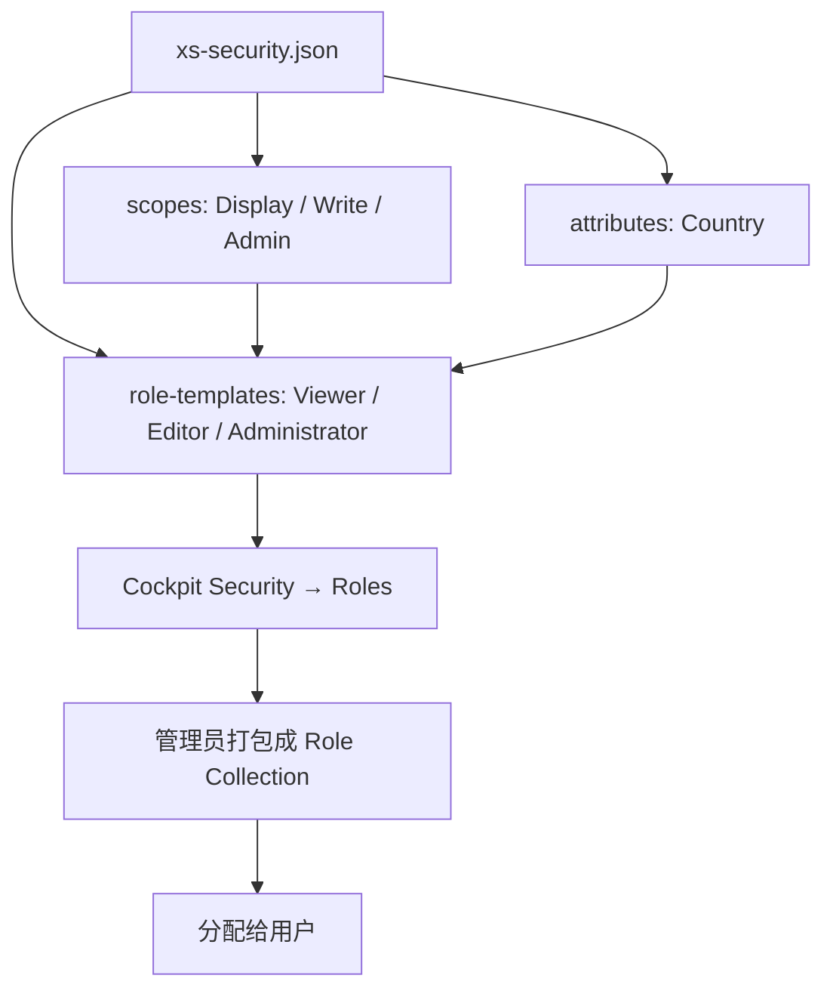

## 6. 功能是什么？

**`xs-security.json`** 是 XSUAA 服务实例的**应用安全描述文件**（Application Security Descriptor）。它不是运行时代码，而是「声明」：声明应用叫什么、有哪些权限点、有哪些角色模板、支持哪些登录回调地址。

创建或更新 XSUAA 实例时，平台读取这个文件并：

1. 生成一个 **OAuth Client**（`clientid` / `clientsecret` / `url`）。
2. 把 `scopes` 发布为可被引用的权限点。
3. 把 `role-templates` 发布为 Cockpit 中可见的 **Role**。
4. 配置允许的 `redirect-uris`（登录回调地址）。

<Callout type="info" title="文件放哪里">
通常放在项目根目录或 MTA 模块目录，`cf create-service xsuaa <PLAN> <INSTANCE> -c xs-security.json` 与 `mta.yaml` 中 `path: ./xs-security.json` 都会引用它。
</Callout>

## 7. 为什么需要这个功能？

权限必须「声明」而不是散落在代码里。把权限集中到一个文件后：

- 管理员能在 Cockpit 中看到明确的 Role 名称并分配给用户。
- 代码只检查 Scope，不关心谁被分配了什么角色。
- 权限变更可随版本一起评审、审计、回滚。
- CAP、App Router、Node.js、Java 应用能共享同一套权限定义。

## 8. 实际业务应用场景

- 一个订单应用定义 `Display`（查看）、`Write`（编辑）、`Admin`（管理）三个 Scope。
- 按地区做数据权限：用 `attribute-references` 引入 `Country` 属性。
- 区分「业务查看者 / 业务编辑者 / 系统管理员」三种角色模板。
- 为本地开发与生产部署配置不同的登录回调地址。

## 10. 操作前需要准备什么？

| 准备项 | 说明 |
| --- | --- |
| 唯一 `xsappname` | 建议 `<PROJECT>-<SUBDOMAIN>-<ENV>` |
| 实际访问域名 | 用于 `redirect-uris` 的 `<APP_HOST>` |
| Scope 清单 | 先列出功能，再归并成权限点 |
| 角色矩阵 | 明确每个角色包含哪些 Scope |
| CF CLI | 用于 create-service / update-service |

## 11. 详细操作步骤

1. 列出应用所有需要保护的接口，例如 `/api/orders`（查看）、`/api/orders`（写入）、`/admin`（管理）。
2. 归并成 Scope：`Display`、`Write`、`Admin`。
3. 设计 Role Template：`Viewer`（Display）、`Editor`（Display + Write）、`Administrator`（三者全含）。
4. 编写第 14 节的完整 `xs-security.json`。
5. 用 `node -e "..."` 或 JSON 校验工具确认语法合法。
6. 执行 `cf create-service xsuaa <PLAN> <INSTANCE> -c xs-security.json` 创建实例。
7. 在 Cockpit → Security → Roles 中确认三个 Role 已发布。
8. 修改文件（例如新增 `Export` Scope）后执行 `cf update-service <INSTANCE> -c xs-security.json`。
9. 执行 `cf restage <APP>` 并刷新 Roles 页面确认变更。

## 12. 每一步需要填写的参数

| 字段 | 示例 / 占位符 | 说明 |
| --- | --- | --- |
| `xsappname` | `btp-learning-<SUBDOMAIN>` | 租户内唯一，不能用中文或空格 |
| `tenant-mode` | `dedicated` | 单租户；多租户需额外设计 |
| `scopes[].name` | `$XSAPPNAME.Display` | `$XSAPPNAME` 会被替换为 xsappname |
| `scopes[].description` | `查看业务数据` | 给管理员看的中文说明 |
| `attributes[].name` | `Country` | 来自 IdP 的用户属性名 |
| `role-templates[].scope-references` | `["$XSAPPNAME.Display"]` | 该角色包含的 Scope |
| `oauth2-configuration.redirect-uris` | `https://<APP_HOST>/login/callback` | 必须与实际访问域名一致 |

## 13. 配置截图或界面示意图



## 14. 完整配置文件

```json
{
  "xsappname": "btp-learning-<SUBDOMAIN>",
  "tenant-mode": "dedicated",
  "description": "SAP BTP 中文学习中心 - 订单示例应用安全描述",
  "scopes": [
    {
      "name": "$XSAPPNAME.Display",
      "description": "查看订单数据"
    },
    {
      "name": "$XSAPPNAME.Write",
      "description": "创建与修改订单"
    },
    {
      "name": "$XSAPPNAME.Admin",
      "description": "访问管理员功能"
    }
  ],
  "attributes": [
    {
      "name": "Country",
      "description": "用户所属国家或地区",
      "valueType": "string",
      "valueRequired": false
    }
  ],
  "role-templates": [
    {
      "name": "Viewer",
      "description": "业务查看者：只能读取数据",
      "scope-references": ["$XSAPPNAME.Display"],
      "attribute-references": ["Country"]
    },
    {
      "name": "Editor",
      "description": "业务编辑者：可读写订单",
      "scope-references": ["$XSAPPNAME.Display", "$XSAPPNAME.Write"],
      "attribute-references": ["Country"]
    },
    {
      "name": "Administrator",
      "description": "管理员：包含全部权限",
      "scope-references": ["$XSAPPNAME.Display", "$XSAPPNAME.Write", "$XSAPPNAME.Admin"]
    }
  ],
  "oauth2-configuration": {
    "redirect-uris": [
      "https://<APP_HOST>/login/callback",
      "http://localhost:5000/login/callback"
    ]
  }
}
```

### 逐字段解释

| 字段 | 类型 | 作用 | 常见错误 |
| --- | --- | --- | --- |
| `xsappname` | string | 应用唯一标识，也是所有 Scope 的前缀 | 与其他应用重名导致创建失败 |
| `tenant-mode` | string | 租户模式；`dedicated` 用于单租户 | 误用 `shared` 却没实现租户订阅 |
| `description` | string | 人类可读说明 | 无 |
| `scopes` | array | 定义最小权限点 | Scope 名漏写 `$XSAPPNAME.` 前缀 |
| `attributes` | array | 声明可映射到 IdP 用户属性的数据 | 属性名与 IdP 断言不一致 |
| `role-templates` | array | 把 Scope 与 Attribute 组合成角色模板 | `scope-references` 引用了未定义的 Scope |
| `oauth2-configuration.redirect-uris` | array | 登录回调白名单 | 域名与实际访问地址不一致导致回调被拒 |

<Callout type="warning" title="关于 $XSAPPNAME">
`$XSAPPNAME` 是占位符，运行时会替换为你定义的 `xsappname`。因此 `$XSAPPNAME.Display` 的实际 Scope 全名类似 `btp-learning-<SUBDOMAIN>.Display`。代码里检查 Scope 时应使用**完整名称**，不要直接写 `$XSAPPNAME.Display` 字面量。
</Callout>

## 15. 完整代码示例

下面的 `verify-security-json.js` 在本地校验配置的自洽性（所有 `scope-references` 都必须指向已定义的 Scope）：

```javascript
'use strict';

const fs = require('node:fs');

const file = process.argv[2] || 'xs-security.json';
let config;

try {
  config = JSON.parse(fs.readFileSync(file, 'utf8'));
} catch (error) {
  console.error(`无法解析 ${file}：${error.message}`);
  process.exit(1);
}

const required = ['xsappname', 'tenant-mode', 'scopes', 'role-templates'];
for (const key of required) {
  if (!config[key]) {
    console.error(`缺少必需字段：${key}`);
    process.exit(1);
  }
}

const defined = new Set(config.scopes.map((s) => s.name));
const attributes = new Set((config.attributes || []).map((a) => a.name));
let hasError = false;

for (const template of config['role-templates']) {
  for (const ref of template['scope-references'] || []) {
    if (!defined.has(ref)) {
      console.error(`Role Template ${template.name} 引用了未定义的 Scope：${ref}`);
      hasError = true;
    }
  }
  for (const ref of template['attribute-references'] || []) {
    if (!attributes.has(ref)) {
      console.error(`Role Template ${template.name} 引用了未定义的 Attribute：${ref}`);
      hasError = true;
    }
  }
}

if (hasError) process.exit(1);
console.log(`配置自洽性检查通过：${defined.size} 个 Scope，${attributes.size} 个 Attribute。`);
```

<Callout type="info" title="字段名含连字符">
`role-templates` 含有连字符，在 JavaScript 中必须用 `config['role-templates']` 这样的方括号语法访问，不能写成 `config.role-templates`（会被解析为减法运算）。
</Callout>

## 16. 命令行操作

```bash
# 1) 本地 JSON 语法校验
node -e "JSON.parse(require('fs').readFileSync('xs-security.json','utf8')); console.log('JSON OK')"

# 2) 校验 Scope 与 Role Template 引用自洽
node verify-security-json.js xs-security.json

# 3) 创建 XSUAA 实例（计划名以 cf marketplace 为准）
cf marketplace
cf create-service xsuaa <PLAN> <XSUAA_INSTANCE> -c xs-security.json
cf service <XSUAA_INSTANCE>

# 4) 修改配置后更新已有实例
cf update-service <XSUAA_INSTANCE> -c xs-security.json

# 5) 重新部署应用，使 Role / Scope 变更生效
cf bind-service <APP> <XSUAA_INSTANCE>
cf restage <APP>

# 6) 查看已生成的凭据（含敏感信息，注意保管）
cf env <APP>
```

参数解释：

- `-c xs-security.json`：把本地文件作为服务实例的配置参数传给 XSUAA。
- `cf update-service -c`：更新已有实例的安全描述；**新增 Scope 后必须执行**，否则 Cockpit 中看不到新 Role。
- `cf restage`：重新 staging，让应用重新读取绑定与环境变量。
- `cf env <APP>`：检查 `VCAP_SERVICES.xsuaa[0].credentials.xsappname` 是否与文件一致。

## 17. 执行后的预期结果

```text
JSON OK
配置自洽性检查通过：3 个 Scope，1 个 Attribute。
```

`cf service <XSUAA_INSTANCE>` 显示创建/更新成功；Cockpit → Security → Roles 中出现 `Viewer`、`Editor`、`Administrator` 三个 Role；`cf env <APP>` 中的 `xsappname` 与文件一致。

## 18. 如何验证是否成功

1. JSON 语法与引用自洽性检查都通过。
2. Cockpit 中能看到三个 Role，名称与 `role-templates` 一致。
3. 打开任一 Role 的详情，可见其包含的 Scope 与 `scope-references` 一致。
4. `cf env <APP>` 的 `xsappname` 与配置一致。
5. 新增一个 Scope 后执行 `cf update-service`，刷新后能看到新 Scope 被引用。

## 19. 常见错误及解决方案

| 现象 | 原因 | 处理 |
| --- | --- | --- |
| 创建实例失败，提示名称已存在 | `xsappname` 与租户内其他应用冲突 | 改用含项目与环境后缀的唯一值 |
| JSON 解析失败 | 尾随逗号、注释或中文引号 | 用标准 JSON 校验工具修正 |
| Role 中看不到 Scope | `scope-references` 引用名拼写错误 | 与 `scopes[].name` 逐字比对 |
| 回调地址被拒绝 | `redirect-uris` 与实际域名不一致 | 补上实际 App Router 域名后 `cf update-service` |
| 修改文件后 Role 未变化 | 未执行 `cf update-service` | 更新实例并 restage 应用 |
| 代码中 Scope 校验永远失败 | 用了 `$XSAPPNAME.Display` 字面量 | 使用完整 Scope 名或从环境变量注入 |

## 20. 安全注意事项

- `xs-security.json` 不含密钥，可入 Git；但它定义了权限边界，变更必须走代码评审。
- 不要在 `scopes` 中定义过宽的权限（例如一个 `All` Scope 覆盖所有功能）。
- `redirect-uris` 只保留必要域名；本地 `localhost` 回调仅限开发配置，生产配置应移除。
- Attribute 若用于数据隔离，必须在后端强制校验，不能只依赖前端展示。
- 生产与测试使用不同 `xsappname`，避免 token 跨环境互认。

## 21. 本章总结

`xs-security.json` 是「权限的单一事实来源」：`scopes` 定义能做什么，`attributes` 提供用户上下文，`role-templates` 把权限打包成角色，`oauth2-configuration` 约束登录回调。修改后必须 `cf update-service` 与 `cf restage`。下一步是把 Role 打包成 Role Collection 并分配给用户。

## 22. 实战练习

1. 为订单应用增加 `Export` Scope，并让 `Editor` 角色包含它，更新实例后在 Cockpit 中确认。
2. 写一个脚本输出每个 Role Template 包含的 Scope 全名（把 `$XSAPPNAME` 替换成实际 xsappname）。
3. 故意在 `scope-references` 中写一个不存在的 Scope，用校验脚本捕获错误。
4. 继续 [Role Collection 与用户授权](/docs/xsuaa-role-collections) 与 [项目三完整实战](/docs/project-xsuaa-login)。
